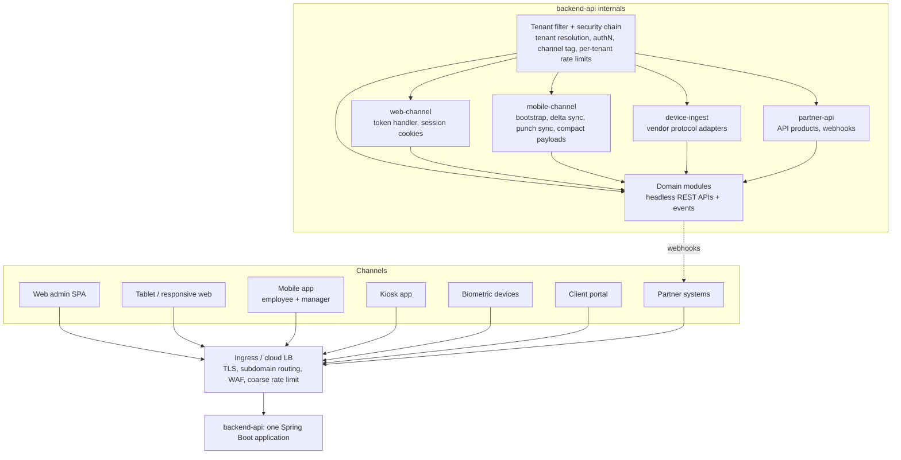

# Multi-Channel & Headless API Architecture

Companion to [PROJECT_INITIATION.md](PROJECT_INITIATION.md). Allied Payroll is **API-first and headless**. Every capability is delivered as a versioned API, and every front end consumes those same APIs:
- web portal
- employee and manager mobile apps
- supervisor tablets
- attendance kiosks
- biometric devices
- client portal
- partner integrations

No business logic lives in a front end.

---

## 1. Channels and their characteristics

| Channel | Users | Device / form factor | Connectivity | Key capabilities |
|---|---|---|---|---|
| **Web admin portal** | Tenant admins, HR, payroll, accounts, operations | Desktop / laptop browsers | Always online | Full back office: setup, payroll, billing, reports, bulk import |
| **Responsive web (tablet)** | Branch managers, site supervisors | iPad / Android tablets, browser | Mostly online | Approvals, attendance grid, roster, deployments, dashboards |
| **Employee mobile app** | Guards, technicians, office staff | Android-first (low-end devices), iOS | Intermittent | Self check-in (face / geo / QR), payslips, leave, letters (acknowledge), documents, notifications, regional language |
| **Manager / supervisor app** | Field officers, supervisors, engineers | Phone / tablet (same app, role-based) | Intermittent | Mark team attendance, relievers, site visits (geo-tagged forms), incidents, approvals, material issue (inventory), work-order timesheets |
| **Attendance kiosk** | Employees at a site / office gate | Shared Android tablet in kiosk mode, fixed at a location | Intermittent; must work offline | Face recognition / QR / PIN punch-in and punch-out; no personal login |
| **Biometric / access-control devices** | Employees | Third-party fingerprint / face terminals (e.g. eSSL, ZKTeco, Matrix) | LAN / internet | Device pushes punches to our device-ingest endpoint |
| **Client portal** | Client contact persons | Browser (responsive) | Online | View deployments, attendance, invoices, compliance challans, visit reports; raise service requests |
| **Partner / public API** | Tenants' ERP, accounting (Zoho, Tally), HRMS, BI tools | Server-to-server | Online | Read and write employees, attendance, payroll outputs, invoices; webhooks |
| **Messaging channels (later)** | Employees | WhatsApp / SMS | — | Payslip link, leave balance, OTP, shift reminders |

All channels share the same **tenant resolution, identity, permissions, data scope, i18n and audit**.

---

## 2. Layered architecture

Per [ADR 0003](adr/0003-single-api-backend-web-and-mobile-clients.md) there is **one backend**. Channel concerns are modules inside it, not separate services.



| Layer | Responsibility | Must not |
|---|---|---|
| **Domain modules** (headless) | Business rules, data ownership, canonical REST resources, domain events | Know which channel is calling (except for audit and channel policy) |
| **Tenant filter and security chain** (`common-tenancy`, `common-security`) | Tenant resolution, token validation, channel tagging, rate limits per tenant / channel / client, request-ID | Contain business logic |
| **Channel modules** (`web-channel`, `mobile-channel`, `device-ingest`, `partner-api`) | Channel-specific auth handling, payload shaping (`fields=`, compact sync payloads), offline sync protocol, vendor protocols, API products | Own data or business rules. They only orchestrate and compose domain module APIs (ArchUnit enforced) |
| **Ingress** | TLS, subdomain routing, WAF, coarse rate limiting | Anything application-specific |
| **Channel apps** | Presentation, local caching, device capabilities (camera, GPS, biometrics) | Compute pay, eligibility or statutory values |

### 2.1 Channel module strategy
- **web-channel** serves the web admin, tablet web and client portal.
  - Implements the **token-handler pattern** at `/auth/*`: the browser holds an HttpOnly, SameSite session cookie, and tokens stay on the server.
  - Nothing else. The web app composes screens from canonical resources and `summary` endpoints; the backend has no screen-shaped endpoints (see [BACKEND_REQUIREMENTS.md](BACKEND_REQUIREMENTS.md) §3.3).
- **mobile-channel** serves the mobile app and kiosks under `/api/v1/mobile/...`:
  - the **bootstrap** endpoint
  - **delta sync**
  - the **offline punch queue**
  - compact payloads and `fields=` projections
  - app-version policy
- **partner-api** exposes the public API products (scopes, quotas, keys) and webhooks; it calls the same domain module APIs.
- **device-ingest** maps vendor push/poll protocols to the standard punch command.
- **GraphQL is not used initially.** REST with `fields=` projections and `summary` endpoints covers the needs, and caching and authorization stay simpler. A GraphQL endpoint can be added later if the client portal or partners need flexible querying. Record that as ADR 0004.

---

## 3. Headless API design rules

1. **Canonical, channel-neutral resources:** `/api/v1/employees`, `/sites`, `/attendance-entries`, `/payroll-runs/{id}/paysheets`, `/invoices`. Industry terminology is applied by clients through i18n terminology keys, never in API paths.
2. **Contract-first OpenAPI 3.1** for the backend, committed under `api/openapi/`. Generated SDKs in `api/sdk/`:
   - TypeScript for web
   - Dart for the Flutter app
   - A published public SDK for partners
3. **Versioning:**
   - Paths are versioned by major version (`/api/v1`). Additive changes are allowed within a major version.
   - Breaking changes need `v2`, run in parallel for at least 12 months for external and mobile consumers.
   - Deprecations use the `Deprecation` and `Sunset` headers.
4. **Standard list contract:**
   - Query parameters: `page`/`size` or a `cursor` (cursor for sync and large sets), `sort`, `q`, `filter[...]`, and the global context (`legalEntityId`, `branchId`, `period`, `clientId`, `siteId`).
   - A `fields=` projection keeps payloads small on mobile.
   - Status-count summary endpoints back the dashboard cards.
5. **Errors:** `application/problem+json` with a stable `code`, a localized `title`/`detail` (from `Accept-Language`), `params`, `traceId`, and field `errors[]`.
6. **Idempotency:** all mutating calls from mobile, kiosk, devices and partners send an `Idempotency-Key`. The server stores the result for 24–72 h. This is mandatory for punches, payments and imports.
7. **Concurrency:** `ETag` / `If-Match` on updates (optimistic locking via the entity `@Version`). `If-None-Match` on reads saves mobile bandwidth.
8. **Money and dates:**
   - Amounts are decimal strings (`"18500.00"`) with an explicit currency.
   - Dates use ISO-8601: `date` for business dates, `date-time` with offset for instants.
   - Formatting happens on the client.
9. **Files:** uploads and downloads (photos, documents, payslip PDFs) go through **presigned object-storage URLs**. They never stream through the backend.
10. **Long-running work** (payroll run, report, import, statutory file) returns `202 Accepted` with a `job` resource. Clients poll it or receive a push or webhook when it completes.
11. **Server-driven forms.** Custom fields, field configuration, client-visit forms and onboarding forms are returned as **form metadata** (field key, type, label key, validation, options, visibility rules). Web, mobile, tablet and kiosk render them with a shared renderer specification. Tenant customization then needs no app release.
12. **Bootstrap endpoint** (`GET /bootstrap`) per channel. It returns:
    - tenant branding
    - enabled modules and feature flags
    - the user's permissions and data scope
    - terminology and i18n bundle versions
    - the settings that channel needs (e.g. punch windows, geofence, face-recognition on or off)
    - the minimum app version

    Clients cache it with an ETag.

---

## 4. Identity & authentication per channel

| Channel | Flow | Token / session | Notes |
|---|---|---|---|
| Web admin, tablet web, client portal | OIDC Authorization Code + PKCE via the **web-channel** token-handler endpoints (`/auth/*`) | HttpOnly Secure SameSite cookie; access tokens never reach the browser | Tenant from subdomain; optional SSO (SAML/OIDC) for corporate tenants |
| Mobile app | OIDC Auth Code + PKCE (system browser), or **mobile OTP** login | Short-lived access token + rotating refresh token in secure storage (Keychain / Keystore) | Optional biometric unlock of the refresh token; device binding |
| Kiosk | **Device credential**: the kiosk is provisioned once by an admin (QR enrolment code) and receives a device client identity bound to `tenant + work location` | Client-credentials token scoped `kiosk:punch` for that location only | The employee is identified per punch by face match, QR badge or PIN. There is **no employee session on the kiosk** |
| Biometric devices | Device serial registered to `tenant + location`; vendor push protocol through an adapter; HMAC or a shared secret per device; IP allowlist where possible | — | Punches enter the same attendance pipeline as `source = DEVICE` |
| Partner / public API | OAuth2 client credentials (preferred) or a scoped API key for simple integrations | Tokens scoped per API product, per tenant | Per-client quotas; key rotation; audit of every call |
| `backend-batch` | No inbound traffic; jobs carry tenant and initiating user as job parameters into `TenantContext` | — | Same image and security configuration as `backend-api` |

Every token carries **`tenant`**, **`sub`** (user, device or client), **`channel`** (`web|mobile|kiosk|device|partner`) and scopes. **Channel policies** restrict what each channel can do. For example, payroll approval is not allowed from the kiosk channel. Publishing a payroll may be web-only if the tenant chooses.

---

## 5. Device management

The **device registry** is owned by the identity module, and push tokens by the notification module.

| Capability | Details |
|---|---|
| Registration | Each install or kiosk gets a `device_id`. The registry stores platform, OS, app version, model, last seen, push token, and the bound user or location |
| Kiosk provisioning | An admin generates a one-time enrolment QR for a work location. The kiosk scans it and receives its device credential. Kiosks can be remotely disabled, rotated or re-bound |
| Trust signals | Play Integrity / App Attest attestation; root/jailbreak and mock-location detection; tenant policy decides whether to block or flag |
| App version policy | `min_supported_version` and `latest_version` per platform, returned in bootstrap. The app forces an upgrade below the minimum |
| Remote config | Feature flags and settings delivered through bootstrap. Kiosk settings (face-match threshold, punch windows, offline limits) are per location |
| Push notifications | FCM (Android/iOS) and APNs via the notification module. Payload carries IDs only, never PII; the app fetches details. Localized by the recipient's locale |
| Lost device / logout everywhere | Revoke refresh tokens and device bindings per user or device |

---

## 6. Offline-first attendance (mobile and kiosk)

Attendance must keep working at sites with poor connectivity. Everything else may need a connection.

```
Device                                   Server (mobile-channel → attendance module)
──────                                   ──────────────────────────────────────
capture punch:
  employee, type (IN/OUT), device_time,
  monotonic elapsed since last sync,
  geo + accuracy, face-match score / photo ref,
  source (SELF|KIOSK|QR|SUPERVISOR),
  client_punch_id (UUID) ─────────────►  POST /api/v1/mobile/sync/punches  (batch, Idempotency per client_punch_id)
store in encrypted local queue           validate: device trusted? employee deployed at location?
retry with backoff                       geofence, punch window, duplicate, face score threshold
                                         server_time recorded; device_time corrected via
                                         offset from last server sync (clock-tamper check)
                       ◄─────────────    per-punch result: ACCEPTED | FLAGGED(reason) | REJECTED(reason)
```

- **Sync payload rules:**
  - Batched, idempotent and ordered per device.
  - Results are returned per item.
  - Accepted punches feed the same attendance pipeline as web entry, so approval and payroll don't change.
- **Time integrity:**
  - The device records both wall-clock and monotonic time. The server computes the device clock offset at each sync.
  - Punches with an implausible offset are **flagged** for supervisor review, not silently accepted.
- **Kiosk local cache.** The kiosk keeps the roster of employees deployed at its location, and their **face templates only if the tenant enables on-device matching**. Templates are encrypted, refreshed by delta sync, and wiped on de-provisioning. Otherwise face matching runs server-side when the kiosk is online, and offline punches are queued with a photo for later matching.
- **Offline limits per tenant:** maximum offline duration and maximum queued punches. Beyond either limit, punches are flagged.
- **Delta sync for reference data** (roster, shifts, holidays, leave balances, bundles): `GET /api/v1/mobile/sync/{dataset}?since={cursor}` returns changes and tombstones.
- **Payslips and letters on mobile** are cached read-only after the first view. Payslips are only available once the paysheet is **Approved and Published**.

---

## 7. Integrations: public API, webhooks, devices

- **Public API products:**
  - Employees & Org (read/write)
  - Attendance (punch ingest, monthly work info)
  - Payroll Outputs (read paysheets, statutory summaries, bank files)
  - Billing (read invoices and receipts)
  - Reference data

  Each has its own scopes, quotas and documentation portal.
- **Webhooks:** tenant-configured subscriptions to domain events, for example:
  - `employee.created`
  - `attendance.approved`
  - `payroll.published`
  - `invoice.approved`
  - `einvoice.generated`
  - `contract.expiring`

  How they're delivered:
  - Payloads are signed with HMAC-SHA256 and timestamped, with replay protection.
  - Retries use exponential backoff, failed deliveries go to a dead-letter queue, and there is a delivery log in the UI.
  - Payloads carry IDs and minimal data. Receivers fetch details through the API, which keeps PII out of webhook logs.
- **Biometric device adapters:** one adapter per vendor protocol (push or poll). Each maps device user IDs to employees and normalizes punches into the standard punch command. New vendors are added as adapters only.
- **Accounting and ERP connectors** (Zoho Books, Tally) consume the same public APIs and webhooks. They are not special internal paths.

---

## 8. Cross-cutting requirements for every channel

| Concern | Rule |
|---|---|
| Multi-tenancy | The tenant is resolved by the backend's tenant filter from subdomain, token or device binding, and never accepted from the payload |
| Data scope | Supervisors and client contacts only see their assigned branches, clients and sites. This is enforced in the domain modules, not in the UI |
| i18n | `Accept-Language` on every call. Bundles are versioned and cached per channel. PDFs are English by default (see [LOCALIZATION_I18N.md](LOCALIZATION_I18N.md)) |
| Accessibility & form factor | The web is responsive (desktop, then tablet). Mobile uses large targets and icon-first actions for field staff. The kiosk UI is a single-purpose, full-screen, high-contrast layout with audio and visual feedback |
| Rate limiting | Per tenant, per channel and per client ID. Burst allowances for kiosk sync at shift change |
| Observability | `channel`, `app_version`, `device_id` (hashed) and `tenant` are tagged on traces and metrics. Each channel has its own SLO dashboard |
| Audit | Every mutation records the channel, device and app version alongside the user |
| Privacy | Location is captured only at punch and visit events (no continuous tracking unless a later, consented "field tracking" feature is approved). Face images and templates are retained per policy. Consent is recorded per employee (DPDP) |
| Security | OWASP API Security Top 10; certificate pinning in the mobile and kiosk apps; no secrets in apps; per-device credentials revocable |

---

## 9. Delivery plan by channel

| Phase | Channels |
|---|---|
Channels ship together in every vertical slice of [DEVELOPMENT_PLAN.md](DEVELOPMENT_PLAN.md); this table shows when each channel capability first appears.

| Phase | Channel capability |
|---|---|
| **0** | Tenant filter with channel tagging; OpenAPI pipeline and SDK generation; `web-channel` token handler; `mobile-channel` bootstrap; idempotency and ETag support in `common-web`; device registry skeleton; web and Flutter scaffolds |
| **1** | Sign in on web (OIDC + PKCE session) and mobile (OTP, PKCE); kiosk provisioning by QR; App Shell on web; forced-upgrade policy |
| **4** | `mobile-channel` punch sync and delta sync; employee self check-in; supervisor marking; kiosk offline queue; push notifications |
| **5–7** | Payslips on mobile; client portal (read-only, Phase 6); self-onboarding on mobile (Phase 7) |
| **9** | `device-ingest` adapters (first 2 vendors); `partner-api` v1 and webhooks; Zoho/Tally connectors; WhatsApp channel; Kafka only if streams are needed |
| **10** | Technician timesheets and material issue on mobile; optional consented field tracking; GraphQL endpoint if justified |

---

## 10. Decisions
1. **Mobile stack: Flutter (decided).** One codebase for employee, manager and kiosk modes. The Dart SDK is generated from OpenAPI (`dart-dio`).
2. **Face recognition:**
   - Recommended: **hybrid**. Match on the device for speed and offline use; the server re-verifies for audit.
   - The commercial SDK goes behind a `FaceEngine` interface.
   - Vendor to be chosen in the PoC. See [MOBILE_AND_DEVICES.md](MOBILE_AND_DEVICES.md) §2.
3. **Biometric device vendors:** recommended ZKTeco/eSSL (ADMS push) first, then Matrix COSEC. Confirm against the pilot customers' installed devices.
4. **Kiosk hardware:** recommended Samsung Galaxy Tab Active5 Enterprise Edition + Knox for rugged sites; minimum spec for others; Android Enterprise dedicated-device mode. Confirm in the PoC. See [MOBILE_AND_DEVICES.md](MOBILE_AND_DEVICES.md) §3.
5. **Public API commercial model:** included in all plans, or a premium add-on (pending).
