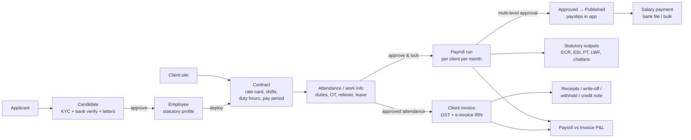
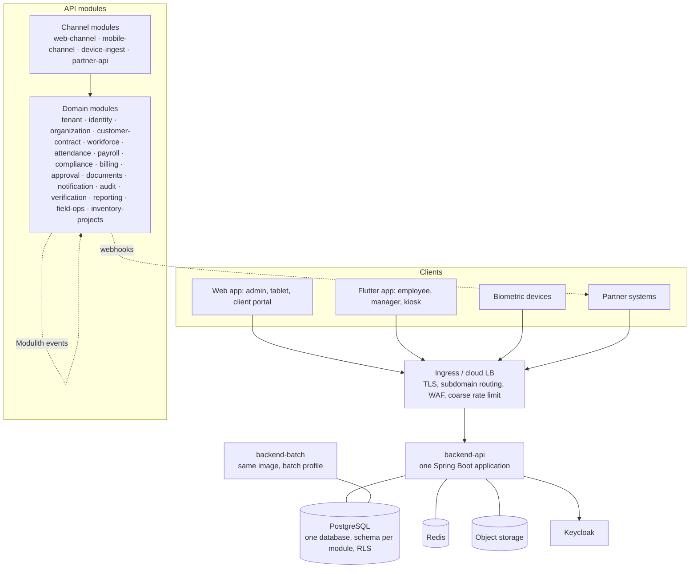

# Allied Payroll — Project Initiation Document

| | |
|---|---|
| **Product** | Allied Payroll — multi-tenant workforce & payroll SaaS |
| **Target customers** | Security agencies, facility-management / manpower-staffing agencies, and general companies (IT services, corporates) |
| **Architecture** | One Spring Boot API backend (Spring Modulith modules), one React web app, one Flutter app; multi-tenant SaaS ([ADR 0003](adr/0003-single-api-backend-web-and-mobile-clients.md)) |
| **Status** | Initiation — scope, architecture and roadmap proposed for review |
| **Inputs** | `reference/Pay.docx` (draft schema), `reference/screens.docx`, `screen1.docx`, `screen2.docx` (153 screenshots of an existing commercial staffing-payroll product, used as a functional benchmark only) |
| **Companion docs** | [INDUSTRY_PROFILES_AND_STRUCTURE.md](INDUSTRY_PROFILES_AND_STRUCTURE.md) (structure per industry, location/state rules, holidays) · [LOCALIZATION_I18N.md](LOCALIZATION_I18N.md) (multilingual base) · [MULTI_CHANNEL_API.md](MULTI_CHANNEL_API.md) (headless APIs for web, tablet, mobile, kiosk, devices, partners) · [MOBILE_AND_DEVICES.md](MOBILE_AND_DEVICES.md) (Flutter, biometrics, hardware) · [UI_UX_STRATEGY.md](UI_UX_STRATEGY.md) (UX goals, personas, design system, tooling) · [TEAM_SKILLS_MATRIX.md](TEAM_SKILLS_MATRIX.md) (skills, team, training) · `.claude/skills/` (coding conventions for Claude Code) |

> The benchmark screenshots belong to a third-party product. We use them only to understand the problem domain. Do not copy its branding, UI text, layouts, or any client/employee data visible in them.

---

## 1. Vision and scope

Build a SaaS platform on which an **agency or company (tenant)** can run the full hire-to-pay-to-bill cycle:

```
Onboard → Deploy → Mark attendance → Run payroll → Pay & comply → Bill the client → Track profit
```

The platform has to serve different operating models with one codebase. **The platform is multi-tenant and multilingual from the first release.**

| | **Staffing profile** (security / facility / manpower agencies) | **Project / field-service profile** (e.g. boiler engineering) | **Corporate profile** (IT company, general employer) |
|---|---|---|---|
| Structure | Client → Sites → Posts → Shifts | Client → Sites (plants) → Equipment; Projects / Work orders / AMC | Office locations in several states → Departments / Teams |
| Who is paid | Guards, housekeeping, technicians deployed at client sites | Engineers and technicians deployed to client sites; workshop staff | Own employees |
| Pay basis | Per duty/shift × contract rate; OT in duties or hours; relievers | Monthly CTC + site allowance / per diem; OT hours from timesheets | Monthly CTC, LOP days, OT optional |
| Payroll grouping | One payroll **per client site per month** | One payroll **per pay group per month**; costs allocated to projects | One payroll **per legal entity / pay group per month** |
| Billing | Monthly GST invoice per client site, derived from approved attendance | Milestone, work-order, AMC and material invoices; e-way bill | Usually none (optional module) |
| Inventory | Optional (uniforms, ID cards, consumables) | **Core** (spares, consumables, tools, warehouses + site stores, issue to work order) | Optional (IT assets) |
| Key compliance | PF, ESIC, PT, LWF, minimum wages, CLRA, PSARA (security), police verification | PF, ESIC, PT, LWF, minimum wages, TDS, GST on goods + services | PF, ESIC, PT and LWF **by office state**, TDS (Form 16 / 24Q), gratuity, **location-wise holidays** |

A tenant chooses an **industry profile** when it is provisioned. The profile switches modules, strategies, terminology and defaults through configuration. It is not a code fork. The generic structure, the strategy plug-ins and the state/location rule resolution are specified in [INDUSTRY_PROFILES_AND_STRUCTURE.md](INDUSTRY_PROFILES_AND_STRUCTURE.md).

### 1.1 In scope (target product)
Tenant & subscription management · Agency/company setup · Customer & client-site management · Contracts with rate cards & shifts · Onboarding with KYC and bank verification · Employee master & statutory registers · Attendance (manual, bulk, mobile self-service with face/geo/QR, kiosk) · Payroll engine (earnings, deductions, benefits, employer costs, arrears, holds) · Statutory compliance (EPF, ESIC, PT, LWF, TDS, bonus, gratuity, minimum wages) · Salary disbursement & bank files · Client invoicing with GST and e-invoicing (IRN) · Receivables (receipts, write-offs, withholdings, credit notes) · Payroll-vs-invoice profitability · Approvals engine · Documents & letters · Reports · Employee mobile app · Field operations (site visits, incidents) · Purchase & inventory (uniforms, consumables).

### 1.2 Out of scope for MVP (later phases)
- Purchase and inventory. This is a later phase for staffing and corporate tenants, but it is **core for the project/field-service profile**, so it must ship before onboarding such a tenant. See §8.
- Field-ops GPS tracking.
- Grievances and service requests.
- Accounting integrations (Zoho/Tally).
- PDF utilities.
- Custom report builder.

---

## 2. Findings from the benchmark screenshots

### 2.1 Global behaviour
- **One subdomain per tenant**, in the form `{tenant}.<domain>/…`.
- **A global context bar on every page.** It holds four selectors: **Branch** (or "All"), **Year**, **Month** and **Client**. Every list, dashboard, attendance sheet, payroll and invoice is scoped by them. Our API has to treat *(tenant, branch, period, client)* as a first-class request context.
- **A standard list page**, used for almost every screen:
  - search box and filter chips (filter state is kept in the URL query, so views can be bookmarked)
  - a column chooser, plus a "More filters" button
  - **Export to Excel**, **Bulk Upload**, and **+ Create** buttons
  - sortable columns and server-side pagination with "Go to page"
  - colour-coded row actions (view, edit, delete, documents, letters, deactivate/reactivate)
- **A standard bulk-import framework** used everywhere (organizations, clients, employees, statutory/bank updates, terminations, attendance, salary payments, products):
  1. Download the template.
  2. Upload `.xlsx` or `.csv`.
  3. The server validates the file and reports errors per row.
  4. Fix and re-upload.
  5. Submit.

  Most screens have separate **Create** and **Update** templates.
- **Masters lock once used.** Warning types, violation types and incident types "cannot be edited/deleted after being used".
- **Tenant-configurable forms:**
  - the tenant decides per field whether it is required
  - tenants can add their own **custom fields** (name, label, type, required, active)
  - **document types are defined by metadata**: has number / issue date / valid-from / expiry, and whether multiple documents are allowed
- **Readable codes** carry type prefixes:

  | Prefix | Entity |
  |---|---|
  | `ORG` | Customer organization |
  | `CLI` | Client site |
  | `BR` | Branch |
  | `CON` | Contract |
  | `CP` | Contact person |
  | `EC` | Employee candidate |
  | `ADM` | Admin |
  | `CVF` | Client visit form |
  | `CRN` | Credit note |
  | `IW` | Warehouse |
  | `SP` | Supplier |

  Employee codes use configurable series, e.g. `{PREFIX}00182`. Invoice numbers follow `{PREFIX}{FY e.g. 2627}/{MM}/{seq}`.
- **SaaS billing:** an "overdue subscription" banner warns that the account will be suspended, and there is a usage check.
- **Mobile app:**
  - Payslips become visible only when the paysheet is **Approved *and* Published**.
  - Self-attendance supports face recognition and QR codes.
  - Managers' site visits are geo-tagged.
- **A generic multi-level approval engine.** "My Approvals" lists items by `resource_type` with a flow status. It is reused for payroll, credit notes, vendors, POs and bills.
- **Weak spots we must not copy:**
  - Aadhaar and bank account numbers are shown **unmasked** in lists.
  - Date formats are inconsistent.
  - Placeholder employees and emails are auto-generated (`{code}@{agencydomain}`).

### 2.2 Module map (as observed)

| Module | Sub-features observed |
|---|---|
| **Dashboard** | Active/inactive counts (organizations, clients, employees); monthly invoice summary; paysheet summary; expiring contracts; employee birthdays |
| **Agency** (tenant setup) | Profile (CIN, GSTIN, PAN, PF establishment code, ESIC employer code, PT reg no); Zones; Branches; GST Letter of Undertaking (LUT) numbers; GST registrations per state (verified flag, e-invoice-enabled flag, mapped to branches); ESIC sub-codes per location; PT registration per state/location; bank accounts (default, mapped to branches); Admins; Managers; Roles; Service accounts (client portal / API) |
| **Customer** | Organizations (client's legal entity) → Clients (sites/billing units, each served by one agency branch); Contact persons (optional portal login); Reporting officers (agency users assigned to sites; primary or supervisor); CLRA licences (worker cap, authority, validity); Client GST (registration type, verified flag); Client groups; Documents & document types; Challans (monthly statutory proof per client); Client visit forms & responses (form builder, PDF, send to client, daily map/timeline per manager); Incidents & incident types; Reports |
| **Onboarding** | Applicants (enquiries) → Candidates (pre-assigned client and designation) → Aadhaar e-KYC → bank account penny-drop verification → offer/appointment letters (publish → acknowledge by due date) → Approve → convert to employee |
| **Employees** | Master list (deployed client, designation, DOB, DOJ, active and verified toggles); EPF register (PF / Non-PF / Pending UAN, member no, UAN); ESIC register (ESIC / Non-ESIC / Pending, IP number); PT on/off; bank accounts (primary and secondary, verification log); Aadhaar KYC; face recognition enrolment; bulk create/update/statutory-bank update; documents; letters; verification checklist; joining fee (instalments recovered via payroll); police verification (local station and CFC tracks, certificate expiry); termination (types, reactivation, bulk, relieving letters); warnings (verbal → written → final, violation types, letter templates); employee settings (DOJ backdating limit, EPF/ESIC registration due N days after DOJ, mandatory UAN/KYC/bank verification, designations restricted to client, PF contribution constraints) |
| **Contracts** | Client contracts (Active/Expired, usually 1 year, renewed by cloning); expiring contracts; clients without an active contract; Employee contracts; Mini (short-term) contracts; reports: Resource Master, CTC Register, Projected P&L |
| **Attendance** | Month-wise sheet per **contract** with shift tabs (overnight shifts included); per employee: duties, OT, reliever, leaves; Approve/Delete; date-wise and employee-wise views (one employee can work at several clients a month); additional duties (by type, in duties and hours); bulk upload in date-wise and type-wise modes; active shifts per contract; client-signed attendance documents; reports (muster roll, combined muster roll, unmarked attendance, …); settings (self, kiosk and QR channels; face recognition; deployed-only restriction; one shift per day; early/late punch windows; overnight-shift date basis; every deployed employee must have attendance before approval) |
| **Payroll** | Dashboard; Run payroll per client per month (fails unless attendance/work information is **approved**); pending clients; approvals; **Payroll vs Invoice** P&L (gross + benefits + fixed cost + compliance cost vs invoice sub-total); Paysheets (one per employee); Payments (per paysheet, per payroll, bulk upload; Paid/Partially/To-be-paid); Benefits (individual, groups, client benefit batches per period); Arrears & arrear groups; Settings (rounding Off/Round/Ceil/Floor for earnings, deductions, EPF, ESIC, net, benefits, costs, CTC, with "apply only to total" toggles; ESIC contribution-period salary-revision check; payslip options); reports (payslip, wage/salary register, EPF, ESI, PT, LWF, combined statutory, register of wages & muster roll, bank statement, salary hold, unpaid/completed payments) |
| **Invoices** | Dashboard; client-site invoices (sub-total, tax, grand total; Approved; payment status); receipts; write-offs; withholdings (hold → release); clients with no invoice; credit notes (Draft → Approved); **GST e-invoice** (IRN, ack no/date, Active/Cancelled, pending IRN) for invoices and credit notes; item master; adjustment master (percentage or fixed); settings (rounding per level, email attachments = invoice PDF + attendance register, quantity multiplier, personnel source = Attendance) |
| **Purchase** | Vendor organizations → branches (approval, Zoho sync status) → contacts; POs (line items, approvals, documents); Bills (payments, approvals, Zoho) |
| **Inventory** | Products (uniforms by size, ID cards, consumables); Warehouses (default, transfers); suppliers; purchase returns; **issue challans** warehouse → manager → employee (Open/OnGoing/Closed/Renewed); pending salary deductions for issued items |
| **Extras** | Service requests, grievances, PDF tools, document creator, async report downloads |

### 2.3 End-to-end process (staffing profile)



### 2.4 Gaps in the reference material
None of the screenshots opens an **add or edit form**. Before detailed design, we still need screenshots or specs for:
- the contract create screen: **rate card per designation**, wage breakup, billing rate, service charge, and posts/headcount
- salary structure and component setup
- the payroll run result and paysheet detail
- payslip layout
- the EPF/ESIC/PT detail forms
- the leave and holiday setup
- the onboarding candidate form
- the invoice line-item composition

The note "Lokator – location??" in `screens.docx` shows that whether to include **GPS tracking of field staff** is still undecided (see §11).

---

## 3. Domain model

### 3.1 Tenancy & organisation hierarchy

```
Platform (SaaS operator)
└── Tenant  (subscribing agency/company; subdomain; industry profile; plan; feature flags)
    ├── Legal Entity  (CIN, PAN, TAN, PF establishment code, ESIC employer code, PSARA licence…)
    │   ├── GST Registration (per state; e-invoice enabled; LUT)
    │   ├── ESIC Sub-code (per location) · PT Registration (per state) · LWF Registration
    │   └── Bank Account (default; mapped to branches)
    ├── Zone → Branch  (operating office; GSTIN; warehouse)
    ├── Department / Cost Centre / Pay Group   ← corporate profile
    └── Customer Organization → Client Site      ← staffing profile
            ├── Contract (rate card, shifts, duty hours, pay period, billing terms)
            ├── CLRA Licence · Client GST · Reporting Officers · Contacts · Documents
            └── Deployments (employee ↔ site ↔ designation ↔ shift, effective-dated)
```

The draft schema in `Pay.docx` has `organizations`, `employees_contractors`, `salary_components`, `salary_structure`, `payroll_run`, `statutory_rules` and `audit_logs`. It is a good start but needs these changes:
- **Split "tenant" from "legal entity".** One agency often runs several entities. The screenshots show 36 "organizations" under one tenant.
- **Add client site, contract and deployment.** The staffing model depends on them.
- **Split `payroll_run` into a run header (`payroll`, per client or pay group per month) and per-employee `paysheet` rows with component lines.** The draft has one row per employee.
- **Add component categories `BENEFIT` and `EMPLOYER_COST`** next to earning and deduction.
- **Version statutory rules by effective date and state.** Platform-maintained defaults should be overridable per tenant.

### 3.2 Core aggregates (by bounded context)

| Context | Aggregates / entities |
|---|---|
| Tenant | Tenant, Subscription, Plan, FeatureFlag, TenantSetting (typed key/value by module), NumberSeries |
| Organisation | LegalEntity, Zone, Branch, GstRegistration, LutNumber, EsicSubCode, PtRegistration, LwfRegistration, CompanyBankAccount, Department, PayGroup |
| Identity | User (admin, manager, client contact, employee, service account), Role, Permission, DataScope (entity/branch/client) |
| Customer | CustomerOrganization, ClientSite, ClientGroup, ContactPerson, ReportingOfficer, ClraLicence, ClientGstInfo |
| Contract | ClientContract (status, validity, renewal chain), RateCard line (designation × wage breakup × bill rate × posts), Shift, BillingTerms (service charge %, statutory reimbursement, GST treatment / RCM), EmployeeContract, MiniContract |
| Workforce | Applicant, Candidate, Employee, Designation (short codes such as SG, HK, SWP), Deployment, StatutoryProfile (PF/ESIC/PT/LWF applicability, UAN, member no, IP no), BankAccount, KycRecord, FamilyMember, Nominee, PoliceVerification, JoiningFee (+ instalments), Warning, Termination, CustomFieldValue |
| Attendance | AttendanceSheet (contract × month; Draft → Approved), AttendanceEntry (employee × date × shift × code), Punch (source: app/face/QR/kiosk/upload/manual; geo), WorkInformation (monthly totals: duties, OT duties/hours, reliever, leave, LOP), AdditionalDuty, LeaveType, Holiday calendar |
| Payroll | SalaryComponent, SalaryStructure (effective-dated), PayrollRun (client/pay group × month), Paysheet (employee) + PaysheetLine (component, amount, basis), SalaryHold, Arrear / ArrearGroup, Benefit / BenefitGroup, Payslip, Disbursement / PaymentBatch |
| Statutory | StatutoryRuleSet (type, state, effective from/to, params), MinimumWageRate (state × zone × skill × effective date), Challan, StatutoryReturn (ECR, ESI MC, PT, LWF, 24Q), TaxDeclaration / Proof |
| Billing | Invoice (+ lines: manpower, items, adjustments, tax), CreditNote, Receipt, WriteOff, Withholding, EInvoice (IRN, ack), InvoiceItem, Adjustment |
| Workflow | ApprovalFlowDefinition (resource type, levels, approver rules), ApprovalRequest, ApprovalAction |
| Documents | DocumentType (metadata flags), Document (owner polymorphic, expiry), LetterTemplate, Letter (publish → acknowledge) |
| Field ops (later) | VisitForm, VisitResponse (geo), Incident, IncidentType, Grievance, ServiceRequest |
| Inventory (later) | Product, Warehouse, Supplier, PurchaseOrder, Bill, IssueChallan, IssueLine → payroll deduction |

### 3.3 Key state machines
- **Candidate:** Applied → KYC done → Bank verified → Letters acknowledged → Approved → Converted.
- **Employee:** Active ⇄ Inactive; Active → Terminated → Reactivated. The verified flag is derived from the document checklist.
- **Contract:** Draft → Active → Expiring (a window derived from the expiry date) → Expired | Renewed (cloned).
- **Attendance sheet:** Draft → Submitted → Approved (locked) → Reopened (needs permission, and only while the payroll is not yet approved).
- **Payroll:** Draft (computed) → In approval → Approved → Published → Paid / Partially paid. A correction after approval is made through **arrears or a revision run**, never by editing approved data.
- **Invoice:** Draft → Approved → IRN generated → Sent. Payment status moves Pending → Partially paid → Paid, adjusted by write-offs and withholdings. Cancellation and credit notes reverse it.
- **Approval request:** Pending (level n) → Approved / Rejected / Returned.

---

## 4. Payroll & compliance engine (core IP)

### 4.1 Calculation model
1. **Inputs are frozen per run.** These are the approved work information, the effective salary structure or contract rate card, the statutory profile, the active rule sets, loans/joining-fee instalments, inventory deductions, holds and arrears. They are snapshotted into the run, so a payroll can always be reproduced and audited.
2. **Components** have a category (`EARNING`, `DEDUCTION`, `BENEFIT`, `EMPLOYER_COST`) and the flags `is_statutory`, `taxable`, `part_of_pf_wages`, `part_of_esi_wages`, `part_of_bonus_wages`, `part_of_gross`, `prorate` and `rounding`.
3. **Formulas** use a **sandboxed expression language**: whitelisted functions and variables, no reflection. The engine resolves them in dependency-graph order. Never use raw SpEL or JavaScript evaluation.
4. **Pay bases:**
   - **Monthly fixed:** amount × (paid days ÷ divisor). The divisor is calendar days, a fixed 26/30, or working days, configured per contract or pay group.
   - **Per duty:** rate × duties. Duty hours come from the contract (e.g. 8 h).
   - **OT:** duties or hours × an OT rate rule (single or double rate, contract specific).
   - **Reliever duties** and **additional duties** are separate input buckets.
5. **Rounding** is configurable per category (Off / Round / Ceil / Floor) and can apply per component or only to the total, as the benchmark settings do. All money is `BigDecimal` at scale 2 and stored as `NUMERIC(15,2)`.
6. **Minimum-wage guard.** Flag or block any paysheet whose wages fall below the minimum wage for the state, zone and skill category on that date.
7. **Outputs:**
   - Paysheet lines: earnings, deductions, net pay, benefits, employer costs and CTC.
   - Statutory contribution records.
   - Bank disbursement lines.
   - GL-ready summaries.

### 4.2 Indian statutory rules to model (rule tables, effective-dated, platform-maintained)

> These values are a starting point for the rule tables. **Get a compliance consultant to validate them before go-live**, and keep them as data, never as constants in code. Two transitions need tracking:
> - **The four Labour Codes took effect on 21 Nov 2025.** Central and state rules are still being notified. One consequence is the "wages" definition: excluded allowances above 50% of total pay are added back.
> - **The Income-tax Act, 2025 replaces the 1961 Act from 1 Apr 2026.** Section and form numbers change.

| Area | Rules to support |
|---|---|
| **EPF & MP Act / SS Code** | Employee 12% of PF wages. Employer 12% = 3.67% EPF + 8.33% EPS (EPS on wages capped at ₹15,000; not for members who joined after Sep 2014 earning above the ceiling at joining, nor after age 58). EDLI 0.5% and admin charges 0.5% (with minimums). Wage ceiling ₹15,000, with an option to contribute on actual wages (the "PF contribution constraints" setting). Voluntary PF. ECR file generation. Due by the 15th of the following month. |
| **ESIC** | Employee 0.75%, employer 3.25% of gross wages. Eligible if gross ≤ ₹21,000 (₹25,000 for persons with disability). **Contribution periods Apr–Sep and Oct–Mar:** an employee covered at the start stays covered for the whole period. The setting decides whether a salary revision triggers a re-check. Employee share exempt below the daily-wage threshold. Location-wise sub-codes. Monthly contribution file. |
| **Professional Tax** | State-wise slab tables. Monthly, half-yearly (e.g. Tamil Nadu) or annual frequency. Month-specific amounts (e.g. a higher February instalment in some states). Annual cap ₹2,500. Determined by the **work-location state**. |
| **Labour Welfare Fund** | State-wise employee and employer amounts. Monthly, half-yearly or annual frequency. Applicability thresholds. |
| **Minimum wages** | Central and state schedules by zone and skill category (unskilled, semi-skilled, skilled, highly skilled). **VDA revisions (typically Apr/Oct)** produce **arrears**. |
| **Bonus** | 8.33%–20% of bonus wages. Eligibility wage ≤ ₹21,000. Calculation ceiling: ₹7,000 or the minimum wage, whichever is higher. Paid monthly as an earning or annually as a benefit group. |
| **Gratuity** | 15/26 × last drawn wages × years of service. Eligibility 5 years (1 year for fixed-term employees under the SS Code). Cap ₹20 lakh. Staffing agencies often **accrue and bill it as an employer cost**. |
| **Leave / leave encashment** | Leave policies per pay group or contract. Encashment as a benefit. |
| **TDS on salary** | New regime by default, old regime by opt-in. Monthly projection, declarations and proofs, previous-employer income, perquisites. Quarterly return (24Q) and annual certificate (Form 16), with numbers changing under the 2025 Act. |
| **CLRA** | Licence per client site and headcount cap (validated against active deployments). Statutory registers: register of wages, muster roll, combined muster roll. |
| **PSARA** (security) | Agency licence per state, plus police verification and training records per guard. Track expiry and alert before it lapses. |
| **GST on invoices** | 18% on manpower and security services. CGST+SGST or IGST depending on **place of supply vs supplier GSTIN state**. **Reverse charge (RCM)** for security services supplied by a non-body-corporate to a registered business. Exempt or zero-rated with LUT. **E-invoicing (IRN via the IRP)** when the tenant's turnover crosses the notified threshold, within the reporting time limit. |
| **Data protection** | Aadhaar Act (store masked or tokenised; no full number in lists; Aadhaar vault). **DPDP Act 2023 / Rules** (consent, purpose limitation, retention, breach notification). |

---

## 5. Architecture

> The backend's own requirements (headless API only, API conventions, per-module functional scope, NFRs) are in [BACKEND_REQUIREMENTS.md](BACKEND_REQUIREMENTS.md). This section keeps the architecture overview.

### 5.1 Technology baseline (proposed)

| Concern | Choice |
|---|---|
| Language / runtime | **Java 25 LTS** (virtual threads, records, pattern matching). Originally proposed as Java 21; changed by [ADR 0001](adr/0001-spring-boot-4-java-25.md) |
| Framework | **Spring Boot 4.x** (Spring Framework 7, Jackson 3, JSpecify null-safety), Spring Web MVC, Spring Data JPA (Hibernate 7), Spring Security (OAuth2 Resource Server), `RestClient` / `@HttpExchange` interfaces for outbound calls, Resilience4j, **Spring Modulith** for module boundaries and events. Originally proposed as Boot 3.x; changed by [ADR 0001](adr/0001-spring-boot-4-java-25.md) |
| Build | Gradle (Kotlin DSL) multi-project monorepo, version catalog, shared convention plugins |
| Database | **PostgreSQL 16+**, one database, one schema per module; Flyway migrations per module |
| Messaging | **Spring Modulith event publication registry** (transactional outbox in PostgreSQL, async idempotent listeners). Apache Kafka deferred to Phase 9 for external streams ([ADR 0003](adr/0003-single-api-backend-web-and-mobile-clients.md)) |
| Cache / locks | Redis (sessions, rate limits, distributed locks for payroll runs, idempotency keys) |
| Identity | **Keycloak** (OIDC). One realm, with tenant carried as an organization claim; mobile OTP login for employees and field staff |
| Object storage | S3-compatible (AWS S3 / MinIO); per-tenant prefixes; server-side encryption |
| Documents | Template-driven PDFs (payslips, invoices, letters) **in English by default**: Thymeleaf + OpenHTMLtoPDF behind a `PdfRenderer` port. Optional regional-language PDFs later through a Chromium-based adapter (Indic shaping). Apache POI for Excel import/export |
| Internationalization | ICU4J MessageFormat via Spring `MessageSource`; `*_i18n` JSONB on master data; tenant/industry terminology overrides; launch locales en-IN, hi, ta, te, kn, ml. See [LOCALIZATION_I18N.md](LOCALIZATION_I18N.md) |
| Batch | Spring Batch for payroll runs, bulk imports, statutory files and report generation |
| API | REST + OpenAPI 3 (springdoc), versioned `/api/v1`; problem+json errors |
| Observability | OpenTelemetry tracing, Micrometer → Prometheus/Grafana, structured JSON logs → Loki/ELK |
| Testing | JUnit, AssertJ, Testcontainers (Postgres, Keycloak), `@ApplicationModuleTest`, OpenAPI contract and breaking-change tests, Modulith verification and ArchUnit for architecture rules |
| Deployment | One backend image (Jib or Buildpacks) deployed as `backend-api` and `backend-batch`; static web; Kubernetes + Helm; cloud load balancer / ingress for TLS, subdomain routing and WAF; GitHub Actions CI; India cloud region for data residency |
| Web front end | **React + TypeScript + Vite**, shadcn/ui (Radix) + Tailwind on our design tokens, TanStack Query/Router/Table, Storybook (recommended). See [UI_UX_STRATEGY.md](UI_UX_STRATEGY.md) |
| Mobile | **Flutter** (decided). One app with employee, manager/supervisor and kiosk modes; offline punch queue; face verification through a commercial SDK. See [MOBILE_AND_DEVICES.md](MOBILE_AND_DEVICES.md) |

### 5.2 Backend module decomposition

Per [ADR 0003](adr/0003-single-api-backend-web-and-mobile-clients.md) the backend is **one Spring Boot application** exposing one versioned REST API that every channel uses; web, tablet, mobile, kiosk, biometric devices, the client portal and partner systems all consume the same endpoints. Inside, **Spring Modulith application modules** own the bounded contexts, and **channel modules** shape data for a channel without owning any rules. See [MULTI_CHANNEL_API.md](MULTI_CHANNEL_API.md).



| # | Module | Owns | Notes |
|---|---|---|---|
| C1 | **web-channel** | Token-handler session for browsers (`/auth/*`, HttpOnly cookie, CSRF) | Channel module: no data, no rules, no screen endpoints |
| C2 | **mobile-channel** | `GET /api/v1/mobile/bootstrap`, delta sync, batched idempotent punch sync, compact payloads, app-version policy for mobile and kiosk | Channel module; Phase 1 (bootstrap), Phase 4 (sync) |
| C3 | **device-ingest** | Vendor adapters for biometric/access devices → standard punch command | Channel module; Phase 9 |
| C4 | **partner-api** | Public API products (scopes, quotas, keys), webhooks with HMAC signing and delivery log | Channel module; Phase 9 |
| 1 | **identity** | Users, roles, permissions, data scopes (legal entity / branch / client), Keycloak sync, OTP login, **device registry and kiosk provisioning**, partner API clients | Keycloak holds credentials; this module holds authorization |
| 2 | **tenant** | Tenant provisioning, industry profile templates, plans and subscription, feature flags, **typed module settings**, terminology, number series, branding | Also the platform admin console back end |
| 3 | **organization** | Legal entities, zones, branches, work locations with holiday calendars, GST/ESIC/PT/LWF registrations, LUT, company bank accounts, departments, pay groups, designations | |
| 4 | **customer-contract** | Customer organizations, client sites, groups, contacts, reporting officers, CLRA licences; contracts, **rate cards**, shifts, billing terms, deployments | Contract is the pivot for both payroll and billing in the staffing profile |
| 5 | **workforce** | Applicants, candidates, employees, statutory profile, bank accounts, family/nominees, police verification, joining fee, warnings, termination, custom fields | PII encrypted at field level |
| 6 | **verification** | Adapters: Aadhaar e-KYC, bank penny-drop, GSTIN, PAN, face enrolment and match; verification log | Provider-agnostic ports |
| 7 | **attendance** | Punches (app/face/QR/kiosk/device), sheets, work information, additional duties, leave and holidays, approval and lock, `FaceEngine` port | Publishes `WorkInformationApproved` |
| 8 | **payroll** | Components, structures, payroll runs, paysheets, arrears, benefits, holds, payslips, disbursement batches and bank files; the pure calculation core is a plain Java library inside this module | Runs execute on `backend-batch`; owns run snapshots |
| 9 | **compliance** | Statutory rule sets, minimum wages, PT/LWF slabs, TDS, ECR/ESI/PT/LWF files, challans, 24Q/Form 16, statutory registers | Rule packs maintained at platform level, overridable per tenant |
| 10 | **billing** | Invoices, credit notes, receipts, write-offs, withholdings, GST computation, e-invoice (IRN), payroll-vs-invoice P&L | |
| 11 | **approval** | Flow definitions per `resource_type`, multi-level approvals, "My approvals" inbox | Generic; used by payroll, billing, purchase and others |
| 12 | **documents** | Document types and expiry, letter templates, letters (publish/acknowledge), PDF rendering, file storage | |
| 13 | **notification** | Email, SMS, WhatsApp, push; templates per tenant; push tokens | Event-driven |
| 14 | **reporting** | Dashboards, async report jobs and downloads, Excel export, read models fed by module events, read-replica queries | Keeps heavy queries off the transactional path |
| 15 | **audit** | Immutable audit trail (who, what, old/new, when, IP, channel) for every change | Append-only tables |
| — | **common-import** | Template → upload → validate → errors → commit, as a platform library plus a job table in each owning module | Not a module; each module validates its own data |
| Later | **field-ops**, **inventory-projects** | Site visits, incidents, grievances; vendors, POs, bills, warehouses, issue challans, work orders, timesheets | Phases 9–10 |

**Rules that keep one backend healthy:** a module imports only another module's `api` package (Modulith verification in CI); it never joins another module's tables; cross-module side effects go through events; channel modules contain no business logic (ArchUnit). Extracting a module into its own deployable needs an ADR and changes no API path or event type.

### 5.3 Multi-tenancy design

| Layer | Mechanism |
|---|---|
| Resolution | The backend's tenant filter (`common-tenancy`) maps the `Host` subdomain (or `X-Tenant` for API clients) to `tenant_id` and checks it against the JWT `tenant` claim. A mismatch is rejected. |
| Propagation | A `TenantContext` uses scoped values or thread-locals, and is propagated to async executors, event listeners (as event metadata) and batch job parameters. |
| Data isolation (default) | **Shared database per service, `tenant_id` on every tenant-owned table.** Hibernate 7 `@TenantId` acts as the discriminator, and **PostgreSQL Row-Level Security** adds defence in depth (`SET app.tenant_id` per transaction). Composite indexes start with `tenant_id`. |
| Data isolation (premium) | A routing `DataSource` lets large or regulated tenants be moved to a **dedicated database** without code changes. |
| Data scoping inside a tenant | Every query also applies the user's **data scope** (allowed legal entities, branches, clients). This is the global branch/client selector backed by authorization: managers and reporting officers only see their sites. |
| Files | `s3://bucket/{tenant_id}/{module}/…`; presigned URLs; never public. |
| Events | Every event carries `tenantId`; consumers set the context before handling. |
| Configuration | Tenant settings and feature flags are cached per tenant and invalidated by event. |
| Encryption | Envelope encryption for PII (Aadhaar, PAN, bank account, UAN): one data key per tenant held in a KMS. Fields hold a masked display value plus ciphertext, with a blind index for lookups. |
| Noisy neighbours | Per-tenant rate limits; payroll and report jobs go through a fair queue keyed by tenant. |
| Lifecycle | Provision (seed masters and default rule sets) → trial → active → suspended (read-only, as the overdue banner warns) → offboarded (export, then purge after the retention period). |

### 5.4 Integration & consistency
- **Writes stay inside one module.** Cross-module effects are handled through **domain events** published through the Spring Modulith event publication registry (a transactional outbox), and listeners are idempotent. A module reads another module's data only through that module's published `api` package, never its tables.
- **Payroll snapshots its inputs once at run start** through the workforce, customer-contract and attendance module APIs (frozen input snapshot), then computes without further reads, so a run is reproducible and the API pods are not touched by month-end batch load.
- **Key events:**
  - `TenantProvisioned`
  - `EmployeeOnboarded`, `EmployeeDeployed`, `EmployeeTerminated`, `StatutoryProfileChanged`
  - `ContractActivated`, `ContractExpiring`
  - `WorkInformationApproved`
  - `PayrollApproved`, `PayrollPublished`, `SalaryPaid`
  - `InvoiceApproved`, `EInvoiceGenerated`
  - `DocumentExpiring`
- **Distributed processes:**
  - The month close for a client (attendance approved → payroll → invoice) is a choreographed process driven by module events.
  - The payroll run itself is an orchestrated Spring Batch job in the payroll module, executed on the `backend-batch` deployment and protected by a per-(tenant, group, month) lock.
- **External integrations sit behind ports and adapters:**
  - KYC, penny-drop, GSTIN and PAN providers
  - the GST IRP / GSP for e-invoicing
  - banks (salary file formats and payout APIs)
  - SMS, email and WhatsApp
  - face-match providers
  - later, Zoho Books and Tally

### 5.5 Security & access control
- **User types:**
  - platform operator
  - tenant admin
  - HR, payroll, accounts and operations staff
  - manager/supervisor (field)
  - client contact (portal)
  - employee (mobile/self-service)
  - service account (API)
- **RBAC plus data scope.** A tenant defines its own roles from a fixed permission catalogue (`module:action`). On top of that, each user is limited to particular legal entities, branches or clients.
- **Maker–checker on money-moving actions**, through the approval service:
  - payroll approval and publishing
  - salary disbursement
  - invoice approval and cancellation
  - write-offs
  - statutory rule overrides
- **PII handling:**
  - PII is masked in all lists, and revealing it requires a permission and is audited.
  - Aadhaar is never stored in full outside the vault.
  - Data is retained per DPDP and statutory record-keeping periods.
- **OWASP ASVS L2 baseline.**
  - Dependencies and images are scanned in CI.
  - Secrets are kept in a vault.
  - Uploaded files are scanned, and Excel imports reject formulas and macros.

### 5.6 Non-functional targets (proposed; to confirm)

| Attribute | Target |
|---|---|
| Scale | 1,000 tenants; 500k employees in total; 50k employees in the largest tenant |
| Payroll run | 10,000 paysheets in under 5 min; runs can be resumed and repeated safely |
| API latency | p95 < 300 ms for list and detail calls |
| Availability | 99.9% monthly; RPO 15 min, RTO 4 h |
| Audit | 100% of create/update/delete on tenant data; payroll and invoice snapshots kept for at least 8 years |
| Data residency | All data stored in India |

---

## 6. Cross-cutting platform features (build once, reuse everywhere)

1. **Global request context:** tenant, legal entity, branch, period (year-month) and client, accepted as standard query or header parameters by every list API.
2. **List API conventions:**
   - filters, sort, pagination, search, column projection
   - Excel/CSV export as an async job for large sets
   - count/summary endpoints for status cards
3. **Bulk import framework:**
   - template generation from field metadata, including custom fields
   - row-level validation with an error file
   - separate Create and Update modes
   - asynchronous commit with progress
4. **Configurable forms:** a required flag per field per tenant, plus custom fields stored as typed EAV or JSONB with validation.
5. **Document type metadata and expiry alerts.** This covers contracts, CLRA licences, police verification, PSARA licences, client documents and LUTs.
6. **Lock-after-use masters** (soft delete with referential checks).
7. **Number series** per tenant, entity and financial year, with formats such as `{PREFIX}{FY}/{MM}/{SEQ}` and `EMP{00000}`.
8. **Approval engine** with configurable levels.
9. **Letters:** template → generate → publish → acknowledge.
10. **Notifications and in-app banners** (subscription overdue, compliance due dates, expiring documents).
11. **Audit trail and record versioning** (effective-dated history for salary, deployment and statutory profile).
12. **Multilingual base.**
    - Message keys everywhere, with translatable master data and industry terminology overrides.
    - UI and notifications use the user's or recipient's language. **PDFs are in English by default**, and regional PDFs are optional.
    - Indian number format (₹12,34,567.00) and ISO dates in the API.
    - Full design in [LOCALIZATION_I18N.md](LOCALIZATION_I18N.md).
13. **Location-based rules and holidays.**
    - Every employee is attached to a **work location**. Holidays, PT, LWF, minimum wages and S&E rules are resolved from that location's state and calendar on each date.
    - Full design in [INDUSTRY_PROFILES_AND_STRUCTURE.md](INDUSTRY_PROFILES_AND_STRUCTURE.md) §6.

---

## 7. Repository & code structure

One repository, three codebases ([ADR 0003](adr/0003-single-api-backend-web-and-mobile-clients.md)):

```
alliedpayroll/
├── backend/                     # ONE Spring Boot application → one image, deployed as backend-api and backend-batch
│   ├── build-logic/             # Gradle convention plugins (java, backend-module, testing, quality)
│   ├── gradle/libs.versions.toml
│   ├── Dockerfile
│   ├── app/                     # bootable application: main class, profiles, security chain, OpenAPI aggregation
│   ├── platform/                # shared libraries (no business logic)
│   │   ├── common-core          # money, period, codes, errors
│   │   ├── common-tenancy       # TenantContext, tenant filter, Hibernate tenant resolver, RLS hooks
│   │   ├── common-security      # JWT → principal, data-scope enforcement, permission annotations, channel policy
│   │   ├── common-web           # list/query conventions, problem+json, idempotency, ETag, rate limiting
│   │   ├── common-events        # event metadata, Modulith registry config, idempotent listener support, (Kafka later)
│   │   ├── common-import        # bulk import framework
│   │   └── common-test          # Testcontainers fixtures, tenant test helpers, ArchUnit rules
│   ├── modules/                 # Spring Modulith application modules, one per bounded context (§5.2)
│   │   ├── tenant, identity, audit, organization, workforce, customer-contract,
│   │   ├── attendance, payroll, compliance, approval, billing, documents,
│   │   └── notification, verification, reporting, field-ops, inventory-projects
│   └── channels/                # channel modules: shape data, own no rules
│       ├── web-channel          # token handler (/auth) only
│       ├── mobile-channel       # bootstrap, delta sync, punch sync
│       ├── device-ingest        # vendor protocol adapters
│       └── partner-api          # public API products, webhooks
├── api/
│   ├── openapi/                 # committed OpenAPI documents (source of truth for clients)
│   └── sdk/                     # generated SDKs: typescript, dart, java (never edited)
├── frontend/                    # ONE React SPA: admin, tablet, client portal (responsive)
├── mobile/                      # ONE Flutter app: employee, manager/supervisor and kiosk modes
├── design-tokens/               # tokens.json → Style Dictionary → CSS/Tailwind + Flutter ThemeExtension
├── docker-compose.yml           # the whole local stack in one command; helm charts come with the cloud decision
└── docs/
    ├── PROJECT_INITIATION.md    # this document
    ├── modules/                 # Spring Modulith generated module docs
    └── adr/                     # architecture decision records
```

Each module uses a **hexagonal layout**: `api` (published interfaces, DTOs, events) · `web` (controllers) → `application` (use cases) → `domain` (aggregates, rules) → `infrastructure` (JPA, listeners, clients). Modulith verification and ArchUnit tests enforce it (see the `new-backend-module` skill).

---

## 8. Delivery roadmap

| Phase | Goal | Scope |
|---|---|---|
| **0 — Foundation** | Walking skeleton with real multi-tenancy and multilingual support | Monorepo and CI; platform libraries; the single backend application with its first modules; Keycloak plus the identity module; tenant provisioning with **industry profile templates**, settings, feature flags, terminology and number series; **i18n plumbing (message bundles, locale resolution, `*_i18n` columns, pseudo-locale CI)**; work locations and **location holiday calendars**; audit; document storage; import framework; local docker-compose; observability; first ADRs |
| **1 — MVP: pay the workforce** | A staffing **and** a corporate tenant can run a statutory-compliant monthly payroll | Organization setup (entities, branches, registrations); customers, client sites, contracts with rate cards and shifts; employee master, statutory profile, bank accounts and deployments, with bulk upload; attendance (monthly and date-wise entry, bulk upload, approval and lock), leave and holidays; payroll engine (components, structures, per-duty and monthly pay, OT, PF/ESIC/PT/LWF, rounding, holds), approvals, publishing, payslip PDF, bank transfer file; statutory outputs (ECR, ESIC, PT, LWF, wage register, muster roll); web portal |
| **2 — Bill & collect, onboard digitally** | Close the hire-to-cash loop | Client invoicing from approved attendance (GST, RCM, items, adjustments, PDF/email with attendance register); e-invoice IRN; receipts, credit notes, write-offs, withholdings; payroll-vs-invoice P&L; onboarding pipeline with Aadhaar e-KYC, penny-drop and letters; arrears (minimum-wage/VDA revisions), benefits (bonus, gratuity, leave encashment), TDS with declarations, 24Q/Form 16; employee mobile app (payslips, self-attendance with face/geo/QR, letters); dashboards |
| **3 — Operations & ecosystem** | Differentiators, add-ons and the project/field-service profile | Field ops (site-visit forms, incidents, manager tracking); police verification and PSARA tracking; warnings and discipline; **inventory** (items, warehouses and site stores, stock ledger, transfers, issue to work order or employee, uniform recovery via payroll, tool custody, reorder levels) and **purchase** (vendors, PO, GRN, bills); **projects, work orders and AMC, timesheets, job costing, e-way bill**; Zoho/Tally integration; client portal; custom reports; SaaS subscription billing and usage metering. *Bring inventory and projects forward if a boiler-engineering-type tenant is the pilot.* |

**Exit criteria for Phase 1:**
- Payroll for a sample staffing tenant (3 client sites, 2 states, 300 employees) reconciles to the rupee with a hand-computed reference workbook, including PF, ESIC, PT and LWF.
- An IT tenant with offices in 3 states reconciles too, with each office's holidays, PT and LWF applied per location.
- The web UI and mobile payslip screen work in English, Hindi and Tamil. Payslip PDFs are produced in English.
- Two tenants cannot see each other's data, verified by automated tests at the API, database (RLS) and file-storage layers.

---

## 9. Team & ways of working (suggested)

The full skills inventory, team composition and training plan are in [TEAM_SKILLS_MATRIX.md](TEAM_SKILLS_MATRIX.md). Summary:
- **Roles:** architect/tech lead; 4–6 backend Java engineers; 2 front-end engineers; 1 mobile engineer; 1 QA/SDET; DevOps (shared); a **payroll and compliance domain expert** who owns the rule tables and reference test cases; a product owner.
- **Process:**
  - Two-week sprints. An ADR records every significant decision.
  - Contract-first APIs (OpenAPI reviewed before implementation).
  - Definition of done includes tenant-isolation tests and audit coverage.
- **Payroll test suite:** golden-file tests per state and scenario. Each case is input attendance plus structure, with the expected paysheet lines, all maintained by the domain expert.

---

## 10. Key risks

| Risk | Mitigation |
|---|---|
| Statutory rules change (Labour Codes rollout, new Income-tax Act, state PT/LWF/minimum-wage revisions) | Effective-dated rule tables kept as data; platform-maintained rule packs; compliance owner; arrears engine for retroactive changes |
| Calculation errors damage trust | Frozen input snapshots, golden tests, parallel run against the incumbent system during pilot, maker–checker before publishing |
| Cross-tenant data leak | Discriminator + RLS + scoped storage + automated isolation tests + pen-test before GA |
| The single backend degrades into a tangle | Spring Modulith verification and ArchUnit as blocking CI gates; modules own their schema and expose only an `api` package; extraction only via ADR |
| PII and Aadhaar regulatory exposure | Vault/tokenisation, masking, consent records, DPDP-aligned retention and breach process |
| Third-party API dependence (KYC, IRP, banks) | Adapter ports, retries with backoff, manual fallback paths, provider redundancy |
| Large-tenant month-end load | Batch partitioning, per-tenant queues, read replicas for reporting |

---

## 11. Decisions needed from the business

1. **Pilot segment.** Which profile do we deliver first: security/facility staffing or corporate/IT? The proposal is to build both into the payroll engine from day one and pilot with a staffing agency, because it covers the harder cases.
2. **Field-staff GPS tracking** (the "Lokator" question): in or out of scope, and in which phase. It brings DPDP consent obligations.
3. **Front end:** React + shadcn/ui is recommended ([UI_UX_STRATEGY.md](UI_UX_STRATEGY.md) §6); confirm it. **Mobile is decided: Flutter.** The face SDK vendor, kiosk tablet/MDM and biometric terminal vendors are recommended in [MOBILE_AND_DEVICES.md](MOBILE_AND_DEVICES.md) and will be confirmed by a 4-week proof of concept before Phase 2.
4. **Cloud provider and region** (AWS Mumbai, Azure India or GCP Mumbai) and budget for managed Postgres, Redis, object storage and Keycloak.
5. **Provider choices:** KYC, penny-drop, e-invoice GSP, SMS/WhatsApp, face match.
6. **Pricing model:** per employee per month vs tiered plans. It decides which usage metering the tenant service needs.
7. **Data isolation tiers.** Should dedicated databases be offered for enterprise tenants at launch?
8. **More reference material** for the gaps in §2.4: the contract rate-card form, salary structure setup, paysheet detail and payslip sample.

---

## Appendix A — Benchmark settings to replicate as typed tenant settings

| Module | Setting | Type |
|---|---|---|
| Employee | DOJ backdating limit (days) | int |
| Employee | EPF / ESIC registration due (days from DOJ) | int |
| Employee | Restrict designation to those on the deployed client's contract | bool |
| Employee | Mandatory UAN / Aadhaar KYC / bank verification at onboarding | bool ×3 |
| Employee | PF contribution constraint (ceiling vs actual) | enum |
| Employee | Default password policy | string/enum |
| Attendance | Restrict self / kiosk / general marking to deployed clients | bool ×3 |
| Attendance | One shift per day for self attendance | bool |
| Attendance | Face recognition in self attendance; QR check-in | bool ×2 |
| Attendance | Early/late punch-in and punch-out windows | minutes ×4 |
| Attendance | Overnight-shift attendance date basis (shift start / shift end) | enum |
| Attendance | All deployed employees must have attendance before approval | bool |
| Payroll | Rounding for earnings, deductions, EPF, ESIC, net pay, benefits, costs, CTC | enum (Off/Round/Ceil/Floor) ×8 |
| Payroll | Apply rounding only to totals (earnings, deductions, benefits, costs) | bool ×4 |
| Payroll | Salary-revision check in ESIC contribution period | bool |
| Payroll | Show payslips in mobile app; one payslip per page; multiple templates | bool ×3 |
| Invoice | Rounding for line items, sub-total, tax, adjustments, grand total | enum ×5 |
| Invoice | Email attachments (invoice PDF, attendance register PDF) | multi-select |
| Invoice | Use quantity multiplier | bool |
| Invoice | Source for personnel information (attendance / contract) | enum |

## Appendix B — Standard reports to deliver
- **Payroll:**
  - payslip, wage register, salary register
  - EPF, ESI, PT and LWF summaries, and the combined statutory report
  - register of wages and muster roll
  - bank statement / transfer file
  - salary hold, unpaid and completed payments
  - benefits report, duty summary, consolidated reports
- **Attendance:** date-range report, client-site monthly report, employee monthly report, muster roll, combined muster roll, work information, unmarked attendance.
- **Contracts:** resource master, CTC register, projected P&L.
- **Customer:** client, CLRA, organization, contract and client-wise reports.
- **Employees:** employee reports, documents, termination and candidate reports.
