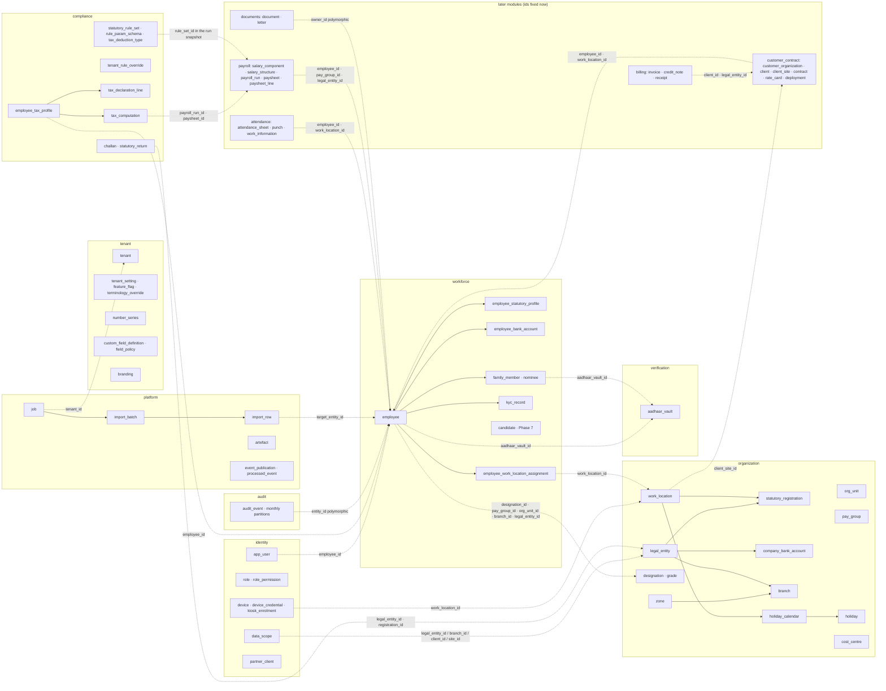

# Database schema design

Status: approved direction (2026-11-04). This folder is the schema design for the single PostgreSQL database behind the Allied Payroll backend ([ADR 0003](../adr/0003-single-api-backend-web-and-mobile-clients.md)). Each module document carries the DDL that becomes that module's first Flyway migration, unchanged. Phases 0 to 2 and the compliance module (rule registry and income tax) are designed in full; later modules are fixed only at the level of aggregate names and ids (§5) and get their own document in their phase, inside their slices.

| Document | Schema | Phase | Owner module or library |
|---|---|---|---|
| [platform.md](platform.md) | `platform`, `batch` | 0 | `common-events`, `common-import`, job support |
| [tenant.md](tenant.md) | `tenant` | 0 to 1 | `tenant` |
| [identity.md](identity.md) | `identity` | 1 | `identity` |
| [audit.md](audit.md) | `audit` | 1 | `audit` |
| [organization.md](organization.md) | `organization` | 2 | `organization` |
| [workforce.md](workforce.md) | `workforce` | 2, extended 7 | `workforce` |
| [verification.md](verification.md) | `verification` | 2 (Aadhaar vault), extended 7 | `verification` |
| [compliance.md](compliance.md) | `compliance` | 5, extended 8 | `compliance` |

Sources: [BACKEND_REQUIREMENTS.md](../BACKEND_REQUIREMENTS.md) §4 and §5, [INDUSTRY_PROFILES_AND_STRUCTURE.md](../INDUSTRY_PROFILES_AND_STRUCTURE.md) §3 and §6, [PROJECT_INITIATION.md](../PROJECT_INITIATION.md) §3 and Appendix A, [LOCALIZATION_I18N.md](../LOCALIZATION_I18N.md) §4, the `tenant-aware-entity` and `secure-coding` skills, and the reference draft in `reference/Pay.docx` (its ideas, not its names or integer keys).

## 1. Conventions every table follows

**Database.** PostgreSQL 17, one database, one schema per module plus `platform` and `batch`. Extensions: `btree_gist` (effective-date exclusion constraints), `pg_trgm` (name search), `ltree` (org-unit paths). Default collation `und-x-icu` so names sort correctly in every script. Timezone of the server is UTC; business dates are `DATE` in the tenant's calendar, instants are `TIMESTAMPTZ`.

**Roles.** `app` is the only role the backend connects as: `NOBYPASSRLS`, no DDL, no `DELETE` on audit. `migrate` owns the schemas, runs Flyway and has `BYPASSRLS` for data migrations that must touch every tenant. `readonly` on the replica for reporting.

**Naming.** `snake_case`, singular table names (`employee`, not `employees`), `{table}_id` for foreign keys, `ix_{table}_{cols}` for indexes, `uq_{table}_{cols}` for unique constraints, `ck_{table}_{rule}` for checks, `fk_{table}_{ref}` for foreign keys. Status and type columns are `VARCHAR` with a `CHECK` list, never a PostgreSQL enum, so a value can be added without a type migration.

**Ids.** `UUID` primary keys generated by the application as UUID v7 through the injected `IdGenerator` (time-ordered, index-friendly, safe for offline creation on mobile and for imports). No database default, so a row created outside the application is visible as such. Human-facing numbers (employee code, invoice number) come from `tenant.number_series`.

**Standard columns** on every tenant-owned table, in this order:

```sql
id          UUID PRIMARY KEY,
tenant_id   UUID NOT NULL,
-- business columns
version     BIGINT NOT NULL DEFAULT 0,                 -- optimistic locking, surfaces as ETag
created_at  TIMESTAMPTZ NOT NULL, created_by UUID NOT NULL,
updated_at  TIMESTAMPTZ NOT NULL, updated_by UUID NOT NULL,
deleted_at  TIMESTAMPTZ NULL                           -- soft delete; only on masters and documents
```

`created_by` and `updated_by` hold an `identity.app_user.id`, or the fixed system actor id `00000000-0000-0000-0000-000000000001` for jobs and listeners, or a device id for kiosk and device writes.

**Tenant isolation, three layers.**
1. `tenant_id` is the first column of every unique constraint and every composite index.
2. Hibernate `@TenantId` on the entity, fed by `TenantContext`; never from a request.
3. Row-level security on every tenant-owned table through one helper, applied in the migration right after the table:

```sql
SELECT platform.enable_tenant_rls('organization.designation');
```

The helper (defined in [platform.md](platform.md)) enables and forces RLS and creates the policy `tenant_isolation USING (tenant_id = platform.current_tenant()) WITH CHECK (...)`. `platform.current_tenant()` reads `current_setting('app.tenant_id', true)` and returns `NULL` when the setting is absent, so a connection without a tenant context sees no rows. The backend sets `app.tenant_id` with `SET LOCAL` at the start of every transaction.

**Platform-owned tables** (statutory rule packs, holiday masters, industry-profile templates, the permission catalogue, the tenant directory itself) have no `tenant_id` and no RLS. They live in the module that publishes them and are read-only to tenant code paths.

**Foreign keys** exist only inside a schema. A reference to another module's row is a plain `UUID` column named after it (`work_location_id`, `employee_id`) with no constraint, because modules may not join across their boundaries (Modulith rule). The owning module validates the reference through the other module's published `api`, and the overview in §5 records every such reference so deletes and lock-after-use checks know where to look.

**Money and numbers.** Amounts `NUMERIC(15,2)`; rates and factors `NUMERIC(12,4)`; percentages `NUMERIC(7,4)` holding the percentage value (12.5 for 12.5%); never `FLOAT`. Currency is INR throughout the first phases; a `currency CHAR(3)` column appears only where a second currency is plausible (billing, Phase 6).

**Effective dating.** Tables that hold history carry `effective_from DATE NOT NULL, effective_to DATE NULL` (inclusive, `NULL` means open) and an exclusion constraint so periods of the same parent never overlap:

```sql
CONSTRAINT ex_{table}_no_overlap EXCLUDE USING gist (
  tenant_id WITH =, employee_id WITH =,
  daterange(effective_from, effective_to, '[]') WITH &&
)
```

History rows are closed by setting `effective_to`, never rewritten. Queries ask "as of date D".

**PII.** Each protected field is stored as a triple: `{field}_enc BYTEA` (envelope-encrypted with the tenant's data key), `{field}_masked VARCHAR` (what lists show), `{field}_hash BYTEA` (HMAC-SHA256 blind index for exact-match search; indexed). Aadhaar does not use the triple: the number lives only in `verification.aadhaar_vault` ([verification.md](verification.md)), encrypted under a key reserved for Aadhaar, and every other table holds `aadhaar_vault_id` plus `aadhaar_last4 CHAR(4)` and the KYC status. Corporate identifiers of the tenant's own legal entities (CIN, company PAN, TAN, registration numbers) are not personal data and are stored in clear. Phone and email are PII and use the triple.

**Translatable text.** Masters shown to end users carry `name VARCHAR` (default-locale text) plus `name_i18n JSONB NOT NULL DEFAULT '{}'` keyed by BCP 47 tag. Long rich text (letter templates, policies) uses the `translation` table in the documents module later. Personal names are Latin-script columns plus `name_regional JSONB` for an optional native-script rendering.

**Custom fields.** Entities that tenants extend carry `custom_fields JSONB NOT NULL DEFAULT '{}'` validated against `tenant.custom_field_definition`. A GIN index is added only when a tenant needs to filter on them.

**Soft delete and lock-after-use.** Masters are never hard-deleted. `deleted_at` marks removal, unique constraints are partial (`WHERE deleted_at IS NULL`) so a code can be reused after deletion, and the service refuses deletion or edits of identifying fields while any transaction references the row (the "in use" check runs through the referencing modules' `api`).

**Audit.** Every create, update and delete on tenant data writes one `audit.audit_event` row in the same transaction, with masked old and new values. Tables never carry their own history columns beyond `updated_*`.

**Partitioning.** `audit.audit_event` is partitioned by month from day one. Punches, paysheet lines and import rows are partitioned by period when their modules arrive. Partitions are created ahead by a scheduled job on `backend-batch`, never on demand in a request.

**Indexes.** Every list endpoint's default filter and sort has a matching composite index starting with `tenant_id`, written in the same migration as the table. Blind-index columns get a plain btree. Name search uses a `pg_trgm` GIN index on the display name. Foreign-key columns inside a schema are indexed.

## 2. Migrations

- One Flyway instance, one `flyway_schema_history` table in `platform`, locations `classpath:db/migration/{module}` per module (`new-backend-module` step 4).
- Versions are namespaced by module so they never collide: `V{m}_{n}__{description}.sql` where `m` is the module number below and `n` increments inside the module. Flyway orders by version, so `platform` always runs first.

| m | Schema | m | Schema |
|---|---|---|---|
| 0 | platform (incl. roles, helpers, batch) | 6 | customer_contract |
| 1 | tenant | 7 | attendance |
| 2 | identity | 8 | payroll |
| 3 | audit | 9 | compliance |
| 4 | organization | 10 | billing |
| 5 | workforce | 11 | verification (Aadhaar vault, later face templates and the verification log) |
| | | 12 onward | approval, documents, notification, reporting, field_ops, inventory_projects |

- Migrations are forward-only and online-safe: add column, backfill in batches, add constraint `NOT VALID` then `VALIDATE`; never rename in place.
- Each migration is checked by SQLFluff (ADR 0002) and by the migration test in `testing-strategy` §2 item 7.

## 3. Test obligations per table

From `tenant-aware-entity` §10 and `testing-strategy` §2: a repository test running as the `app` role (RLS really applied), a cross-tenant read, update and delete test, a per-tenant uniqueness test, and for effective-dated tables an overlap-rejection test. These exist before the table is used by an endpoint.

## 4. What is deliberately not in the database

- Idempotency records (24 to 72 hours) and rate-limit counters: Redis.
- Access and refresh tokens, sessions, passwords: Keycloak and the `web-channel` session store (Redis).
- Files: object storage; the database holds object keys and hashes only (`platform.artefact`).
- Face templates: the verification module's encrypted store (Phase 7), referenced by id. Aadhaar numbers are in the database, but only in `verification.aadhaar_vault`.
- Cross-module joins, views across schemas, triggers that implement business rules.

## 5. Overview: aggregates and the references between modules

Solid arrows are foreign keys inside a schema; dashed arrows are id references across modules (no constraint, validated through the owning module's `api`). Later modules show only the aggregates and ids fixed now.



**Cross-module reference register.** When a row is deleted or deactivated, the owner asks these modules whether it is in use.

| Referenced row | Referenced from (module.table.column) |
|---|---|
| `organization.legal_entity` | identity.data_scope.scope_id; organization.branch, statutory_registration, company_bank_account, work_location; workforce.employee, candidate; payroll.*, billing.*, compliance.* |
| `organization.branch` | identity.data_scope.scope_id; workforce.employee.branch_id; attendance, payroll (later) |
| `organization.work_location` | identity.device.work_location_id; workforce.employee.primary_work_location_id, employee_work_location_assignment; customer_contract.client_site (reverse: work_location.client_site_id); attendance.punch, attendance_sheet |
| `organization.designation` | workforce.employee, candidate; customer_contract.rate_card_line, deployment |
| `organization.pay_group` | workforce.employee; payroll.payroll_run |
| `organization.holiday_calendar` | organization.work_location, pay_group; customer_contract.client_site (follows client calendar) |
| `organization.statutory_registration` | organization.work_location (ESIC sub-code, PT, LWF, S&E); compliance.challan, statutory_return |
| `compliance.statutory_rule_set` | compliance.tax_computation.rule_set_id; payroll.payroll_run input snapshot (resolved rule-set ids); never deleted, only `SUPERSEDED` or `WITHDRAWN` |
| `compliance.tax_deduction_type` | compliance.tax_declaration_line; `INCOME_TAX` pack `allowedDeductions` and `deductionLimits` keys; never deleted, only `RETIRED` |
| `verification.aadhaar_vault` | workforce.employee.aadhaar_vault_id, family_member.aadhaar_vault_id, candidate.aadhaar_vault_id (deleting the subject deletes the vault row through the `AadhaarVault` port) |
| `workforce.employee` | identity.app_user.employee_id; customer_contract.deployment; attendance.*; payroll.paysheet, salary_structure; documents.document.owner_id; audit.audit_event.entity_id |
| `identity.app_user` | every `created_by` / `updated_by`; approval.approval_request; audit.audit_event.actor_user_id |
| `platform.job` | platform.import_batch; every job-producing resource's `jobId` |

## 6. Open items

- Confirm PostgreSQL 17 and the managed-database offering with the cloud decision (DEVELOPMENT_PLAN §1 item 3). Nothing here needs features beyond 15, except that `uuidv7()` in the database would need 18; we generate ids in the application anyway.
- Whether mobile OTP is implemented as a Keycloak authenticator SPI or in the identity module decides whether `identity.otp_challenge` ships (see identity.md §4).
- Aadhaar vault keys are in the cloud KMS (decided 2026-11-06); an HSM-backed key store is a KMS option if a customer requires it. The per-tenant wrapped-key table `tenant.tenant_key` is still to be designed (verification.md §7).
- Dedicated-database tier for large tenants: the routing `DataSource` is in the backend design; this schema needs no change for it because every table is already tenant-keyed.
