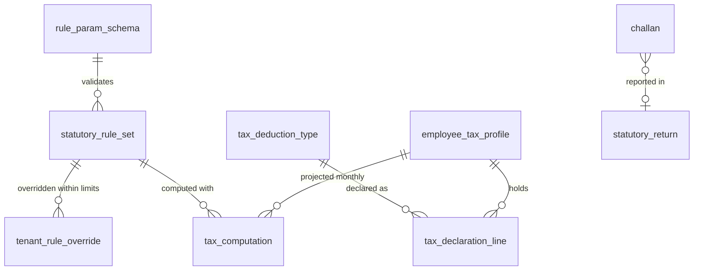

# Schema: compliance (Phase 5, extended Phase 8)

Owner: the `compliance` module. Migration namespace `V9_n`. Requirements: [BACKEND_REQUIREMENTS.md](../BACKEND_REQUIREMENTS.md) §4.9; [PROJECT_INITIATION.md](../PROJECT_INITIATION.md) §4.2; the `statutory-rule` skill. Decision 2026-11-07: income tax is modelled as one rule pack per tax year per regime, edited in the platform admin screen with maker-checker publishing, with the database as the source of truth and repo files as seeds; TDS stays in Phase 8 with this schema designed now.

## 1. Purpose

Two halves. The **rule registry** (§3.1 to §3.4) is platform-owned: every statutory number the payroll needs, as effective-dated, jurisdiction-keyed packs that only the compliance owner publishes, plus the catalogue of income-tax deductions and the per-tenant overrides the law allows. The **tenant records** (§3.5 to §3.9) hold what the rules are applied to: each employee's tax profile and declarations per tax year, the monthly tax computations, and the challans and returns filed.

Phase 5 ships the registry with the PF, ESIC, PT, LWF and minimum-wage packs, the overrides, challans and returns. Phase 8 adds the income-tax packs, the deduction catalogue in use, tax profiles, declarations and computations. All tables are created in `V9_1`, so Phase 8 adds data and code, not DDL.

What is not here: the calculators (pure functions in the module's domain package), the paysheet lines they produce (payroll module), proof files (documents module, referenced by id), the Form 16 and 24Q PDFs and text files (`platform.artefact`, referenced by id).

## 2. ERD



`employee_id`, `legal_entity_id`, `statutory_registration_id`, `payroll_run_id`, `paysheet_id`, `document_id` and `artefact_id` are id references to other modules, no foreign keys.

## 3. Tables

### 3.1 `rule_param_schema` (platform-owned)

The JSON schema each rule type's `params` must satisfy, versioned so a pack says which schema it was written against. The admin screen renders its editor from this schema, and `tenant_overridable` lists the JSON pointers a tenant may override.

```sql
CREATE SCHEMA compliance AUTHORIZATION migrate;

CREATE TABLE compliance.rule_param_schema (
  id                UUID PRIMARY KEY,
  rule_type         VARCHAR(30) NOT NULL,                   -- EPF, ESIC, PT, LWF, MIN_WAGE, BONUS, GRATUITY, INCOME_TAX, PERQUISITE_VALUATION, TDS_CALENDAR, LABOUR_CODE_WAGES
  schema_version    SMALLINT NOT NULL,
  json_schema       JSONB NOT NULL,                         -- JSON Schema draft 2020-12
  tenant_overridable JSONB NOT NULL DEFAULT '[]',           -- JSON pointers, e.g. ["/declarationCutoffMonth", "/allowRegimeSwitchAfterFirstRun"]
  status            VARCHAR(12) NOT NULL DEFAULT 'ACTIVE' CHECK (status IN ('ACTIVE','RETIRED')),
  created_at        TIMESTAMPTZ NOT NULL, created_by UUID NOT NULL,
  updated_at        TIMESTAMPTZ NOT NULL, updated_by UUID NOT NULL,
  CONSTRAINT uq_rule_param_schema UNIQUE (rule_type, schema_version)
);
```

### 3.2 `statutory_rule_set` (platform-owned)

One row per published version of a rule pack. The key of a pack is `(rule_type, state_code, variant)`: central rules leave `state_code` null, state rules carry it, and `variant` separates packs that coexist for one jurisdiction and date, which today means the income-tax regimes `NEW` and `OLD`. Published packs with the same key never overlap in time; drafts may, because a mid-year amendment is drafted while the current pack is live.

```sql
CREATE TABLE compliance.statutory_rule_set (
  id                UUID PRIMARY KEY,
  rule_type         VARCHAR(30) NOT NULL,
  sphere            VARCHAR(8) NOT NULL CHECK (sphere IN ('CENTRAL','STATE')),
  state_code        CHAR(2) NULL,                           -- ISO 3166-2:IN; null for central
  variant           VARCHAR(16) NULL,                       -- INCOME_TAX: NEW | OLD; null otherwise
  effective_from    DATE NOT NULL,
  effective_to      DATE NULL,                              -- INCOME_TAX packs always end on 31 March of the tax year
  version_no        SMALLINT NOT NULL,                      -- increments per key
  status            VARCHAR(12) NOT NULL DEFAULT 'DRAFT' CHECK (status IN ('DRAFT','PUBLISHED','SUPERSEDED','WITHDRAWN')),
  act_code          VARCHAR(30) NULL,                       -- IT_ACT_1961, IT_ACT_2025, SS_CODE_2020, EPF_ACT_1952 ...
  schema_version    SMALLINT NOT NULL,                      -- compliance.rule_param_schema
  params            JSONB NOT NULL,
  title             VARCHAR(150) NOT NULL,                  -- "Income tax, new regime, tax year 2025-26"
  source_reference  VARCHAR(255) NOT NULL,                  -- Finance Act, notification or circular number and date
  source_artefact_id UUID NULL,                             -- platform.artefact: the notification PDF
  change_summary    TEXT NULL,                              -- what changed against the previous version, shown in the diff view
  supersedes_id     UUID NULL REFERENCES compliance.statutory_rule_set (id),
  submitted_by      UUID NULL, submitted_at TIMESTAMPTZ NULL,
  published_by      UUID NULL, published_at TIMESTAMPTZ NULL,   -- the checker; never the submitter
  version           BIGINT NOT NULL DEFAULT 0,
  created_at        TIMESTAMPTZ NOT NULL, created_by UUID NOT NULL,
  updated_at        TIMESTAMPTZ NOT NULL, updated_by UUID NOT NULL,
  CONSTRAINT uq_statutory_rule_set_version UNIQUE NULLS NOT DISTINCT (rule_type, state_code, variant, version_no),
  CONSTRAINT ck_statutory_rule_set_state CHECK ((sphere = 'STATE') = (state_code IS NOT NULL)),
  CONSTRAINT ck_statutory_rule_set_publish CHECK (status <> 'PUBLISHED' OR (published_by IS NOT NULL AND published_by <> submitted_by)),
  CONSTRAINT ex_statutory_rule_set_published_no_overlap EXCLUDE USING gist (
    rule_type WITH =, COALESCE(state_code, '') WITH =, COALESCE(variant, '') WITH =,
    daterange(effective_from, effective_to, '[]') WITH &&
  ) WHERE (status = 'PUBLISHED')
);
CREATE INDEX ix_statutory_rule_set_lookup ON compliance.statutory_rule_set (rule_type, state_code, variant, status, effective_from DESC);
CREATE INDEX ix_statutory_rule_set_params ON compliance.statutory_rule_set USING gin (params);
```

Rules the DDL encodes:

- **A published pack is never edited.** `PUBLISHED` rows accept no `params` change (enforced in the service and by a repository test). A change is a new row with `supersedes_id`, and publishing it sets the old row to `SUPERSEDED` and closes its `effective_to` to the day before.
- **Maker-checker.** `submitted_by` drafts, a different `published_by` publishes; the check constraint refuses a self-published pack.
- **Resolution** is "the `PUBLISHED` pack of this key whose range contains date D"; the exclusion constraint guarantees there is at most one.

### 3.3 `tax_deduction_type` (platform-owned)

The catalogue of deductions, exemptions and other-income heads an employee can declare or an employer provides. It holds identity and behaviour; the amounts and caps for a year are in the `INCOME_TAX` pack keyed by `code`, so a Budget change touches the pack only. `legal_reference` maps the code to the section under each Act, which is how the 2025 Act's renumbering stays out of the code.

```sql
CREATE TABLE compliance.tax_deduction_type (
  code              VARCHAR(40) PRIMARY KEY,                -- INV_LIFE_INS_PF_ELSS, NPS_EMPLOYEE_ADDL, NPS_EMPLOYER, HEALTH_INSURANCE, HRA, LTA, HOME_LOAN_INTEREST_SELF_OCCUPIED, STANDARD_DEDUCTION, PROFESSIONAL_TAX_PAID, DONATIONS, EDU_LOAN_INTEREST, DISABILITY_SELF, INTEREST_SAVINGS ...
  category          VARCHAR(20) NOT NULL CHECK (category IN ('SALARY_EXEMPTION','SALARY_DEDUCTION','CHAPTER_DEDUCTION','HOUSE_PROPERTY','OTHER_INCOME','EMPLOYER_CONTRIBUTION','PERQUISITE')),
  name              VARCHAR(120) NOT NULL,
  name_i18n         JSONB NOT NULL DEFAULT '{}',
  help_key          VARCHAR(120) NULL,                      -- message key for the declaration screen's help text
  regimes           JSONB NOT NULL DEFAULT '["OLD"]',       -- ["NEW","OLD"]: which regimes allow it
  declared_by       VARCHAR(12) NOT NULL CHECK (declared_by IN ('EMPLOYEE','EMPLOYER','AUTO')),  -- AUTO: standard deduction, PT paid, employer NPS from payroll
  cap_rule          VARCHAR(16) NOT NULL CHECK (cap_rule IN ('NONE','FIXED','PCT_OF_SALARY','FORMULA')),  -- values in the pack: deductionLimits[code]
  formula_key       VARCHAR(40) NULL,                       -- HRA_LEAST_OF_THREE, LTA_BLOCK_OF_FOUR; a named calculator, not an expression
  proof_type        VARCHAR(16) NOT NULL DEFAULT 'DOCUMENT' CHECK (proof_type IN ('NONE','DOCUMENT','RENT_RECEIPTS','CERTIFICATE','FORM_12BB')),
  details_schema    JSONB NOT NULL DEFAULT '{}',            -- JSON Schema for tax_declaration_line.details (rent per month, landlord PAN, policy numbers)
  legal_reference   JSONB NOT NULL DEFAULT '{}',            -- {"IT_ACT_1961": "80C", "IT_ACT_2025": "123"}
  display_order     SMALLINT NOT NULL DEFAULT 100,
  effective_from    DATE NOT NULL,
  effective_to      DATE NULL,
  status            VARCHAR(12) NOT NULL DEFAULT 'ACTIVE' CHECK (status IN ('ACTIVE','RETIRED')),
  created_at        TIMESTAMPTZ NOT NULL, created_by UUID NOT NULL,
  updated_at        TIMESTAMPTZ NOT NULL, updated_by UUID NOT NULL
);
```

### 3.4 `tenant_rule_override`

What a tenant may set within a rule: only the pointers the schema marks `tenant_overridable`, validated at save time against the pack in force. Examples: the declaration cut-off month, the proof deadline, whether an employee may change regime after the first run of the year, which perquisites the tenant provides, PF on actual wages above the ceiling, the ESIC re-check policy on revision. Slabs, rates, ceilings and limits are never overridable.

```sql
CREATE TABLE compliance.tenant_rule_override (
  id                UUID PRIMARY KEY,
  tenant_id         UUID NOT NULL,
  rule_type         VARCHAR(30) NOT NULL,
  state_code        CHAR(2) NULL,
  variant           VARCHAR(16) NULL,
  legal_entity_id   UUID NULL,                              -- organization.legal_entity; null = whole tenant
  effective_from    DATE NOT NULL,
  effective_to      DATE NULL,
  overrides         JSONB NOT NULL,                         -- {"/declarationCutoffMonth": 1, "/allowRegimeSwitchAfterFirstRun": false}
  reason            VARCHAR(255) NULL,
  status            VARCHAR(12) NOT NULL DEFAULT 'ACTIVE' CHECK (status IN ('ACTIVE','INACTIVE')),
  version           BIGINT NOT NULL DEFAULT 0,
  created_at        TIMESTAMPTZ NOT NULL, created_by UUID NOT NULL,
  updated_at        TIMESTAMPTZ NOT NULL, updated_by UUID NOT NULL,
  CONSTRAINT ex_tenant_rule_override_no_overlap EXCLUDE USING gist (
    tenant_id WITH =, rule_type WITH =, COALESCE(state_code, '') WITH =, COALESCE(variant, '') WITH =,
    COALESCE(legal_entity_id, '00000000-0000-0000-0000-000000000000'::uuid) WITH =,
    daterange(effective_from, effective_to, '[]') WITH &&
  ) WHERE (status = 'ACTIVE')
);
CREATE INDEX ix_tenant_rule_override_lookup ON compliance.tenant_rule_override (tenant_id, rule_type, state_code, effective_from DESC);
SELECT platform.enable_tenant_rls('compliance.tenant_rule_override');
```

### 3.5 `employee_tax_profile`

One row per employee per tax year: the regime, how it was chosen, what the employee brought from a previous employer, and the state of their declaration. `tax_year` is the label the Act uses (`2026-27` for 1 April 2026 to 31 March 2027).

```sql
CREATE TABLE compliance.employee_tax_profile (
  id                    UUID PRIMARY KEY,
  tenant_id             UUID NOT NULL,
  employee_id           UUID NOT NULL,                      -- workforce.employee
  legal_entity_id       UUID NOT NULL,                      -- organization.legal_entity (the deductor, holds the TAN)
  tax_year              CHAR(7) NOT NULL,                   -- '2026-27'
  regime                VARCHAR(4) NOT NULL CHECK (regime IN ('NEW','OLD')),
  regime_source         VARCHAR(12) NOT NULL CHECK (regime_source IN ('DEFAULT','EMPLOYEE','EMPLOYER')),
  regime_opted_at       TIMESTAMPTZ NULL,
  regime_locked_at      TIMESTAMPTZ NULL,                   -- set by the first payroll run after the tenant's cut-off
  age_band              VARCHAR(12) NOT NULL CHECK (age_band IN ('GENERAL','SENIOR','SUPER_SENIOR')),  -- from date of birth at the start of the tax year
  pan_status            VARCHAR(12) NOT NULL DEFAULT 'AVAILABLE' CHECK (pan_status IN ('AVAILABLE','MISSING','INVALID','INOPERATIVE')),  -- MISSING / INOPERATIVE: higher TDS rate from the pack
  previous_employer     JSONB NOT NULL DEFAULT '{}',        -- {salary, exemptions, standardDeduction, professionalTax, pf, tds, employerTan}
  other_income          JSONB NOT NULL DEFAULT '{}',        -- {interest, houseProperty: {rentReceived, interestPaid, lossSetOff}, other}
  declaration_status    VARCHAR(12) NOT NULL DEFAULT 'OPEN' CHECK (declaration_status IN ('OPEN','SUBMITTED','VERIFIED','LOCKED')),
  declaration_submitted_at TIMESTAMPTZ NULL,
  form_16_artefact_id   UUID NULL,                          -- platform.artefact, set when generated
  version               BIGINT NOT NULL DEFAULT 0,
  created_at            TIMESTAMPTZ NOT NULL, created_by UUID NOT NULL,
  updated_at            TIMESTAMPTZ NOT NULL, updated_by UUID NOT NULL,
  CONSTRAINT uq_employee_tax_profile UNIQUE (tenant_id, employee_id, tax_year)
);
CREATE INDEX ix_employee_tax_profile_year ON compliance.employee_tax_profile (tenant_id, legal_entity_id, tax_year, declaration_status);
SELECT platform.enable_tenant_rls('compliance.employee_tax_profile');
```

### 3.6 `tax_declaration_line`

One line per deduction type per profile. `declared_amount` is what the employee says in April, `verified_amount` is what the verifier accepts against proof in January; the calculator uses the declared amount until the tenant's proof deadline and the verified amount after it. `details` follows the type's `details_schema`.

```sql
CREATE TABLE compliance.tax_declaration_line (
  id                  UUID PRIMARY KEY,
  tenant_id           UUID NOT NULL,
  tax_profile_id      UUID NOT NULL REFERENCES compliance.employee_tax_profile (id) ON DELETE CASCADE,
  deduction_type_code VARCHAR(40) NOT NULL REFERENCES compliance.tax_deduction_type (code),
  declared_amount     NUMERIC(15,2) NOT NULL DEFAULT 0,
  verified_amount     NUMERIC(15,2) NULL,
  allowed_amount      NUMERIC(15,2) NULL,                   -- after the pack's cap; recomputed by the calculator, shown with the explanation
  details             JSONB NOT NULL DEFAULT '{}',
  proof_document_ids  JSONB NOT NULL DEFAULT '[]',          -- documents.document ids
  proof_status        VARCHAR(12) NOT NULL DEFAULT 'PENDING' CHECK (proof_status IN ('NOT_REQUIRED','PENDING','ACCEPTED','PARTIAL','REJECTED')),
  verified_by         UUID NULL, verified_at TIMESTAMPTZ NULL,
  remark_key          VARCHAR(120) NULL,                    -- message key for the rejection reason
  version             BIGINT NOT NULL DEFAULT 0,
  created_at          TIMESTAMPTZ NOT NULL, created_by UUID NOT NULL,
  updated_at          TIMESTAMPTZ NOT NULL, updated_by UUID NOT NULL,
  CONSTRAINT uq_tax_declaration_line UNIQUE (tenant_id, tax_profile_id, deduction_type_code)
);
CREATE INDEX ix_tax_declaration_line_proof ON compliance.tax_declaration_line (tenant_id, proof_status);
SELECT platform.enable_tenant_rls('compliance.tax_declaration_line');
```

### 3.7 `tax_computation`

Every run of the income-tax calculator for an employee and month, with the inputs it saw, the pack and override it used and the explanation it produced. `PROJECTION` rows come from previews and the regime-comparison screen; `FINAL` rows are the ones a payroll run deducted, one per paysheet. Nothing is recomputed from a `FINAL` row; a later month simply projects again with the deducted-to-date figure.

```sql
CREATE TABLE compliance.tax_computation (
  id                  UUID PRIMARY KEY,
  tenant_id           UUID NOT NULL,
  tax_profile_id      UUID NOT NULL REFERENCES compliance.employee_tax_profile (id) ON DELETE CASCADE,
  employee_id         UUID NOT NULL,
  tax_year            CHAR(7) NOT NULL,
  period              CHAR(7) NOT NULL,                     -- 'YYYY-MM'
  kind                VARCHAR(12) NOT NULL CHECK (kind IN ('PROJECTION','COMPARISON','FINAL')),
  regime              VARCHAR(4) NOT NULL CHECK (regime IN ('NEW','OLD')),
  rule_set_id         UUID NOT NULL REFERENCES compliance.statutory_rule_set (id),
  override_id         UUID NULL REFERENCES compliance.tenant_rule_override (id),
  payroll_run_id      UUID NULL,                            -- payroll.payroll_run, FINAL only
  paysheet_id         UUID NULL,                            -- payroll.paysheet, FINAL only
  inputs              JSONB NOT NULL,                       -- projected annual salary by head, exemptions, declarations as used, previous employer, other income, deducted to date
  result              JSONB NOT NULL,                       -- taxable income, slab tax by band, rebate, surcharge, cess, annual tax, months remaining
  annual_tax          NUMERIC(15,2) NOT NULL,
  tds_to_date         NUMERIC(15,2) NOT NULL,
  tds_this_period     NUMERIC(15,2) NOT NULL,
  explanation         JSONB NOT NULL,                       -- ordered lines: {key, params, amount}; rendered through message keys
  computed_at         TIMESTAMPTZ NOT NULL,
  created_at          TIMESTAMPTZ NOT NULL, created_by UUID NOT NULL,
  CONSTRAINT ck_tax_computation_final CHECK (kind <> 'FINAL' OR (payroll_run_id IS NOT NULL AND paysheet_id IS NOT NULL))
);
CREATE UNIQUE INDEX uq_tax_computation_final ON compliance.tax_computation (tenant_id, paysheet_id) WHERE kind = 'FINAL';
CREATE INDEX ix_tax_computation_employee ON compliance.tax_computation (tenant_id, employee_id, tax_year, period, kind, computed_at DESC);
SELECT platform.enable_tenant_rls('compliance.tax_computation');
```

Volume is employees × months × a few previews; partition by `tax_year` when a tenant passes fifty thousand employees (noted in `performance-and-scale`). Rows are immutable: no `version`, no `updated_*`.

### 3.8 `challan`

One row per statutory payment due: PF ECR, ESIC, PT, LWF per state registration, TDS on salary per legal entity. Created by the payroll run's `ChallanDue` event with the amount from the run, completed by the finance user with the payment details.

```sql
CREATE TABLE compliance.challan (
  id                  UUID PRIMARY KEY,
  tenant_id           UUID NOT NULL,
  legal_entity_id     UUID NOT NULL,                        -- organization.legal_entity
  registration_id     UUID NULL,                            -- organization.statutory_registration; null for TDS (TAN is on the legal entity) and EPF (code on the entity)
  challan_type        VARCHAR(16) NOT NULL CHECK (challan_type IN ('EPF_ECR','ESIC','PT','LWF','TDS_SALARY','OTHER')),
  state_code          CHAR(2) NULL,
  period              CHAR(7) NOT NULL,                     -- 'YYYY-MM'; half-yearly PT and LWF use the last month of the half
  due_date            DATE NOT NULL,                        -- from the TDS_CALENDAR or the rule pack's dueDay
  amount              NUMERIC(15,2) NOT NULL,
  breakup             JSONB NOT NULL DEFAULT '{}',          -- employee share, employer share, admin charges, interest, penalty
  payroll_run_ids     JSONB NOT NULL DEFAULT '[]',
  status              VARCHAR(12) NOT NULL DEFAULT 'DUE' CHECK (status IN ('DUE','PAID','LATE','CANCELLED')),
  paid_on             DATE NULL,
  challan_no          VARCHAR(40) NULL,
  bank_reference      VARCHAR(80) NULL,                     -- BSR code + CIN for TDS, TRRN for EPF
  receipt_artefact_id UUID NULL,                            -- platform.artefact
  version             BIGINT NOT NULL DEFAULT 0,
  created_at          TIMESTAMPTZ NOT NULL, created_by UUID NOT NULL,
  updated_at          TIMESTAMPTZ NOT NULL, updated_by UUID NOT NULL,
  CONSTRAINT uq_challan UNIQUE NULLS NOT DISTINCT (tenant_id, legal_entity_id, challan_type, registration_id, period)
);
CREATE INDEX ix_challan_due ON compliance.challan (tenant_id, status, due_date);
SELECT platform.enable_tenant_rls('compliance.challan');
```

### 3.9 `statutory_return`

One row per return or register generated: the monthly ECR and ESIC files, PT and LWF returns, the quarterly 24Q, the annual Form 16 batch, wage register and muster roll. The file is an artefact; the row tracks filing.

```sql
CREATE TABLE compliance.statutory_return (
  id                  UUID PRIMARY KEY,
  tenant_id           UUID NOT NULL,
  legal_entity_id     UUID NOT NULL,
  registration_id     UUID NULL,
  return_type         VARCHAR(20) NOT NULL CHECK (return_type IN ('EPF_ECR','ESIC_MONTHLY','PT_RETURN','LWF_RETURN','TDS_24Q','FORM_16','WAGE_REGISTER','MUSTER_ROLL','COMBINED_MUSTER_ROLL','OTHER')),
  state_code          CHAR(2) NULL,
  period_from         DATE NOT NULL,
  period_to           DATE NOT NULL,
  tax_year            CHAR(7) NULL,                         -- TDS_24Q and FORM_16
  quarter             SMALLINT NULL CHECK (quarter IS NULL OR quarter BETWEEN 1 AND 4),
  due_date            DATE NULL,
  status              VARCHAR(12) NOT NULL DEFAULT 'DRAFT' CHECK (status IN ('DRAFT','GENERATED','FILED','ACCEPTED','REJECTED','REVISED')),
  generated_at        TIMESTAMPTZ NULL,
  artefact_id         UUID NULL,                            -- platform.artefact
  line_count          INTEGER NULL,
  totals              JSONB NOT NULL DEFAULT '{}',
  challan_ids         JSONB NOT NULL DEFAULT '[]',
  acknowledgement_no  VARCHAR(40) NULL,
  filed_on            DATE NULL,
  revises_id          UUID NULL REFERENCES compliance.statutory_return (id),
  version             BIGINT NOT NULL DEFAULT 0,
  created_at          TIMESTAMPTZ NOT NULL, created_by UUID NOT NULL,
  updated_at          TIMESTAMPTZ NOT NULL, updated_by UUID NOT NULL,
  CONSTRAINT ck_statutory_return_period CHECK (period_to >= period_from)
);
CREATE INDEX ix_statutory_return_lookup ON compliance.statutory_return (tenant_id, legal_entity_id, return_type, period_from DESC);
SELECT platform.enable_tenant_rls('compliance.statutory_return');
```

## 4. The `INCOME_TAX` pack

One pack per tax year per regime. Everything a Finance Act changes is here, keyed by the catalogue codes of §3.3. The example carries the Finance Act 2025 values for tax year 2025-26 as the seed shape; **the compliance consultant validates every number before a pack is published** (PROJECT_INITIATION §4.2), and the 2026-27 packs are written from the Finance Act 2026 when the project reaches Phase 8.

```json
{
  "taxYear": "2025-26",
  "regime": "NEW",
  "actCode": "IT_ACT_1961",
  "isDefaultRegime": true,
  "slabs": {
    "GENERAL": [
      {"from": 0, "to": 400000, "rate": 0}, {"from": 400000, "to": 800000, "rate": 5},
      {"from": 800000, "to": 1200000, "rate": 10}, {"from": 1200000, "to": 1600000, "rate": 15},
      {"from": 1600000, "to": 2000000, "rate": 20}, {"from": 2000000, "to": 2400000, "rate": 25},
      {"from": 2400000, "to": null, "rate": 30}
    ],
    "SENIOR": "GENERAL",
    "SUPER_SENIOR": "GENERAL"
  },
  "rebate": {"incomeLimit": 1200000, "maxAmount": 60000, "marginalRelief": true},
  "surcharge": {
    "bands": [{"from": 5000000, "rate": 10}, {"from": 10000000, "rate": 15}, {"from": 20000000, "rate": 25}],
    "marginalRelief": true
  },
  "cess": {"rate": 4, "nameKey": "tax.cess.health_education"},
  "deductionLimits": {
    "STANDARD_DEDUCTION": {"fixed": 75000},
    "NPS_EMPLOYER": {"pctOfSalary": 14, "salaryBasis": "BASIC_DA"},
    "PROFESSIONAL_TAX_PAID": {"fixed": null}
  },
  "allowedDeductions": ["STANDARD_DEDUCTION", "NPS_EMPLOYER", "PROFESSIONAL_TAX_PAID"],
  "withoutPan": {"rate": 20, "ruleKey": "tax.without_pan.higher_of_slab_or_rate"},
  "rounding": {"taxableIncome": "DOWN_TO_10", "tax": "NEAREST_10", "monthlyTds": "NEAREST_1"},
  "declarationCutoffMonth": 1,
  "proofDeadlineMonth": 1,
  "allowRegimeSwitchAfterFirstRun": false,
  "monthlySpread": "REMAINING_MONTHS"
}
```

The `OLD` pack for the same year differs in its slabs (three age bands with their own thresholds), its rebate, a longer `allowedDeductions` list (`INV_LIFE_INS_PF_ELSS`, `NPS_EMPLOYEE_ADDL`, `HEALTH_INSURANCE`, `HRA`, `LTA`, `HOME_LOAN_INTEREST_SELF_OCCUPIED`, `EDU_LOAN_INTEREST`, `DONATIONS`, `DISABILITY_SELF`, `INTEREST_SAVINGS` and the rest of the catalogue) with their limits, formula parameters for HRA and LTA, and a fourth surcharge band. The schema's `tenant_overridable` list for `INCOME_TAX` is exactly `/declarationCutoffMonth`, `/proofDeadlineMonth`, `/allowRegimeSwitchAfterFirstRun` and `/perquisitesProvided`.

Companion packs on their own cadence: `PERQUISITE_VALUATION` (motor car, accommodation, interest-free loans, with their valuation rates) and `TDS_CALENDAR` (challan due day, 24Q quarter due dates, Form 16 issue date), both `CENTRAL`, no variant.

## 5. The calculator

`IncomeTaxCalculator.compute(pack, overrides, inputs) → TaxComputation` is a pure function in the compliance domain package. It never reads the clock or the database. Steps, each producing explanation lines:

1. Project annual gross per head from the salary structure and the months paid so far, plus previous-employer income and other income.
2. Apply exemptions and salary deductions allowed in the regime (HRA formula, LTA, standard deduction, professional tax paid), each capped by the pack.
3. Apply chapter deductions allowed in the regime from the declaration lines, using declared or verified amounts by the proof deadline rule, each capped.
4. Round taxable income; apply the age band's slabs; apply rebate with marginal relief; apply surcharge with marginal relief; apply cess; apply the without-PAN rule.
5. Subtract TDS deducted to date and previous-employer TDS; spread the balance over the remaining months per `monthlySpread`; round.

A mid-year amendment is a new pack version from the amendment date. Because step 4 is annual and step 5 is cumulative, the remaining months absorb the difference automatically. No arrears, no recomputation of approved runs.

The `COMPARISON` kind runs both regimes for the same inputs so the employee screen can show "you pay ₹X less under the new regime"; it never changes the profile.

## 6. Changing the rules

| Step | Who | What happens |
|---|---|---|
| Draft | compliance owner, platform role `compliance:rule_pack_edit` | The admin screen "Statutory rule packs" lists packs by type, year and jurisdiction. "New version" copies the current pack into a `DRAFT` with `supersedes_id`; the editor is a form rendered from `rule_param_schema` (slab table, limits, switches), with a raw JSON view. `source_reference` and `change_summary` are required. |
| Validate | the service, on save and on submit | JSON schema; slabs contiguous and ascending with the last band open; rates non-decreasing; `effective_from` and `effective_to` inside one tax year for `INCOME_TAX`; every code in `allowedDeductions` exists in the catalogue and allows the regime; every `deductionLimits` key is allowed. |
| Preview | drafter | "Simulate" runs the calculator on the draft against the platform's sample profiles (five salary levels × two age bands × with and without declarations) and shows the diff against the live pack's results. |
| Submit | drafter | Status stays `DRAFT`, `submitted_by` is set, the approver is notified. |
| Publish | a different compliance owner, `compliance:rule_pack_publish` | The golden tests for that rule type ran green in CI against the draft's exported JSON (the CI job exports drafts through the API). Publish sets `PUBLISHED`, supersedes the previous version, writes an audit row and publishes `RulePackPublished`. |
| Roll over | `backend-batch`, on `RulePackPublished` for the first `INCOME_TAX` pack of a new tax year | Creates `employee_tax_profile` rows for active employees with the default regime and `declaration_status = OPEN`, notifies employees to declare. The previous year's choice does not carry over unless the tenant's override says so. |

Seeds: `backend/modules/compliance/src/main/resources/rule-packs/{rule_type}/{central|state_code}/{effective_from}[.variant].json`, loaded by `V9_2` as `PUBLISHED` with `published_by` set to the system actor, used for fresh environments and as the fixtures of the golden tests. After go-live the database is the source of truth and a published pack is exported back into the repo by the CI job, so the two never drift.

Permissions added to the catalogue: `compliance:rule_pack_edit`, `compliance:rule_pack_publish` (platform roles only), `tax:profile_view`, `tax:declaration_verify`, `tax:regime_change` (tenant HR), and employee self-service through the mobile and web employee surfaces for their own declaration.

## 7. Events

| Event | When |
|---|---|
| `RulePackPublished` | A pack reaches `PUBLISHED`; payroll invalidates its rule cache, the roll-over job listens for income tax |
| `TaxDeclarationSubmitted`, `TaxDeclarationVerified` | Employee submits; verifier completes proof review |
| `RegimeChanged` | Employee or HR changes the regime before the lock |
| `ChallanDue`, `ChallanPaid` | Run approval creates the challan; finance records payment |
| `ReturnGenerated`, `ReturnFiled` | File produced; acknowledgement recorded |

## 8. Tests this schema adds

Beyond README §3: a repository test that a `PUBLISHED` pack refuses a `params` update; a test that two published packs of one key cannot overlap and that a draft may; a test that a self-published pack is rejected; schema validation tests per rule type with one invalid example each; golden tests per tax year and regime for the boundaries (income exactly at the rebate limit and ₹1 above, each surcharge threshold with marginal relief, senior-citizen slabs, no PAN, mid-year joiner with previous-employer income, declaration dropped at proof verification in January, a mid-year pack amendment); and a test that a tenant override touching a non-overridable pointer is rejected.

## 9. Open items

- Whether `MIN_WAGE` rates (state × zone × skill × scheduled employment, VDA twice a year) fit `params` or need their own `minimum_wage_rate` master for the payroll guard's query pattern; proposed: own master, designed in the Phase 5 minimum-wage slice.
- Form 12BB capture as a structured declaration versus a PDF upload; proposed: structured, with the 12BB PDF generated from the lines.
- Whether the platform admin screen lives in the web app under a platform tenant or in a separate internal tool; proposed: same web app, platform roles, hidden for tenant users.
