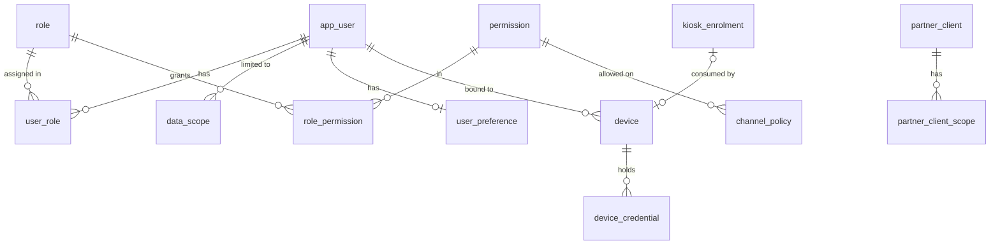

# Schema: identity (Phase 1)

Owner: the `identity` module. Migration namespace `V2_n`. Requirements: [BACKEND_REQUIREMENTS.md](../BACKEND_REQUIREMENTS.md) §4.2, §2, §7; [MULTI_CHANNEL_API.md](../MULTI_CHANNEL_API.md) §4; the `secure-coding` skill.

## 1. Purpose

Who can act in a tenant, with which permissions, over which data, from which channel and device. Authentication itself is Keycloak's (one realm, tenant as organisation); this schema holds the tenant-side user record, the permission model, data scopes, the device registry and kiosk credentials, channel policy and partner API clients.

Not here: passwords, sessions, access and refresh tokens (Keycloak and the `web-channel` Redis session store).

## 2. ERD



## 3. Tables

### 3.1 `permission` (platform-owned catalogue)

The catalogue is code: each module declares its permissions in an enum, and a startup reconciler upserts this table so the API can list them and roles can reference them by code. Rows are never deleted; a retired permission is marked.

```sql
CREATE SCHEMA identity AUTHORIZATION migrate;

CREATE TABLE identity.permission (
  code            VARCHAR(60) PRIMARY KEY,                  -- payroll:approve, employee:pii_reveal
  module_code     VARCHAR(30) NOT NULL,
  description_key VARCHAR(120) NOT NULL,                    -- message key
  money_moving    BOOLEAN NOT NULL DEFAULT FALSE,           -- maker–checker candidates
  default_channels JSONB NOT NULL DEFAULT '["WEB","MOBILE"]',
  status          VARCHAR(12) NOT NULL DEFAULT 'ACTIVE' CHECK (status IN ('ACTIVE','RETIRED')),
  created_at      TIMESTAMPTZ NOT NULL,
  updated_at      TIMESTAMPTZ NOT NULL
);
```

### 3.2 `app_user`

One row per person or service identity in a tenant. `keycloak_subject` links to the IdP; the user's employee or client-contact record, when any, is an id reference into the owning module.

```sql
CREATE TABLE identity.app_user (
  id                  UUID PRIMARY KEY,
  tenant_id           UUID NOT NULL,
  keycloak_subject    VARCHAR(64) NULL,                     -- null until the invitation is accepted
  user_type           VARCHAR(20) NOT NULL CHECK (user_type IN ('ADMIN','MANAGER','CLIENT_CONTACT','EMPLOYEE','SERVICE_ACCOUNT')),
  username            VARCHAR(80) NOT NULL,                 -- login name shown in audit; email or phone-derived
  display_name        VARCHAR(150) NOT NULL,
  email_enc           BYTEA NULL, email_masked VARCHAR(80) NULL, email_hash BYTEA NULL,
  phone_enc           BYTEA NULL, phone_masked VARCHAR(20) NULL, phone_hash BYTEA NULL,
  preferred_locale    VARCHAR(16) NULL,
  scope_mode          VARCHAR(12) NOT NULL DEFAULT 'RESTRICTED' CHECK (scope_mode IN ('ALL','RESTRICTED')),
  employee_id         UUID NULL,                            -- workforce.employee
  client_contact_id   UUID NULL,                            -- customer_contract.contact (Phase 3)
  status              VARCHAR(12) NOT NULL DEFAULT 'INVITED' CHECK (status IN ('INVITED','ACTIVE','DISABLED','LOCKED')),
  invited_at          TIMESTAMPTZ NULL,
  activated_at        TIMESTAMPTZ NULL,
  last_login_at       TIMESTAMPTZ NULL,
  last_login_channel  VARCHAR(12) NULL,
  logout_everywhere_at TIMESTAMPTZ NULL,                    -- tokens issued before this are rejected
  version             BIGINT NOT NULL DEFAULT 0,
  created_at          TIMESTAMPTZ NOT NULL, created_by UUID NOT NULL,
  updated_at          TIMESTAMPTZ NOT NULL, updated_by UUID NOT NULL,
  deleted_at          TIMESTAMPTZ NULL,
  CONSTRAINT uq_app_user_subject UNIQUE (tenant_id, keycloak_subject),
  CONSTRAINT uq_app_user_username UNIQUE (tenant_id, username),
  CONSTRAINT uq_app_user_employee UNIQUE (tenant_id, employee_id)
);
CREATE INDEX ix_app_user_tenant_status_type ON identity.app_user (tenant_id, status, user_type);
CREATE INDEX ix_app_user_email_hash ON identity.app_user (tenant_id, email_hash);
CREATE INDEX ix_app_user_phone_hash ON identity.app_user (tenant_id, phone_hash);
SELECT platform.enable_tenant_rls('identity.app_user');
```

### 3.3 `role`, `role_permission`, `user_role`

Roles are per tenant. Template roles (`system = true`) come from the industry profile and can be copied but not edited, so a template upgrade can refresh them.

```sql
CREATE TABLE identity.role (
  id            UUID PRIMARY KEY,
  tenant_id     UUID NOT NULL,
  code          VARCHAR(40) NOT NULL,
  name          VARCHAR(80) NOT NULL,
  name_i18n     JSONB NOT NULL DEFAULT '{}',
  description   VARCHAR(255) NULL,
  system        BOOLEAN NOT NULL DEFAULT FALSE,
  status        VARCHAR(12) NOT NULL DEFAULT 'ACTIVE' CHECK (status IN ('ACTIVE','INACTIVE')),
  version       BIGINT NOT NULL DEFAULT 0,
  created_at    TIMESTAMPTZ NOT NULL, created_by UUID NOT NULL,
  updated_at    TIMESTAMPTZ NOT NULL, updated_by UUID NOT NULL,
  deleted_at    TIMESTAMPTZ NULL,
  CONSTRAINT uq_role_code UNIQUE (tenant_id, code)
);
SELECT platform.enable_tenant_rls('identity.role');

CREATE TABLE identity.role_permission (
  tenant_id       UUID NOT NULL,
  role_id         UUID NOT NULL REFERENCES identity.role (id) ON DELETE CASCADE,
  permission_code VARCHAR(60) NOT NULL REFERENCES identity.permission (code),
  granted_at      TIMESTAMPTZ NOT NULL, granted_by UUID NOT NULL,
  PRIMARY KEY (tenant_id, role_id, permission_code)
);
SELECT platform.enable_tenant_rls('identity.role_permission');

CREATE TABLE identity.user_role (
  tenant_id     UUID NOT NULL,
  user_id       UUID NOT NULL REFERENCES identity.app_user (id) ON DELETE CASCADE,
  role_id       UUID NOT NULL REFERENCES identity.role (id),
  assigned_at   TIMESTAMPTZ NOT NULL, assigned_by UUID NOT NULL,
  PRIMARY KEY (tenant_id, user_id, role_id)
);
CREATE INDEX ix_user_role_role ON identity.user_role (tenant_id, role_id);
SELECT platform.enable_tenant_rls('identity.user_role');
```

The effective permission set of a user is the union over roles, computed on sign-in and cached in the session; `RoleChanged` invalidates it.

### 3.4 `data_scope`

What a `RESTRICTED` user may see. One row per allowed legal entity, branch, client or site. A legal entity implies its branches; a client implies its sites. The query layer turns these rows into predicates.

```sql
CREATE TABLE identity.data_scope (
  id            UUID PRIMARY KEY,
  tenant_id     UUID NOT NULL,
  user_id       UUID NOT NULL REFERENCES identity.app_user (id) ON DELETE CASCADE,
  scope_type    VARCHAR(16) NOT NULL CHECK (scope_type IN ('LEGAL_ENTITY','BRANCH','CLIENT','SITE')),
  scope_id      UUID NOT NULL,                              -- organization.* or customer_contract.* id
  created_at    TIMESTAMPTZ NOT NULL, created_by UUID NOT NULL,
  CONSTRAINT uq_data_scope UNIQUE (tenant_id, user_id, scope_type, scope_id)
);
SELECT platform.enable_tenant_rls('identity.data_scope');
```

### 3.5 `channel_policy`

Overrides of `permission.default_channels` per tenant: which channels may exercise a permission (kiosk may only punch; payroll publish web-only).

```sql
CREATE TABLE identity.channel_policy (
  id              UUID PRIMARY KEY,
  tenant_id       UUID NOT NULL,
  permission_code VARCHAR(60) NOT NULL REFERENCES identity.permission (code),
  channel         VARCHAR(12) NOT NULL CHECK (channel IN ('WEB','MOBILE','KIOSK','DEVICE','PARTNER')),
  allowed         BOOLEAN NOT NULL,
  version         BIGINT NOT NULL DEFAULT 0,
  created_at      TIMESTAMPTZ NOT NULL, created_by UUID NOT NULL,
  updated_at      TIMESTAMPTZ NOT NULL, updated_by UUID NOT NULL,
  CONSTRAINT uq_channel_policy UNIQUE (tenant_id, permission_code, channel)
);
SELECT platform.enable_tenant_rls('identity.channel_policy');
```

### 3.6 `device`, `kiosk_enrolment`, `device_credential`

Every app install and every kiosk tablet. Mobile devices bind to a user; kiosks bind to a work location and authenticate with a device credential issued through a one-time enrolment QR.

```sql
CREATE TABLE identity.device (
  id                  UUID PRIMARY KEY,
  tenant_id           UUID NOT NULL,
  device_kind         VARCHAR(12) NOT NULL CHECK (device_kind IN ('MOBILE','KIOSK','TERMINAL')),
  platform            VARCHAR(12) NOT NULL CHECK (platform IN ('ANDROID','IOS','WEB','VENDOR')),
  model               VARCHAR(80) NULL,
  os_version          VARCHAR(40) NULL,
  app_version         VARCHAR(20) NULL,
  app_build           INTEGER NULL,
  install_id_hash     BYTEA NOT NULL,                       -- HMAC of the app's install id
  push_token_enc      BYTEA NULL,
  user_id             UUID NULL REFERENCES identity.app_user (id),   -- MOBILE
  work_location_id    UUID NULL,                            -- KIOSK / TERMINAL: organization.work_location
  vendor_serial       VARCHAR(80) NULL,                     -- TERMINAL: ZKTeco/eSSL/Matrix serial
  attestation_status  VARCHAR(12) NOT NULL DEFAULT 'UNKNOWN' CHECK (attestation_status IN ('UNKNOWN','PASSED','FAILED','SKIPPED')),
  status              VARCHAR(12) NOT NULL DEFAULT 'ENROLLED' CHECK (status IN ('ENROLLED','ACTIVE','DISABLED')),
  disabled_reason     VARCHAR(255) NULL,
  last_seen_at        TIMESTAMPTZ NULL,
  last_sync_at        TIMESTAMPTZ NULL,
  version             BIGINT NOT NULL DEFAULT 0,
  created_at          TIMESTAMPTZ NOT NULL, created_by UUID NOT NULL,
  updated_at          TIMESTAMPTZ NOT NULL, updated_by UUID NOT NULL,
  CONSTRAINT uq_device_install UNIQUE (tenant_id, install_id_hash),
  CONSTRAINT ck_device_binding CHECK (
    (device_kind = 'MOBILE' AND user_id IS NOT NULL) OR
    (device_kind IN ('KIOSK','TERMINAL') AND work_location_id IS NOT NULL))
);
CREATE INDEX ix_device_tenant_user ON identity.device (tenant_id, user_id);
CREATE INDEX ix_device_tenant_location ON identity.device (tenant_id, work_location_id);
SELECT platform.enable_tenant_rls('identity.device');

CREATE TABLE identity.kiosk_enrolment (
  id                UUID PRIMARY KEY,
  tenant_id         UUID NOT NULL,
  work_location_id  UUID NOT NULL,
  token_hash        BYTEA NOT NULL,                         -- the QR carries the raw token once
  expires_at        TIMESTAMPTZ NOT NULL,                   -- 15 minutes
  consumed_at       TIMESTAMPTZ NULL,
  consumed_by_device_id UUID NULL REFERENCES identity.device (id),
  created_at        TIMESTAMPTZ NOT NULL, created_by UUID NOT NULL,
  CONSTRAINT uq_kiosk_enrolment_token UNIQUE (token_hash)
);
SELECT platform.enable_tenant_rls('identity.kiosk_enrolment');

CREATE TABLE identity.device_credential (
  id              UUID PRIMARY KEY,
  tenant_id       UUID NOT NULL,
  device_id       UUID NOT NULL REFERENCES identity.device (id) ON DELETE CASCADE,
  credential_hash BYTEA NOT NULL,                           -- hash of the issued secret
  scopes          JSONB NOT NULL DEFAULT '["kiosk:punch"]',
  issued_at       TIMESTAMPTZ NOT NULL,
  expires_at      TIMESTAMPTZ NOT NULL,
  rotated_from_id UUID NULL REFERENCES identity.device_credential (id),
  revoked_at      TIMESTAMPTZ NULL,
  revoked_reason  VARCHAR(255) NULL,
  CONSTRAINT uq_device_credential_hash UNIQUE (credential_hash)
);
CREATE INDEX ix_device_credential_device ON identity.device_credential (tenant_id, device_id) WHERE revoked_at IS NULL;
SELECT platform.enable_tenant_rls('identity.device_credential');
```

The kiosk credential is exchanged for a short-lived token whose claims carry `tenant`, `channel = KIOSK`, the device id and the work location. Remote disable sets `device.status = DISABLED` and revokes credentials; the kiosk learns of it on its next sync and locks.

### 3.7 `partner_client` and `partner_client_scope`

```sql
CREATE TABLE identity.partner_client (
  id              UUID PRIMARY KEY,
  tenant_id       UUID NOT NULL,
  name            VARCHAR(100) NOT NULL,
  client_id       VARCHAR(64) NOT NULL,
  secret_hash     BYTEA NOT NULL,
  secret_rotated_at TIMESTAMPTZ NULL,
  quota           JSONB NOT NULL DEFAULT '{"requestsPerMinute":60,"requestsPerDay":10000}',
  ip_allow_list   JSONB NOT NULL DEFAULT '[]',
  webhook_url     VARCHAR(512) NULL,
  webhook_secret_enc BYTEA NULL,
  status          VARCHAR(12) NOT NULL DEFAULT 'ACTIVE' CHECK (status IN ('ACTIVE','SUSPENDED','REVOKED')),
  version         BIGINT NOT NULL DEFAULT 0,
  created_at      TIMESTAMPTZ NOT NULL, created_by UUID NOT NULL,
  updated_at      TIMESTAMPTZ NOT NULL, updated_by UUID NOT NULL,
  CONSTRAINT uq_partner_client_id UNIQUE (client_id)
);
SELECT platform.enable_tenant_rls('identity.partner_client');

CREATE TABLE identity.partner_client_scope (
  tenant_id         UUID NOT NULL,
  partner_client_id UUID NOT NULL REFERENCES identity.partner_client (id) ON DELETE CASCADE,
  scope             VARCHAR(60) NOT NULL,                   -- partner:attendance.read, partner:invoices.read
  PRIMARY KEY (tenant_id, partner_client_id, scope)
);
SELECT platform.enable_tenant_rls('identity.partner_client_scope');
```

### 3.8 `user_preference`

The generic `/me/preferences` document, one per user per channel. The backend validates size (64 KB) and shape (JSON object) only.

```sql
CREATE TABLE identity.user_preference (
  tenant_id     UUID NOT NULL,
  user_id       UUID NOT NULL REFERENCES identity.app_user (id) ON DELETE CASCADE,
  channel       VARCHAR(12) NOT NULL CHECK (channel IN ('WEB','MOBILE')),
  document      JSONB NOT NULL DEFAULT '{}',
  version       BIGINT NOT NULL DEFAULT 0,
  updated_at    TIMESTAMPTZ NOT NULL,
  PRIMARY KEY (tenant_id, user_id, channel)
);
SELECT platform.enable_tenant_rls('identity.user_preference');
```

### 3.9 `sign_in_help_request`

"Can't sign in" from the sign-in screen, before any authentication. The tenant is known from the subdomain; the requester is not. Rate-limited per IP and per identifier.

```sql
CREATE TABLE identity.sign_in_help_request (
  id              UUID PRIMARY KEY,
  tenant_id       UUID NOT NULL,
  identifier_masked VARCHAR(80) NOT NULL,
  identifier_hash BYTEA NOT NULL,
  channel         VARCHAR(12) NOT NULL,
  message         VARCHAR(500) NULL,
  status          VARCHAR(12) NOT NULL DEFAULT 'OPEN' CHECK (status IN ('OPEN','RESOLVED','DISMISSED')),
  resolved_by     UUID NULL, resolved_at TIMESTAMPTZ NULL,
  created_at      TIMESTAMPTZ NOT NULL
);
CREATE INDEX ix_sign_in_help_open ON identity.sign_in_help_request (tenant_id, status, created_at DESC);
SELECT platform.enable_tenant_rls('identity.sign_in_help_request');
```

## 4. Mobile OTP: two options

Mobile OTP login is a Keycloak concern if implemented as a custom authenticator SPI (recommended: the token issuance, brute-force protection and session semantics stay in one place). Then no table is needed here; the identity module only sends the SMS through the notification port when Keycloak calls back. If the PoC shows the SPI is too costly, the fallback is an `identity.otp_challenge` table (`phone_hash`, `code_hash`, `purpose`, `attempts`, `expires_at`, `consumed_at`, `device_id`) with the identity module exchanging a consumed challenge for a Keycloak token through token exchange. Decide in the Phase 1 slice; the rest of the schema is the same either way.

## 5. Events

| Event | When |
|---|---|
| `UserInvited` | A user row is created and the invitation sent |
| `UserActivated` | First successful sign-in links the Keycloak subject |
| `RoleChanged` | A role's permissions or a user's roles or scopes change |
| `DeviceRegistered`, `DeviceDisabled` | Device lifecycle |
| `KioskEnrolled` | A kiosk consumed an enrolment token |

Sign-in success and failure, OTP outcomes, permission denials and PII reveals are audit events, not domain events.

## 6. Open items

- Keycloak organisation feature versus one realm per tenant: the spec says one realm with the tenant as organisation; confirm the Keycloak version in Phase 0 supports Organizations with the per-tenant branding of the login page we need.
- Whether client-portal contacts are `app_user` rows (proposed: yes, `user_type = CLIENT_CONTACT`, scoped to their client) or a separate identity store.
