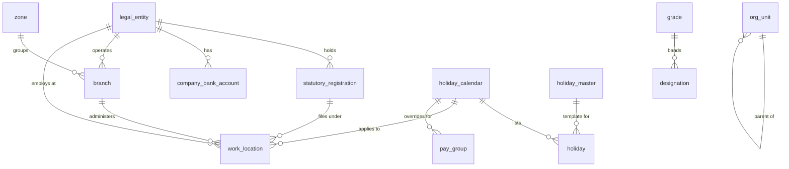

# Schema: organization (Phase 2)

Owner: the `organization` module. Migration namespace `V4_n`. Requirements: [BACKEND_REQUIREMENTS.md](../BACKEND_REQUIREMENTS.md) §4.3; [INDUSTRY_PROFILES_AND_STRUCTURE.md](../INDUSTRY_PROFILES_AND_STRUCTURE.md) §3.1, §3.2, §3.4, §6.

## 1. Purpose

The tenant's own structure: legal entities and their statutory registrations and bank accounts, zones and branches, the org-unit tree, designations and grades, cost centres, pay groups, holiday calendars, and the **work location**, which anchors every location-dependent rule (state, PT and LWF jurisdiction, minimum-wage zone, ESIC sub-code, holidays, geofence).

Industry variation is absent from this schema by design: a client site is a `work_location` of type `CLIENT_SITE` whose `client_site_id` points at the customer module; posts, equipment and other sub-units live there as `site_sub_unit` (Phase 3). Labels come from terminology, never from columns.

## 2. ERD



## 3. Tables

### 3.1 `legal_entity`

```sql
CREATE SCHEMA organization AUTHORIZATION migrate;

CREATE TABLE organization.legal_entity (
  id                    UUID PRIMARY KEY,
  tenant_id             UUID NOT NULL,
  code                  VARCHAR(20) NOT NULL,
  name                  VARCHAR(150) NOT NULL,              -- as on the PAN card
  name_i18n             JSONB NOT NULL DEFAULT '{}',
  short_name            VARCHAR(40) NULL,
  entity_type           VARCHAR(24) NOT NULL CHECK (entity_type IN (
                          'PRIVATE_LIMITED','PUBLIC_LIMITED','LLP','PARTNERSHIP','PROPRIETORSHIP','OPC','TRUST','SOCIETY','OTHER')),
  cin                   VARCHAR(21) NULL,
  pan                   CHAR(10) NOT NULL,                  -- corporate identifier, stored in clear
  tan                   CHAR(10) NULL,
  pf_establishment_code VARCHAR(22) NULL,                   -- e.g. TNMAS0012345000
  esic_employer_code    VARCHAR(17) NULL,
  psara_licence_no      VARCHAR(40) NULL,
  psara_valid_to        DATE NULL,
  psara_states          JSONB NOT NULL DEFAULT '[]',        -- state codes the licence covers
  registered_address    JSONB NOT NULL,                     -- {line1,line2,city,district,state_code,pin,country}
  incorporation_date    DATE NULL,
  default_bank_account_id UUID NULL,                        -- set after the account exists
  status                VARCHAR(12) NOT NULL DEFAULT 'ACTIVE' CHECK (status IN ('ACTIVE','INACTIVE')),
  version               BIGINT NOT NULL DEFAULT 0,
  created_at            TIMESTAMPTZ NOT NULL, created_by UUID NOT NULL,
  updated_at            TIMESTAMPTZ NOT NULL, updated_by UUID NOT NULL,
  deleted_at            TIMESTAMPTZ NULL,
  CONSTRAINT uq_legal_entity_code UNIQUE (tenant_id, code),
  CONSTRAINT uq_legal_entity_pan UNIQUE (tenant_id, pan),
  CONSTRAINT ck_legal_entity_pan CHECK (pan ~ '^[A-Z]{5}[0-9]{4}[A-Z]$')
);
SELECT platform.enable_tenant_rls('organization.legal_entity');
```

### 3.2 `statutory_registration`

One table for every registration a legal entity holds, typed, and state-level where the law is: GST, PT and LWF rows carry the `state_code` they are issued in, and a legal entity holds at most one active PT employer, PT enrolment and LWF registration per state. Shops and Establishments registrations are per establishment, so one state may hold several, each linked from its work location. ESIC sub-codes are per location and also linked from the work location. Central registrations (CLRA principal, factory licence) leave `state_code` null.

```sql
CREATE TABLE organization.statutory_registration (
  id                  UUID PRIMARY KEY,
  tenant_id           UUID NOT NULL,
  legal_entity_id     UUID NOT NULL REFERENCES organization.legal_entity (id),
  registration_type   VARCHAR(16) NOT NULL CHECK (registration_type IN (
                        'GST','ESIC_SUB_CODE','PT_EMPLOYER','PT_ENROLMENT','LWF','SHOPS_ESTABLISHMENT','CLRA_PRINCIPAL','FACTORY','OTHER')),
  state_code          CHAR(2) NULL,                         -- ISO 3166-2:IN, e.g. TN, TG, MH; null for central
  registration_no     VARCHAR(40) NOT NULL,
  registered_name     VARCHAR(150) NULL,
  address             JSONB NULL,
  valid_from          DATE NULL,
  valid_to            DATE NULL,
  attributes          JSONB NOT NULL DEFAULT '{}',          -- GST: {einvoiceEnabled, lutNo, lutValidTo, filingFrequency}; PT: {frequency}; S&E: {establishmentType, maxEmployees}
  status              VARCHAR(12) NOT NULL DEFAULT 'ACTIVE' CHECK (status IN ('ACTIVE','INACTIVE','EXPIRED')),
  version             BIGINT NOT NULL DEFAULT 0,
  created_at          TIMESTAMPTZ NOT NULL, created_by UUID NOT NULL,
  updated_at          TIMESTAMPTZ NOT NULL, updated_by UUID NOT NULL,
  deleted_at          TIMESTAMPTZ NULL,
  CONSTRAINT uq_statutory_registration UNIQUE (tenant_id, legal_entity_id, registration_type, registration_no),
  CONSTRAINT ck_statutory_registration_state CHECK (
    registration_type NOT IN ('GST','PT_EMPLOYER','PT_ENROLMENT','LWF','SHOPS_ESTABLISHMENT') OR state_code IS NOT NULL)
);
CREATE INDEX ix_statutory_registration_entity_type ON organization.statutory_registration (tenant_id, legal_entity_id, registration_type, state_code);
CREATE UNIQUE INDEX uq_statutory_registration_one_per_state ON organization.statutory_registration (tenant_id, legal_entity_id, registration_type, state_code)
  WHERE registration_type IN ('PT_EMPLOYER','PT_ENROLMENT','LWF') AND status = 'ACTIVE' AND deleted_at IS NULL;
SELECT platform.enable_tenant_rls('organization.statutory_registration');
```

### 3.3 `company_bank_account`

```sql
CREATE TABLE organization.company_bank_account (
  id                  UUID PRIMARY KEY,
  tenant_id           UUID NOT NULL,
  legal_entity_id     UUID NOT NULL REFERENCES organization.legal_entity (id),
  label               VARCHAR(60) NOT NULL,                 -- "HDFC salary account"
  bank_name           VARCHAR(100) NOT NULL,
  branch_name         VARCHAR(100) NULL,
  ifsc                CHAR(11) NOT NULL,
  account_no_enc      BYTEA NOT NULL, account_no_masked VARCHAR(24) NOT NULL, account_no_hash BYTEA NOT NULL,
  account_type        VARCHAR(12) NOT NULL DEFAULT 'CURRENT' CHECK (account_type IN ('CURRENT','SAVINGS','CC','OD')),
  purpose             JSONB NOT NULL DEFAULT '["SALARY"]',  -- SALARY, STATUTORY, COLLECTIONS
  bank_file_format    VARCHAR(30) NULL,                     -- strategy key for the salary file (payroll)
  status              VARCHAR(12) NOT NULL DEFAULT 'ACTIVE' CHECK (status IN ('ACTIVE','INACTIVE')),
  version             BIGINT NOT NULL DEFAULT 0,
  created_at          TIMESTAMPTZ NOT NULL, created_by UUID NOT NULL,
  updated_at          TIMESTAMPTZ NOT NULL, updated_by UUID NOT NULL,
  deleted_at          TIMESTAMPTZ NULL,
  CONSTRAINT uq_company_bank_account UNIQUE (tenant_id, account_no_hash),
  CONSTRAINT ck_company_bank_ifsc CHECK (ifsc ~ '^[A-Z]{4}0[A-Z0-9]{6}$')
);
SELECT platform.enable_tenant_rls('organization.company_bank_account');
```

### 3.4 `zone` and `branch`

Branches are the tenant's operating offices. The staffing profile labels them "Branch", the corporate profile hides zones and may call branches "Offices"; the table is the same.

```sql
CREATE TABLE organization.zone (
  id            UUID PRIMARY KEY,
  tenant_id     UUID NOT NULL,
  code          VARCHAR(20) NOT NULL,
  name          VARCHAR(100) NOT NULL,
  name_i18n     JSONB NOT NULL DEFAULT '{}',
  head_user_id  UUID NULL,
  status        VARCHAR(12) NOT NULL DEFAULT 'ACTIVE' CHECK (status IN ('ACTIVE','INACTIVE')),
  version       BIGINT NOT NULL DEFAULT 0,
  created_at    TIMESTAMPTZ NOT NULL, created_by UUID NOT NULL,
  updated_at    TIMESTAMPTZ NOT NULL, updated_by UUID NOT NULL,
  deleted_at    TIMESTAMPTZ NULL,
  CONSTRAINT uq_zone_code UNIQUE (tenant_id, code)
);
SELECT platform.enable_tenant_rls('organization.zone');

CREATE TABLE organization.branch (
  id                  UUID PRIMARY KEY,
  tenant_id           UUID NOT NULL,
  legal_entity_id     UUID NOT NULL REFERENCES organization.legal_entity (id),
  zone_id             UUID NULL REFERENCES organization.zone (id),
  code                VARCHAR(20) NOT NULL,
  name                VARCHAR(100) NOT NULL,
  name_i18n           JSONB NOT NULL DEFAULT '{}',
  address             JSONB NOT NULL,
  state_code          CHAR(2) NOT NULL,
  gst_registration_id UUID NULL REFERENCES organization.statutory_registration (id),
  phone_masked        VARCHAR(20) NULL, phone_enc BYTEA NULL,
  email               VARCHAR(120) NULL,                    -- office mailbox, not personal
  head_user_id        UUID NULL,
  status              VARCHAR(12) NOT NULL DEFAULT 'ACTIVE' CHECK (status IN ('ACTIVE','INACTIVE')),
  version             BIGINT NOT NULL DEFAULT 0,
  created_at          TIMESTAMPTZ NOT NULL, created_by UUID NOT NULL,
  updated_at          TIMESTAMPTZ NOT NULL, updated_by UUID NOT NULL,
  deleted_at          TIMESTAMPTZ NULL,
  CONSTRAINT uq_branch_code UNIQUE (tenant_id, code)
);
CREATE INDEX ix_branch_tenant_entity ON organization.branch (tenant_id, legal_entity_id, status);
SELECT platform.enable_tenant_rls('organization.branch');
```

### 3.5 `org_unit`

Departments, divisions and teams as one adjacency-list tree with a materialised `ltree` path. Depth is configurable per profile; the path makes "everything under Finance" one index scan.

```sql
CREATE TABLE organization.org_unit (
  id            UUID PRIMARY KEY,
  tenant_id     UUID NOT NULL,
  parent_id     UUID NULL REFERENCES organization.org_unit (id),
  unit_type     VARCHAR(16) NOT NULL CHECK (unit_type IN ('DIVISION','DEPARTMENT','TEAM','OTHER')),
  code          VARCHAR(20) NOT NULL,
  name          VARCHAR(100) NOT NULL,
  name_i18n     JSONB NOT NULL DEFAULT '{}',
  path          LTREE NOT NULL,                             -- codes from the root, e.g. ops.south.chn
  depth         SMALLINT NOT NULL,
  head_employee_id UUID NULL,                               -- workforce.employee
  cost_centre_id UUID NULL,
  status        VARCHAR(12) NOT NULL DEFAULT 'ACTIVE' CHECK (status IN ('ACTIVE','INACTIVE')),
  version       BIGINT NOT NULL DEFAULT 0,
  created_at    TIMESTAMPTZ NOT NULL, created_by UUID NOT NULL,
  updated_at    TIMESTAMPTZ NOT NULL, updated_by UUID NOT NULL,
  deleted_at    TIMESTAMPTZ NULL,
  CONSTRAINT uq_org_unit_code UNIQUE (tenant_id, code),
  CONSTRAINT ck_org_unit_depth CHECK (depth BETWEEN 1 AND 6)
);
CREATE INDEX ix_org_unit_path ON organization.org_unit USING gist (tenant_id, path);
CREATE INDEX ix_org_unit_parent ON organization.org_unit (tenant_id, parent_id);
SELECT platform.enable_tenant_rls('organization.org_unit');
```

### 3.6 `cost_centre`, `grade`, `designation`

```sql
CREATE TABLE organization.cost_centre (
  id              UUID PRIMARY KEY,
  tenant_id       UUID NOT NULL,
  legal_entity_id UUID NULL REFERENCES organization.legal_entity (id),
  code            VARCHAR(20) NOT NULL,
  name            VARCHAR(100) NOT NULL,
  name_i18n       JSONB NOT NULL DEFAULT '{}',
  status          VARCHAR(12) NOT NULL DEFAULT 'ACTIVE' CHECK (status IN ('ACTIVE','INACTIVE')),
  version         BIGINT NOT NULL DEFAULT 0,
  created_at      TIMESTAMPTZ NOT NULL, created_by UUID NOT NULL,
  updated_at      TIMESTAMPTZ NOT NULL, updated_by UUID NOT NULL,
  deleted_at      TIMESTAMPTZ NULL,
  CONSTRAINT uq_cost_centre_code UNIQUE (tenant_id, code)
);
SELECT platform.enable_tenant_rls('organization.cost_centre');

CREATE TABLE organization.grade (
  id            UUID PRIMARY KEY,
  tenant_id     UUID NOT NULL,
  code          VARCHAR(20) NOT NULL,
  name          VARCHAR(100) NOT NULL,
  name_i18n     JSONB NOT NULL DEFAULT '{}',
  rank          SMALLINT NOT NULL DEFAULT 0,                -- for ordering and approval thresholds
  status        VARCHAR(12) NOT NULL DEFAULT 'ACTIVE' CHECK (status IN ('ACTIVE','INACTIVE')),
  version       BIGINT NOT NULL DEFAULT 0,
  created_at    TIMESTAMPTZ NOT NULL, created_by UUID NOT NULL,
  updated_at    TIMESTAMPTZ NOT NULL, updated_by UUID NOT NULL,
  deleted_at    TIMESTAMPTZ NULL,
  CONSTRAINT uq_grade_code UNIQUE (tenant_id, code)
);
SELECT platform.enable_tenant_rls('organization.grade');

CREATE TABLE organization.designation (
  id              UUID PRIMARY KEY,
  tenant_id       UUID NOT NULL,
  code            VARCHAR(20) NOT NULL,                     -- short code: SG, HK, SWP, SE
  name            VARCHAR(100) NOT NULL,
  name_i18n       JSONB NOT NULL DEFAULT '{}',
  grade_id        UUID NULL REFERENCES organization.grade (id),
  skill_category  VARCHAR(16) NOT NULL DEFAULT 'SKILLED' CHECK (skill_category IN ('UNSKILLED','SEMI_SKILLED','SKILLED','HIGHLY_SKILLED','SUPERVISORY','CLERICAL')),
  scheduled_employment VARCHAR(60) NULL,                    -- minimum-wage schedule key, e.g. SECURITY_SERVICES
  is_supervisory  BOOLEAN NOT NULL DEFAULT FALSE,
  status          VARCHAR(12) NOT NULL DEFAULT 'ACTIVE' CHECK (status IN ('ACTIVE','INACTIVE')),
  version         BIGINT NOT NULL DEFAULT 0,
  created_at      TIMESTAMPTZ NOT NULL, created_by UUID NOT NULL,
  updated_at      TIMESTAMPTZ NOT NULL, updated_by UUID NOT NULL,
  deleted_at      TIMESTAMPTZ NULL,
  CONSTRAINT uq_designation_code UNIQUE (tenant_id, code)
);
CREATE INDEX ix_designation_tenant_status ON organization.designation (tenant_id, status);
SELECT platform.enable_tenant_rls('organization.designation');
```

`skill_category` and `scheduled_employment` are what the compliance module needs to pick the minimum-wage rate for a designation at a location (§6.1 of the industry profiles document).

### 3.7 `pay_group`

Who is paid together and how often. Pay frequency lives here, not on the employee; an employee's `pay_frequency_override` exists for the rare contractor paid weekly inside a monthly group.

```sql
CREATE TABLE organization.pay_group (
  id                  UUID PRIMARY KEY,
  tenant_id           UUID NOT NULL,
  legal_entity_id     UUID NOT NULL REFERENCES organization.legal_entity (id),
  code                VARCHAR(20) NOT NULL,
  name                VARCHAR(100) NOT NULL,
  name_i18n           JSONB NOT NULL DEFAULT '{}',
  pay_frequency       VARCHAR(12) NOT NULL DEFAULT 'MONTHLY' CHECK (pay_frequency IN ('MONTHLY','WEEKLY','BIWEEKLY')),
  period_rule         JSONB NOT NULL DEFAULT '{"attendanceCutoffDay":null,"payDay":7,"payDayBasis":"NEXT_MONTH"}',
  holiday_calendar_id UUID NULL,                            -- override of the work-location calendar
  bank_account_id     UUID NULL REFERENCES organization.company_bank_account (id),
  status              VARCHAR(12) NOT NULL DEFAULT 'ACTIVE' CHECK (status IN ('ACTIVE','INACTIVE')),
  version             BIGINT NOT NULL DEFAULT 0,
  created_at          TIMESTAMPTZ NOT NULL, created_by UUID NOT NULL,
  updated_at          TIMESTAMPTZ NOT NULL, updated_by UUID NOT NULL,
  deleted_at          TIMESTAMPTZ NULL,
  CONSTRAINT uq_pay_group_code UNIQUE (tenant_id, code)
);
SELECT platform.enable_tenant_rls('organization.pay_group');
```

### 3.8 `holiday_master` (platform-owned), `holiday_calendar`, `holiday`

The platform publishes national and state lists per year; a tenant builds a calendar per year from the template for a state and adds local holidays. Publishing validates the count against the state's National and Festival Holidays rule (compliance module). A work location points at one calendar; a client site may follow the client's calendar instead (set on the customer module's `client_site` in Phase 3, resolved by `HolidayService`).

```sql
CREATE TABLE organization.holiday_master (
  id            UUID PRIMARY KEY,
  year          SMALLINT NOT NULL,
  scope         VARCHAR(10) NOT NULL CHECK (scope IN ('NATIONAL','STATE')),
  state_code    CHAR(2) NULL,
  holiday_date  DATE NOT NULL,
  name          VARCHAR(100) NOT NULL,
  name_i18n     JSONB NOT NULL DEFAULT '{}',
  holiday_type  VARCHAR(12) NOT NULL CHECK (holiday_type IN ('NATIONAL','STATE','RESTRICTED')),
  source_reference VARCHAR(255) NULL,                       -- gazette notification
  status        VARCHAR(12) NOT NULL DEFAULT 'PUBLISHED' CHECK (status IN ('DRAFT','PUBLISHED','WITHDRAWN')),
  created_at    TIMESTAMPTZ NOT NULL, created_by UUID NOT NULL,
  updated_at    TIMESTAMPTZ NOT NULL, updated_by UUID NOT NULL,
  CONSTRAINT uq_holiday_master UNIQUE NULLS NOT DISTINCT (year, scope, state_code, holiday_date, name),
  CONSTRAINT ck_holiday_master_state CHECK (scope = 'NATIONAL' OR state_code IS NOT NULL)
);

CREATE TABLE organization.holiday_calendar (
  id            UUID PRIMARY KEY,
  tenant_id     UUID NOT NULL,
  code          VARCHAR(20) NOT NULL,
  name          VARCHAR(100) NOT NULL,
  name_i18n     JSONB NOT NULL DEFAULT '{}',
  year          SMALLINT NOT NULL,
  state_code    CHAR(2) NOT NULL,
  restricted_quota SMALLINT NOT NULL DEFAULT 0,             -- optional holidays an employee may pick
  status        VARCHAR(12) NOT NULL DEFAULT 'DRAFT' CHECK (status IN ('DRAFT','PUBLISHED','ARCHIVED')),
  published_at  TIMESTAMPTZ NULL,
  version       BIGINT NOT NULL DEFAULT 0,
  created_at    TIMESTAMPTZ NOT NULL, created_by UUID NOT NULL,
  updated_at    TIMESTAMPTZ NOT NULL, updated_by UUID NOT NULL,
  deleted_at    TIMESTAMPTZ NULL,
  CONSTRAINT uq_holiday_calendar UNIQUE (tenant_id, code, year)
);
SELECT platform.enable_tenant_rls('organization.holiday_calendar');

CREATE TABLE organization.holiday (
  id              UUID PRIMARY KEY,
  tenant_id       UUID NOT NULL,
  calendar_id     UUID NOT NULL REFERENCES organization.holiday_calendar (id) ON DELETE CASCADE,
  holiday_date    DATE NOT NULL,
  name            VARCHAR(100) NOT NULL,
  name_i18n       JSONB NOT NULL DEFAULT '{}',
  holiday_type    VARCHAR(12) NOT NULL CHECK (holiday_type IN ('NATIONAL','STATE','LOCAL','RESTRICTED')),
  master_id       UUID NULL REFERENCES organization.holiday_master (id),
  paid            BOOLEAN NOT NULL DEFAULT TRUE,
  created_at      TIMESTAMPTZ NOT NULL, created_by UUID NOT NULL,
  updated_at      TIMESTAMPTZ NOT NULL, updated_by UUID NOT NULL,
  CONSTRAINT uq_holiday UNIQUE (tenant_id, calendar_id, holiday_date, name)
);
CREATE INDEX ix_holiday_calendar_date ON organization.holiday (tenant_id, calendar_id, holiday_date);
SELECT platform.enable_tenant_rls('organization.holiday');
```

A published calendar is immutable; corrections create a new version (new row with the same `code` and `year` is prevented by the unique constraint, so the flow is unpublish to `DRAFT` only while no attendance sheet of that year is approved, otherwise a `LOCAL` addition through a dated amendment recorded in audit). The compliance check at publish time reads the state's minimum from the rule pack.

### 3.9 `work_location`

The anchor. Every employee has exactly one primary work location per date (see `workforce.employee_work_location_assignment`).

```sql
CREATE TABLE organization.work_location (
  id                        UUID PRIMARY KEY,
  tenant_id                 UUID NOT NULL,
  code                      VARCHAR(20) NOT NULL,
  name                      VARCHAR(120) NOT NULL,
  name_i18n                 JSONB NOT NULL DEFAULT '{}',
  location_type             VARCHAR(16) NOT NULL CHECK (location_type IN ('OWN_OFFICE','CLIENT_SITE','PROJECT_SITE','WAREHOUSE','REMOTE')),
  legal_entity_id           UUID NOT NULL REFERENCES organization.legal_entity (id),
  branch_id                 UUID NULL REFERENCES organization.branch (id),
  client_site_id            UUID NULL,                      -- customer_contract.client_site (Phase 3); set when location_type = CLIENT_SITE
  address                   JSONB NOT NULL,                 -- {line1,line2,landmark,city,district,state_code,pin}
  state_code                CHAR(2) NOT NULL,
  district                  VARCHAR(60) NULL,
  pin                       CHAR(6) NULL,
  geo_lat                   NUMERIC(9,6) NULL,
  geo_lng                   NUMERIC(9,6) NULL,
  geofence_radius_m         INTEGER NULL CHECK (geofence_radius_m IS NULL OR geofence_radius_m BETWEEN 20 AND 5000),
  timezone                  VARCHAR(40) NOT NULL DEFAULT 'Asia/Kolkata',
  holiday_calendar_id       UUID NULL REFERENCES organization.holiday_calendar (id),
  pt_state_code             CHAR(2) NULL,                   -- defaults to state_code when null
  lwf_state_code            CHAR(2) NULL,                   -- defaults to state_code when null
  min_wage_zone             VARCHAR(20) NULL,               -- state's zone / area class key
  esic_sub_code_registration_id UUID NULL REFERENCES organization.statutory_registration (id),
  pt_registration_id        UUID NULL REFERENCES organization.statutory_registration (id),
  lwf_registration_id       UUID NULL REFERENCES organization.statutory_registration (id),
  se_registration_id        UUID NULL REFERENCES organization.statutory_registration (id),
  establishment_type        VARCHAR(16) NULL CHECK (establishment_type IS NULL OR establishment_type IN ('SHOP','COMMERCIAL','FACTORY','CLIENT_PREMISES','OTHER')),
  attendance_settings       JSONB NOT NULL DEFAULT '{}',    -- punch windows, face/QR on/off overrides (channel settings)
  status                    VARCHAR(12) NOT NULL DEFAULT 'ACTIVE' CHECK (status IN ('ACTIVE','INACTIVE')),
  version                   BIGINT NOT NULL DEFAULT 0,
  created_at                TIMESTAMPTZ NOT NULL, created_by UUID NOT NULL,
  updated_at                TIMESTAMPTZ NOT NULL, updated_by UUID NOT NULL,
  deleted_at                TIMESTAMPTZ NULL,
  CONSTRAINT uq_work_location_code UNIQUE (tenant_id, code),
  CONSTRAINT uq_work_location_client_site UNIQUE (tenant_id, client_site_id),
  CONSTRAINT ck_work_location_client_site CHECK ((location_type = 'CLIENT_SITE') = (client_site_id IS NOT NULL)),
  CONSTRAINT ck_work_location_geo CHECK ((geo_lat IS NULL) = (geo_lng IS NULL))
);
CREATE INDEX ix_work_location_tenant_type_status ON organization.work_location (tenant_id, location_type, status);
CREATE INDEX ix_work_location_tenant_state ON organization.work_location (tenant_id, state_code);
CREATE INDEX ix_work_location_tenant_branch ON organization.work_location (tenant_id, branch_id);
SELECT platform.enable_tenant_rls('organization.work_location');
```

Jurisdiction attributes are read through one published query, `LocationRules.resolve(workLocationId, date)`, which returns the state, PT and LWF jurisdictions, zone, registrations and calendar, so attendance, payroll and compliance never re-derive them. The `REMOTE` type is one location per state for work-from-home employees.

## 4. Events

| Event | When |
|---|---|
| `LegalEntityCreated`, `LegalEntityChanged` | Identity-bearing fields change (PAN, codes, registrations) |
| `WorkLocationCreated`, `WorkLocationChanged` | Any jurisdiction attribute or calendar assignment changes; carries the changed attribute keys so payroll can flag affected open periods |
| `HolidayCalendarPublished`, `HolidayCalendarChanged` | Publish or amendment |
| `DesignationChanged`, `PayGroupChanged` | Rate-affecting fields change |

## 5. Lock-after-use

Legal entity, branch, work location, designation, pay group and holiday calendar are referenced by workforce, attendance, payroll and billing rows. Deactivation is always allowed; deletion and edits of `code`, `state_code`, `legal_entity_id` and `pay_frequency` are refused once any reference exists (checked through the referencing modules' `api`). Changing a work location's state is never an edit: it is a new location plus a dated assignment change for its employees.

## 6. Open items

- Whether `branch.state_code` should be derived from `address` only (proposed: stored explicitly and validated against the address, since it drives GST registration choice).
- Minimum-wage zone keys per state (`min_wage_zone`) come from the compliance rule pack; the allowed values are validated there, not by a constraint here.
