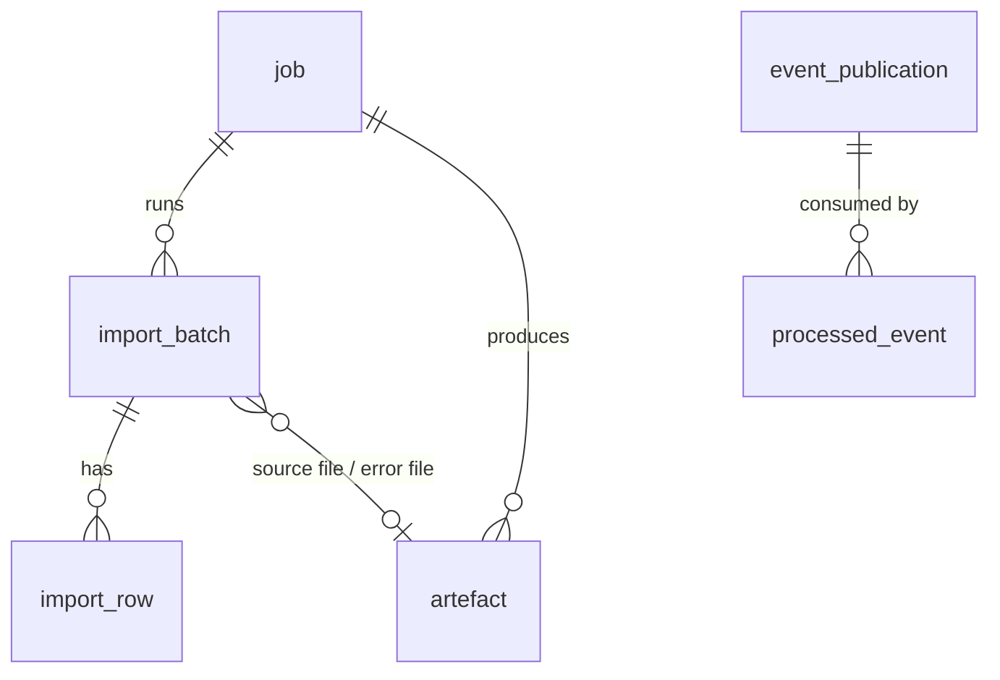

# Schema: platform (Phase 0)

Owner: the platform libraries `common-core`, `common-events`, `common-import` and the job support in `common-web`. Migration namespace `V0_n`. These tables carry no business meaning; modules use them through the library APIs, never directly.

## 1. Purpose

- Roles, the RLS helper functions and the shared `platform.current_tenant()` used by every other schema.
- Spring Modulith's event publication registry (the transactional outbox) and the listener idempotency table.
- The shared `job` resource that every `202 Accepted` response points at, with Spring Batch's own tables in schema `batch`.
- The import framework's batches and rows.
- The artefact registry for every file the backend produces or accepts.

## 2. ERD



## 3. Tables

### 3.1 Roles and helpers (run first, once)

```sql
CREATE ROLE app NOLOGIN NOBYPASSRLS;
CREATE ROLE migrate NOLOGIN BYPASSRLS;
CREATE ROLE readonly NOLOGIN NOBYPASSRLS;

CREATE EXTENSION IF NOT EXISTS btree_gist;
CREATE EXTENSION IF NOT EXISTS pg_trgm;
CREATE EXTENSION IF NOT EXISTS ltree;

CREATE SCHEMA platform AUTHORIZATION migrate;
CREATE SCHEMA batch AUTHORIZATION migrate;

-- Tenant of the current transaction, or NULL when none was set (fail closed).
CREATE FUNCTION platform.current_tenant() RETURNS uuid
  LANGUAGE sql STABLE PARALLEL SAFE AS
$$ SELECT NULLIF(current_setting('app.tenant_id', true), '')::uuid $$;

-- Applies the standard isolation policy to a tenant-owned table.
CREATE FUNCTION platform.enable_tenant_rls(tbl regclass) RETURNS void
  LANGUAGE plpgsql AS $$
BEGIN
  EXECUTE format('ALTER TABLE %s ENABLE ROW LEVEL SECURITY', tbl);
  EXECUTE format('ALTER TABLE %s FORCE ROW LEVEL SECURITY', tbl);
  EXECUTE format(
    'CREATE POLICY tenant_isolation ON %s
       USING (tenant_id = platform.current_tenant())
       WITH CHECK (tenant_id = platform.current_tenant())', tbl);
END $$;

-- Fixed actor id for writes made by jobs and event listeners.
CREATE FUNCTION platform.system_actor() RETURNS uuid
  LANGUAGE sql IMMUTABLE PARALLEL SAFE AS
$$ SELECT '00000000-0000-0000-0000-000000000001'::uuid $$;
```

Grants: `app` gets `USAGE` on every schema and `SELECT, INSERT, UPDATE` on every table, `DELETE` only where the module document says so (never on `audit.audit_event`). The grant statements live in each module's migration next to its tables.

### 3.2 `event_publication` and `processed_event`

Spring Modulith's JDBC registry owns `event_publication`; its column set is the library's (`id`, `listener_id`, `event_type`, `serialized_event`, `publication_date`, `completion_date`). Configure `spring.modulith.events.jdbc.schema=platform` and let the library create it, with `completion-mode=archive` so completed publications move to `event_publication_archive` and are purged after 30 days by a `backend-batch` job. It has no `tenant_id`: the event payload carries `tenantId`, and the registry is infrastructure used by the system actor.

```sql
CREATE TABLE platform.processed_event (
  listener_id     VARCHAR(200) NOT NULL,
  publication_id  UUID NOT NULL,
  processed_at    TIMESTAMPTZ NOT NULL,
  PRIMARY KEY (listener_id, publication_id)
);
```

A listener inserts its row in the same transaction as its side effects; a duplicate key means the publication was already handled and the listener returns without work. Rows older than 90 days are purged.

### 3.3 `job`

Every long-running request creates one row and returns its id. Spring Batch executions, when used, link back through `batch_job_execution_id`.

```sql
CREATE TABLE platform.job (
  id                      UUID PRIMARY KEY,
  tenant_id               UUID NOT NULL,
  job_type                VARCHAR(60) NOT NULL,          -- IMPORT_EMPLOYEES, PAYROLL_RUN, EXPORT, STATUTORY_FILE, ...
  status                  VARCHAR(20) NOT NULL DEFAULT 'QUEUED'
                          CHECK (status IN ('QUEUED','RUNNING','SUCCEEDED','FAILED','CANCELLED')),
  requested_by            UUID NOT NULL,
  channel                 VARCHAR(20) NOT NULL,          -- WEB, MOBILE, KIOSK, DEVICE, PARTNER, SYSTEM
  idempotency_key         VARCHAR(128) NULL,
  legal_entity_id         UUID NULL,                     -- data-scope columns so "my jobs" lists filter correctly
  branch_id               UUID NULL,
  client_id               UUID NULL,
  params                  JSONB NOT NULL DEFAULT '{}',
  progress_pct            SMALLINT NOT NULL DEFAULT 0 CHECK (progress_pct BETWEEN 0 AND 100),
  progress_message_key    VARCHAR(120) NULL,
  progress_params         JSONB NOT NULL DEFAULT '{}',
  result                  JSONB NOT NULL DEFAULT '{}',   -- artefact ids, counts, links
  error_code              VARCHAR(80) NULL,
  error_params            JSONB NULL,
  batch_job_execution_id  BIGINT NULL,
  queued_at               TIMESTAMPTZ NOT NULL,
  started_at              TIMESTAMPTZ NULL,
  finished_at             TIMESTAMPTZ NULL,
  version                 BIGINT NOT NULL DEFAULT 0,
  created_at              TIMESTAMPTZ NOT NULL, created_by UUID NOT NULL,
  updated_at              TIMESTAMPTZ NOT NULL, updated_by UUID NOT NULL,
  CONSTRAINT uq_job_idempotency UNIQUE (tenant_id, idempotency_key)
);
CREATE INDEX ix_job_tenant_status_queued ON platform.job (tenant_id, status, queued_at DESC);
CREATE INDEX ix_job_tenant_requested_by ON platform.job (tenant_id, requested_by, queued_at DESC);
CREATE INDEX ix_job_status_queued ON platform.job (status, queued_at) WHERE status IN ('QUEUED','RUNNING');
SELECT platform.enable_tenant_rls('platform.job');
```

The `backend-batch` poller selects `QUEUED` jobs with `FOR UPDATE SKIP LOCKED` across tenants as the `migrate`-privileged scheduler role, then sets `app.tenant_id` to the job's tenant before running it. Per-tenant fairness (one running payroll job per tenant) is enforced by the poller, not by the table.

### 3.4 `import_batch` and `import_row`

```sql
CREATE TABLE platform.import_batch (
  id                    UUID PRIMARY KEY,
  tenant_id             UUID NOT NULL,
  job_id                UUID NULL REFERENCES platform.job (id),
  entity_type           VARCHAR(60) NOT NULL,            -- EMPLOYEE, WORK_LOCATION, ATTENDANCE_DAYWISE, ...
  mode                  VARCHAR(10) NOT NULL CHECK (mode IN ('CREATE','UPDATE')),
  template_version      VARCHAR(20) NOT NULL,
  status                VARCHAR(20) NOT NULL DEFAULT 'UPLOADED'
                        CHECK (status IN ('UPLOADED','VALIDATING','VALIDATED','HAS_ERRORS',
                                          'COMMITTING','COMMITTED','FAILED','DISCARDED')),
  source_artefact_id    UUID NOT NULL,                   -- the uploaded file
  error_artefact_id     UUID NULL,                       -- the error file, when produced
  file_name             VARCHAR(255) NOT NULL,
  file_sha256           BYTEA NOT NULL,
  uploaded_by           UUID NOT NULL,
  locale                VARCHAR(16) NOT NULL,            -- headers and error messages in this locale
  legal_entity_id       UUID NULL,
  branch_id             UUID NULL,
  total_rows            INTEGER NOT NULL DEFAULT 0,
  valid_rows            INTEGER NOT NULL DEFAULT 0,
  error_rows            INTEGER NOT NULL DEFAULT 0,
  created_count         INTEGER NOT NULL DEFAULT 0,
  updated_count         INTEGER NOT NULL DEFAULT 0,
  committed_at          TIMESTAMPTZ NULL,
  version               BIGINT NOT NULL DEFAULT 0,
  created_at            TIMESTAMPTZ NOT NULL, created_by UUID NOT NULL,
  updated_at            TIMESTAMPTZ NOT NULL, updated_by UUID NOT NULL
);
CREATE INDEX ix_import_batch_tenant_entity ON platform.import_batch (tenant_id, entity_type, created_at DESC);
SELECT platform.enable_tenant_rls('platform.import_batch');

CREATE TABLE platform.import_row (
  tenant_id         UUID NOT NULL,
  batch_id          UUID NOT NULL REFERENCES platform.import_batch (id) ON DELETE CASCADE,
  row_no            INTEGER NOT NULL,                    -- 1-based sheet row, as the user sees it
  raw               JSONB NOT NULL,                      -- cell values by canonical key, as uploaded
  normalised        JSONB NULL,                          -- parsed, trimmed, typed; null until validated
  status            VARCHAR(12) NOT NULL DEFAULT 'PENDING'
                    CHECK (status IN ('PENDING','VALID','ERROR','COMMITTED','SKIPPED')),
  errors            JSONB NOT NULL DEFAULT '[]',         -- [{"column":"pan","code":"validation.pan.format","params":{}}]
  suggestion        JSONB NULL,                          -- "use suggestion" fix the UI can apply
  target_entity_id  UUID NULL,                           -- the created or updated row after commit
  PRIMARY KEY (batch_id, row_no)
);
CREATE INDEX ix_import_row_batch_status ON platform.import_row (batch_id, status);
SELECT platform.enable_tenant_rls('platform.import_row');
```

Rows are kept 30 days after the batch reaches a terminal status, then deleted by a batch job; the batch header stays for audit. The commit is idempotent on `(batch_id, row_no)`: a re-run skips rows already `COMMITTED`.

### 3.5 `artefact`

```sql
CREATE TABLE platform.artefact (
  id                UUID PRIMARY KEY,
  tenant_id         UUID NOT NULL,
  kind              VARCHAR(40) NOT NULL,                -- UPLOAD, IMPORT_ERROR_FILE, EXPORT, PDF, STATUTORY_FILE, BANK_FILE, PHOTO
  object_key        VARCHAR(512) NOT NULL,               -- {tenant}/{kind}/{yyyy}/{mm}/{id}.{ext}
  content_type      VARCHAR(120) NOT NULL,
  size_bytes        BIGINT NOT NULL,
  sha256            BYTEA NOT NULL,
  file_name         VARCHAR(255) NOT NULL,
  produced_by_job_id UUID NULL REFERENCES platform.job (id),
  owner_type        VARCHAR(40) NULL,                    -- EMPLOYEE, INVOICE, PAYROLL_RUN, ... (polymorphic, id only)
  owner_id          UUID NULL,
  av_status         VARCHAR(12) NOT NULL DEFAULT 'PENDING' CHECK (av_status IN ('PENDING','CLEAN','INFECTED','SKIPPED')),
  retention_until   DATE NULL,
  version           BIGINT NOT NULL DEFAULT 0,
  created_at        TIMESTAMPTZ NOT NULL, created_by UUID NOT NULL,
  updated_at        TIMESTAMPTZ NOT NULL, updated_by UUID NOT NULL,
  deleted_at        TIMESTAMPTZ NULL,
  CONSTRAINT uq_artefact_object_key UNIQUE (tenant_id, object_key)
);
CREATE INDEX ix_artefact_tenant_owner ON platform.artefact (tenant_id, owner_type, owner_id);
CREATE INDEX ix_artefact_retention ON platform.artefact (retention_until) WHERE deleted_at IS NULL;
SELECT platform.enable_tenant_rls('platform.artefact');
```

Presigned URLs are issued only for artefacts whose `av_status` is `CLEAN` or `SKIPPED` and whose owner the caller may see.

### 3.6 Spring Batch tables

Schema `batch` holds the standard `BATCH_JOB_INSTANCE`, `BATCH_JOB_EXECUTION`, `BATCH_STEP_EXECUTION` and `BATCH_*_SEQ` objects from the Spring Batch distribution for PostgreSQL, unchanged, with `spring.batch.jdbc.table-prefix=batch.BATCH_`. They are not tenant-aware; the link to a tenant is `platform.job.batch_job_execution_id`.

## 4. Events

None published. `event_publication` carries every other module's events.

## 5. Open items

- `event_publication_archive` purge window (30 days proposed) and whether completed publications are needed for the audit trail. Proposed: no, the audit module records the business change; the registry is plumbing.
- Import rows for very large uploads (50k attendance rows) may warrant partitioning by `batch_id` hash. Decide when the attendance import arrives (Phase 4).
