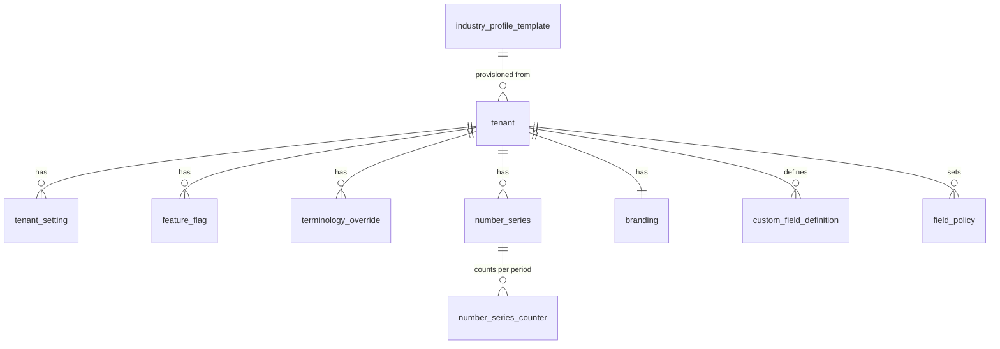

# Schema: tenant (Phases 0 to 1)

Owner: the `tenant` module. Migration namespace `V1_n`. Requirements: [BACKEND_REQUIREMENTS.md](../BACKEND_REQUIREMENTS.md) §4.1 and §5.3, §5.6, §5.7; [INDUSTRY_PROFILES_AND_STRUCTURE.md](../INDUSTRY_PROFILES_AND_STRUCTURE.md) §3.4 and §7; [PROJECT_INITIATION.md](../PROJECT_INITIATION.md) Appendix A.

## 1. Purpose

The tenant directory the tenant filter reads before any tenant context exists, the industry-profile templates a tenant is provisioned from, and everything a tenant configures about itself: typed settings, module flags, terminology, number series, branding, custom fields and field policies.

Two tables are platform-owned (`tenant`, `industry_profile_template`): no `tenant_id`, no RLS, written only by the platform operator API and the provisioning flow. Everything else is tenant-owned.

## 2. ERD



## 3. Tables

### 3.1 `tenant` (platform-owned)

```sql
CREATE SCHEMA tenant AUTHORIZATION migrate;

CREATE TABLE tenant.tenant (
  id                        UUID PRIMARY KEY,
  slug                      VARCHAR(40) NOT NULL,          -- subdomain; lowercase, [a-z0-9-]
  name                      VARCHAR(150) NOT NULL,
  industry_profile_code     VARCHAR(30) NOT NULL,          -- STAFFING, FIELD_SERVICE, CORPORATE
  profile_template_version  INTEGER NOT NULL,              -- the template version last applied
  status                    VARCHAR(20) NOT NULL DEFAULT 'PROVISIONING'
                            CHECK (status IN ('PROVISIONING','ACTIVE','SUSPENDED','DELETING','DELETED')),
  default_locale            VARCHAR(16) NOT NULL DEFAULT 'en-IN',
  enabled_locales           JSONB NOT NULL DEFAULT '["en-IN"]',
  timezone                  VARCHAR(40) NOT NULL DEFAULT 'Asia/Kolkata',
  financial_year_start_month SMALLINT NOT NULL DEFAULT 4 CHECK (financial_year_start_month BETWEEN 1 AND 12),
  plan_code                 VARCHAR(30) NOT NULL DEFAULT 'TRIAL',
  database_route            VARCHAR(40) NOT NULL DEFAULT 'shared',   -- key for the routing DataSource
  data_region               VARCHAR(20) NOT NULL DEFAULT 'in',
  keycloak_org_id           VARCHAR(80) NULL,              -- organisation id in the shared realm
  retention_policy          JSONB NOT NULL DEFAULT '{}',
  suspended_reason          VARCHAR(255) NULL,
  provisioned_at            TIMESTAMPTZ NULL,
  version                   BIGINT NOT NULL DEFAULT 0,
  created_at                TIMESTAMPTZ NOT NULL, created_by UUID NOT NULL,
  updated_at                TIMESTAMPTZ NOT NULL, updated_by UUID NOT NULL,
  deleted_at                TIMESTAMPTZ NULL,
  CONSTRAINT uq_tenant_slug UNIQUE (slug),
  CONSTRAINT ck_tenant_slug CHECK (slug ~ '^[a-z0-9](?:[a-z0-9-]{1,38}[a-z0-9])?$')
);
```

The tenant filter resolves `slug` from the host name, then checks the JWT's organisation claim against `keycloak_org_id`. `database_route` selects the physical database when a tenant moves to a dedicated tier; the row stays in the shared directory.

### 3.2 `industry_profile_template` (platform-owned)

```sql
CREATE TABLE tenant.industry_profile_template (
  id              UUID PRIMARY KEY,
  code            VARCHAR(30) NOT NULL,                     -- STAFFING, FIELD_SERVICE, CORPORATE
  version         INTEGER NOT NULL,
  name            VARCHAR(100) NOT NULL,
  name_i18n       JSONB NOT NULL DEFAULT '{}',
  status          VARCHAR(12) NOT NULL DEFAULT 'DRAFT' CHECK (status IN ('DRAFT','PUBLISHED','RETIRED')),
  payload         JSONB NOT NULL,   -- {modules:[], structureLevels:{}, terminology:{}, defaultMasters:{}, strategies:{}, settings:{}, numberSeries:[]}
  release_notes   TEXT NULL,
  published_at    TIMESTAMPTZ NULL,
  created_at      TIMESTAMPTZ NOT NULL, created_by UUID NOT NULL,
  updated_at      TIMESTAMPTZ NOT NULL, updated_by UUID NOT NULL,
  CONSTRAINT uq_industry_profile_template UNIQUE (code, version)
);
```

Provisioning copies the payload into the tenant's own rows (flags, settings, terminology, number series, default masters in other modules). Re-applying a newer version is a previewed migration that diffs the payload against the tenant's current rows and never overwrites a value the tenant changed.

### 3.3 `tenant_setting`

Typed settings by module (Appendix A of the initiation document). The key catalogue with types and defaults is code (`TenantSettingKey` enum per module); the table stores only values that differ from the default, so a new default reaches every tenant without a data migration.

```sql
CREATE TABLE tenant.tenant_setting (
  id            UUID PRIMARY KEY,
  tenant_id     UUID NOT NULL,
  module_code   VARCHAR(30) NOT NULL,                       -- EMPLOYEE, ATTENDANCE, PAYROLL, INVOICE, I18N, ...
  setting_key   VARCHAR(80) NOT NULL,                       -- doj_backdating_limit_days
  value_type    VARCHAR(12) NOT NULL CHECK (value_type IN ('BOOL','INT','DECIMAL','STRING','ENUM','JSON','DURATION')),
  value         JSONB NOT NULL,                             -- always a JSON scalar or object of value_type
  legal_entity_id UUID NULL,                                -- optional override at legal-entity level
  version       BIGINT NOT NULL DEFAULT 0,
  created_at    TIMESTAMPTZ NOT NULL, created_by UUID NOT NULL,
  updated_at    TIMESTAMPTZ NOT NULL, updated_by UUID NOT NULL,
  CONSTRAINT uq_tenant_setting UNIQUE NULLS NOT DISTINCT (tenant_id, module_code, setting_key, legal_entity_id)
);
SELECT platform.enable_tenant_rls('tenant.tenant_setting');
```

Changes publish `TenantSettingsChanged` with the keys that changed, so modules refresh their caches.

### 3.4 `feature_flag`

Module toggles and sub-features. `module_code` matches the `Module` enum used by `tenantFeatures.isEnabled(...)`.

```sql
CREATE TABLE tenant.feature_flag (
  id            UUID PRIMARY KEY,
  tenant_id     UUID NOT NULL,
  flag_key      VARCHAR(60) NOT NULL,                       -- module:CUSTOMERS, module:BILLING, feature:FACE_PUNCH, ...
  enabled       BOOLEAN NOT NULL DEFAULT FALSE,
  config        JSONB NOT NULL DEFAULT '{}',                -- flag-specific options
  enabled_from  DATE NULL,                                  -- scheduled enablement
  version       BIGINT NOT NULL DEFAULT 0,
  created_at    TIMESTAMPTZ NOT NULL, created_by UUID NOT NULL,
  updated_at    TIMESTAMPTZ NOT NULL, updated_by UUID NOT NULL,
  CONSTRAINT uq_feature_flag UNIQUE (tenant_id, flag_key)
);
SELECT platform.enable_tenant_rls('tenant.feature_flag');
```

Toggling a module publishes `ModuleToggled`. Turning a module off never deletes its data.

### 3.5 `terminology_override`

Labels for the canonical concepts (`client`, `site`, `site_sub_unit`, `work_location`, `engagement`, `duty`, `org_unit`, and any message key the tenant renames) per locale. The profile template seeds them; the tenant edits them. Clients receive the merged bundle through bootstrap.

```sql
CREATE TABLE tenant.terminology_override (
  id            UUID PRIMARY KEY,
  tenant_id     UUID NOT NULL,
  concept_key   VARCHAR(80) NOT NULL,                       -- terminology.site, terminology.site_sub_unit.plural
  locale        VARCHAR(16) NOT NULL,
  label         VARCHAR(80) NOT NULL,
  version       BIGINT NOT NULL DEFAULT 0,
  created_at    TIMESTAMPTZ NOT NULL, created_by UUID NOT NULL,
  updated_at    TIMESTAMPTZ NOT NULL, updated_by UUID NOT NULL,
  CONSTRAINT uq_terminology_override UNIQUE (tenant_id, concept_key, locale)
);
SELECT platform.enable_tenant_rls('tenant.terminology_override');
```

### 3.6 `number_series` and `number_series_counter`

Document and entity numbers: `{PREFIX}{FY}/{MM}/{SEQ}` with a reset policy. One series per entity type, optionally per legal entity (invoices need one per GST registration; that variant is added by billing as a `statutory_registration_id` column in Phase 6).

```sql
CREATE TABLE tenant.number_series (
  id              UUID PRIMARY KEY,
  tenant_id       UUID NOT NULL,
  entity_type     VARCHAR(40) NOT NULL,                     -- EMPLOYEE, CANDIDATE, INVOICE, CREDIT_NOTE, PAYROLL_RUN, ...
  legal_entity_id UUID NULL,
  prefix          VARCHAR(12) NOT NULL,
  pattern         VARCHAR(60) NOT NULL DEFAULT '{PREFIX}{SEQ}', -- tokens: {PREFIX} {FY} {YYYY} {MM} {SEQ}
  seq_padding     SMALLINT NOT NULL DEFAULT 5 CHECK (seq_padding BETWEEN 1 AND 10),
  reset_policy    VARCHAR(16) NOT NULL DEFAULT 'NEVER' CHECK (reset_policy IN ('NEVER','FINANCIAL_YEAR','CALENDAR_YEAR','MONTH')),
  start_value     INTEGER NOT NULL DEFAULT 1,
  status          VARCHAR(12) NOT NULL DEFAULT 'ACTIVE' CHECK (status IN ('ACTIVE','LOCKED')),
  version         BIGINT NOT NULL DEFAULT 0,
  created_at      TIMESTAMPTZ NOT NULL, created_by UUID NOT NULL,
  updated_at      TIMESTAMPTZ NOT NULL, updated_by UUID NOT NULL,
  CONSTRAINT uq_number_series UNIQUE NULLS NOT DISTINCT (tenant_id, entity_type, legal_entity_id)
);
SELECT platform.enable_tenant_rls('tenant.number_series');

CREATE TABLE tenant.number_series_counter (
  tenant_id       UUID NOT NULL,
  series_id       UUID NOT NULL REFERENCES tenant.number_series (id),
  period_key      VARCHAR(10) NOT NULL,                     -- '' for NEVER, '2026-27' for FY, '2026-07' for MONTH
  next_value      INTEGER NOT NULL,
  updated_at      TIMESTAMPTZ NOT NULL,
  PRIMARY KEY (series_id, period_key)
);
SELECT platform.enable_tenant_rls('tenant.number_series_counter');
```

Allocation is `SELECT ... FOR UPDATE` on the counter row inside the caller's transaction, so a rolled-back create leaves a gap rather than a duplicate. Gaps are acceptable for employee codes; for invoices (GST requires a consecutive series) billing allocates the number at approval in a short dedicated transaction. A series becomes `LOCKED` once a number has been issued: the pattern and prefix can no longer change.

### 3.7 `branding`

One row per tenant. The derived palette is computed by the backend from `primary_colour` (OKLCH tonal scale, AA-checked) and cached here so bootstrap does not recompute it.

```sql
CREATE TABLE tenant.branding (
  id                  UUID PRIMARY KEY,
  tenant_id           UUID NOT NULL,
  display_name        VARCHAR(100) NOT NULL,                -- name shown in the shell and on documents
  logo_artefact_id    UUID NULL,
  logo_dark_artefact_id UUID NULL,
  favicon_artefact_id UUID NULL,
  primary_colour      CHAR(7) NOT NULL DEFAULT '#2563EB',   -- sRGB hex as entered
  palette             JSONB NOT NULL DEFAULT '{}',          -- derived accent tokens for light and dark
  palette_adjusted    BOOLEAN NOT NULL DEFAULT FALSE,       -- true when AA correction changed the colour
  email_footer        TEXT NULL,
  document_header     JSONB NOT NULL DEFAULT '{}',          -- address lines, registration numbers to print
  version             BIGINT NOT NULL DEFAULT 0,
  created_at          TIMESTAMPTZ NOT NULL, created_by UUID NOT NULL,
  updated_at          TIMESTAMPTZ NOT NULL, updated_by UUID NOT NULL,
  CONSTRAINT uq_branding_tenant UNIQUE (tenant_id)
);
SELECT platform.enable_tenant_rls('tenant.branding');
```

### 3.8 `custom_field_definition` and `field_policy`

Custom fields are typed metadata; values live in the owning entity's `custom_fields JSONB` keyed by `field_key`. `field_policy` configures built-in fields (required, visible, editable) per entity so the server-driven form metadata and the import template come from one place.

```sql
CREATE TABLE tenant.custom_field_definition (
  id            UUID PRIMARY KEY,
  tenant_id     UUID NOT NULL,
  entity_type   VARCHAR(40) NOT NULL,                       -- EMPLOYEE, CANDIDATE, CLIENT, SITE, WORK_LOCATION, ...
  field_key     VARCHAR(40) NOT NULL,                       -- snake_case, immutable once created
  label         VARCHAR(80) NOT NULL,
  label_i18n    JSONB NOT NULL DEFAULT '{}',
  data_type     VARCHAR(16) NOT NULL CHECK (data_type IN ('TEXT','LONG_TEXT','NUMBER','DECIMAL','DATE','BOOLEAN','SELECT','MULTI_SELECT','PHONE','EMAIL')),
  options       JSONB NOT NULL DEFAULT '[]',                -- [{"value":"A","label":"...","label_i18n":{}}]
  validation    JSONB NOT NULL DEFAULT '{}',                -- {"min":0,"max":100,"pattern":"...","maxLength":80}
  required      BOOLEAN NOT NULL DEFAULT FALSE,
  visibility    JSONB NOT NULL DEFAULT '{}',                -- rules: show when another field has a value
  show_in_list  BOOLEAN NOT NULL DEFAULT FALSE,
  sort_order    SMALLINT NOT NULL DEFAULT 0,
  status        VARCHAR(12) NOT NULL DEFAULT 'ACTIVE' CHECK (status IN ('ACTIVE','INACTIVE')),
  version       BIGINT NOT NULL DEFAULT 0,
  created_at    TIMESTAMPTZ NOT NULL, created_by UUID NOT NULL,
  updated_at    TIMESTAMPTZ NOT NULL, updated_by UUID NOT NULL,
  CONSTRAINT uq_custom_field_definition UNIQUE (tenant_id, entity_type, field_key),
  CONSTRAINT ck_custom_field_key CHECK (field_key ~ '^[a-z][a-z0-9_]{1,39}$')
);
SELECT platform.enable_tenant_rls('tenant.custom_field_definition');

CREATE TABLE tenant.field_policy (
  id            UUID PRIMARY KEY,
  tenant_id     UUID NOT NULL,
  entity_type   VARCHAR(40) NOT NULL,
  field_key     VARCHAR(40) NOT NULL,                       -- built-in field key as in the OpenAPI schema
  required      BOOLEAN NULL,                               -- null = framework default
  visible       BOOLEAN NULL,
  editable_after_create BOOLEAN NULL,
  version       BIGINT NOT NULL DEFAULT 0,
  created_at    TIMESTAMPTZ NOT NULL, created_by UUID NOT NULL,
  updated_at    TIMESTAMPTZ NOT NULL, updated_by UUID NOT NULL,
  CONSTRAINT uq_field_policy UNIQUE (tenant_id, entity_type, field_key)
);
SELECT platform.enable_tenant_rls('tenant.field_policy');
```

A custom field is never deleted once a value exists for it; it becomes `INACTIVE` and is hidden from forms but kept in exports.

## 4. Events

| Event | When | Payload |
|---|---|---|
| `TenantProvisioned` | Provisioning completes | tenantId, profileCode, templateVersion |
| `TenantSettingsChanged` | A setting or field policy changes | tenantId, moduleCode, keys[] |
| `ModuleToggled` | A `module:*` flag changes | tenantId, moduleCode, enabled |
| `BrandingChanged` | Branding saved | tenantId |
| `TerminologyChanged` | Overrides saved | tenantId, bundleVersion |

Bootstrap responses carry an ETag derived from the latest `updated_at` across these tables, so clients refresh only when something changed.

## 5. Open items

- Subscription and usage metering tables (plan limits, metered counts) arrive with Phase 10; `tenant.plan_code` is enough until then.
- Whether `tenant_setting` needs per-branch overrides as well as per-legal-entity. Proposed: no, until a pilot asks.
