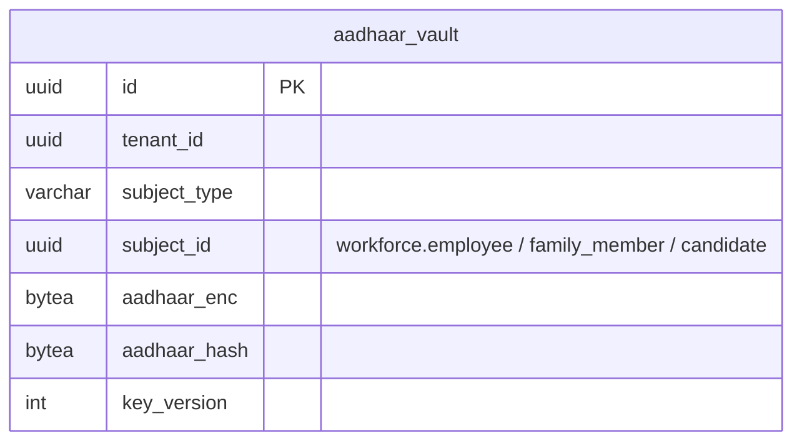

# Schema: verification (Phase 2 vault, extended Phase 7)

Owner: the `verification` module. Migration namespace `V11_n`. Requirements: [BACKEND_REQUIREMENTS.md](../BACKEND_REQUIREMENTS.md) §4.6 and §7; [PROJECT_INITIATION.md](../PROJECT_INITIATION.md) §4.2 and §5 (Aadhaar Act, DPDP Act); the `secure-coding` skill §3. Decision 2026-11-06: Aadhaar numbers are stored, encrypted, in this vault; keys live in the cloud KMS (an HSM-backed key is a KMS configuration choice, not a schema change).

## 1. Purpose

The Aadhaar data vault: the only place in the system that holds an Aadhaar number. Every other table holds the vault row's id and the last four digits. The module ships in Phase 2 with this one table because onboarding captures Aadhaar; Phase 7 adds the provider verification log and the encrypted face-template store to the same schema.

The vault follows the UIDAI Aadhaar Data Vault pattern: a separate store, a reference key that reveals nothing about the number, encryption under a key reserved for Aadhaar, and access through one narrow interface that records who looked and why.

What is not here: the employee's KYC outcome (`workforce.kyc_record`), the name as per Aadhaar and the last four digits (`workforce.employee`), consent records (DPDP consent lives with the subject in `workforce`, referenced by id).

## 2. ERD



`workforce.employee.aadhaar_vault_id`, `workforce.family_member.aadhaar_vault_id` and (Phase 7) `workforce.candidate.aadhaar_vault_id` point here. There is no foreign key in either direction: the vault is another module.

## 3. Tables

### 3.1 `aadhaar_vault`

```sql
CREATE SCHEMA verification;

CREATE TABLE verification.aadhaar_vault (
  id                UUID PRIMARY KEY,                       -- the reference key other tables hold; UUID v7, derived from nothing personal
  tenant_id         UUID NOT NULL,
  subject_type      VARCHAR(16) NOT NULL CHECK (subject_type IN ('EMPLOYEE','FAMILY_MEMBER','CANDIDATE')),
  subject_id        UUID NOT NULL,                          -- workforce.employee / family_member / candidate
  aadhaar_enc       BYTEA NOT NULL,                         -- AES-256-GCM under the tenant's Aadhaar data key, wrapped by the KMS key reserved for Aadhaar
  aadhaar_hash      BYTEA NOT NULL,                         -- HMAC-SHA256 under the tenant's Aadhaar index key; duplicate check only, never a lookup for display
  key_version       INTEGER NOT NULL,                       -- which wrapped data key encrypted this row; rotation re-encrypts by batch
  consent_id        UUID NOT NULL,                          -- workforce consent record (purpose: statutory registration and KYC)
  source            VARCHAR(12) NOT NULL CHECK (source IN ('ONBOARDING','EKYC','IMPORT','SELF_SERVICE')),
  last_accessed_at  TIMESTAMPTZ NULL,
  access_count      INTEGER NOT NULL DEFAULT 0,
  version           BIGINT NOT NULL DEFAULT 0,
  created_at        TIMESTAMPTZ NOT NULL, created_by UUID NOT NULL,
  updated_at        TIMESTAMPTZ NOT NULL, updated_by UUID NOT NULL,
  CONSTRAINT uq_aadhaar_vault_subject UNIQUE (tenant_id, subject_type, subject_id)
);
CREATE UNIQUE INDEX uq_aadhaar_vault_employee_number ON verification.aadhaar_vault (tenant_id, aadhaar_hash)
  WHERE subject_type = 'EMPLOYEE';
CREATE INDEX ix_aadhaar_vault_hash ON verification.aadhaar_vault (tenant_id, aadhaar_hash);
SELECT platform.enable_tenant_rls('verification.aadhaar_vault');

GRANT SELECT, INSERT, DELETE ON verification.aadhaar_vault TO app;
GRANT UPDATE (last_accessed_at, access_count, version, updated_at, updated_by) ON verification.aadhaar_vault TO app;
REVOKE TRUNCATE ON verification.aadhaar_vault FROM app;
```

Rules the DDL encodes:

- **Ciphertext is immutable for the application role.** `app` can update only the access counters. A corrected number is a new row; the old row is deleted. Key rotation runs under `migrate`.
- **One vault row per subject**, and one employee per Aadhaar number inside a tenant (partial unique index). A family member may share a number with an employee (a spouse who is also on the payroll), so the uniqueness is limited to employees.
- **No soft delete.** Deletion is the point: on consent withdrawal, or when the retention schedule fires after termination, the row goes and the subject keeps only `aadhaar_last4` with `aadhaar_kyc_status = 'WITHDRAWN'`.

## 4. Keys

| Key | Where | Scope | Rotation |
|---|---|---|---|
| Aadhaar key-encryption key | Cloud KMS, one per environment, separate from the general PII KEK, with its own IAM policy (only the `backend-api` and `backend-batch` service identities) | all tenants | KMS-managed annual rotation; wrapped data keys are re-wrapped by job |
| Aadhaar data key | Wrapped copy in `tenant.tenant_key` (Phase 1 addition, see §7), `key_version` per copy | one per tenant | new version on demand; `backend-batch` re-encrypts rows and bumps `key_version` |
| Aadhaar index key | KMS-derived HMAC key per tenant | one per tenant | rotation recomputes `aadhaar_hash` in the same batch |

Plaintext data keys are held in memory only, for the life of a request, and never logged. The general PII converter (`tenant-aware-entity` §6) does not know these keys; the vault has its own `AadhaarCipher`.

## 5. Access

All access goes through the module's `api` port `AadhaarVault`:

| Operation | Needs | Writes |
|---|---|---|
| `store(subject, number, consentId, source)` | the caller is the workforce module in an onboarding, import or self-service flow; the subject exists; consent recorded | one row; returns the id |
| `reveal(vaultId, purpose)` | permission `employee:aadhaar_reveal`; a purpose from `ESIC_IP_REGISTRATION`, `EPFO_KYC`, `STATUTORY_FILING`, `AUDIT_INSPECTION`, `EMPLOYEE_REQUEST`; under the per-user rate limit (`verification.aadhaar.reveal-per-day`, default 20) | `audit.audit_event` row `PII_REVEAL` with purpose and subject; `last_accessed_at`, `access_count` |
| `matches(subject, number)` | same as `store` | nothing; answers a duplicate check without a reveal |
| `delete(vaultId, reason)` | the workforce module on consent withdrawal or retention, or the subject through self-service | the row is gone; `audit.audit_event` row `PII_DELETE` |

- **Bulk reveal exists only for statutory files.** ESIC IP registration files and EPFO KYC uploads are generated by `backend-batch` under the system actor with purpose `STATUTORY_FILING`, one audit row per subject, and the file is an artefact with the same retention as the filing. No list, export, report, event, log or API response ever carries the number.
- **Channels.** Mobile self-service may `store` its own number during onboarding and may `delete`; it never reveals. Kiosk, devices and partners have no access at all.
- **Display** everywhere is `XXXX XXXX 1234` from `workforce.employee.aadhaar_last4`. The web client has one reveal control on the employee's statutory tab that calls `reveal` with a chosen purpose and shows the number for sixty seconds without caching it.

## 6. Tests this table adds

Beyond README §3: a test that the `app` role cannot update `aadhaar_enc`; a test that `reveal` without the permission returns 403 and writes nothing; a test that every successful reveal leaves exactly one audit row; the `LogsContainNoPiiTest` regex set includes the Aadhaar pattern; a golden test that the ESIC registration file contains the number for exactly the subjects in the batch and the audit rows match.

## 7. Open items

- `tenant.tenant_key` (wrapped data keys per tenant with versions) is a Phase 1 addition to [tenant.md](tenant.md); it is needed by both the general PII converter and this vault. Design it in the identity and tenant slice that introduces encryption.
- Retention after termination: proposed default 8 years to match the payroll record retention, configurable per tenant in `tenant.tenant_setting` (`verification.aadhaar.retention-days`), with deletion as a `backend-batch` job.
- Whether re-hire reuses the vault row (proposed: yes, the employee row is reactivated and the vault row was retained within the retention window; outside it the number is captured again).
- HSM: if a customer or auditor requires an HSM-backed key, the KMS key is created in a CloudHSM or Dedicated HSM key store; the schema and the port are unchanged.
