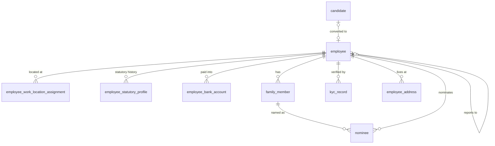

# Schema: workforce (Phase 2, extended Phase 7)

Owner: the `workforce` module. Migration namespace `V5_n`. Requirements: [BACKEND_REQUIREMENTS.md](../BACKEND_REQUIREMENTS.md) §4.5 and §7; [PROJECT_INITIATION.md](../PROJECT_INITIATION.md) §3.2 and §3.3; the `secure-coding` and `tenant-aware-entity` skills; `reference/Pay.docx` for the employee and contractor attributes.

## 1. Purpose

The employee master for employees and contractors, with its effective-dated history (work location, statutory profile), bank accounts, family and nominees, KYC records, custom fields and the PII rules. Phase 2 ships §3; the candidate pipeline, joining fee, police verification, training, warnings and termination are outlined in §4 for Phase 7 so the Phase 2 tables leave room for them.

What is not here: deployments to client sites and posts (customer-contract module, Phase 3), salary structures (payroll, Phase 5), documents and letters (documents, Phase 7), Aadhaar numbers and face templates (verification: the Aadhaar vault in Phase 2, face in Phase 7). Each references `employee.id`.

## 2. ERD



## 3. Tables (Phase 2)

### 3.1 `employee`

One row per person on the payroll, employee or contractor. Current pointers (`primary_work_location_id`, `designation_id`, `pay_group_id`) are denormalised from the effective-dated tables for list performance and are maintained by the service in the same transaction as the history row.

```sql
CREATE SCHEMA workforce AUTHORIZATION migrate;

CREATE TABLE workforce.employee (
  id                      UUID PRIMARY KEY,
  tenant_id               UUID NOT NULL,
  employee_code           VARCHAR(20) NOT NULL,             -- from number series; immutable
  legal_entity_id         UUID NOT NULL,                    -- organization.legal_entity
  employment_type         VARCHAR(12) NOT NULL CHECK (employment_type IN ('EMPLOYEE','CONTRACTOR')),
  engagement_mode         VARCHAR(12) NOT NULL DEFAULT 'FULL_TIME' CHECK (engagement_mode IN ('FULL_TIME','PART_TIME','RELIEVER','TRAINEE','CONSULTANT')),
  status                  VARCHAR(12) NOT NULL DEFAULT 'ACTIVE' CHECK (status IN ('ACTIVE','INACTIVE','TERMINATED')),
  status_changed_on       DATE NULL,

  -- identity (Latin script; regional rendering optional)
  first_name              VARCHAR(80) NOT NULL,
  middle_name             VARCHAR(80) NULL,
  last_name               VARCHAR(80) NULL,
  display_name            VARCHAR(150) NOT NULL,            -- derived; what lists and documents show
  name_regional           JSONB NOT NULL DEFAULT '{}',      -- {"ta-IN": "...", "hi-IN": "..."}
  name_as_per_aadhaar     VARCHAR(150) NULL,                -- what the ECR and ESIC return must carry
  gender                  VARCHAR(12) NOT NULL CHECK (gender IN ('MALE','FEMALE','OTHER','UNDISCLOSED')),
  date_of_birth           DATE NOT NULL,
  blood_group             VARCHAR(3) NULL,
  marital_status          VARCHAR(12) NULL CHECK (marital_status IS NULL OR marital_status IN ('SINGLE','MARRIED','WIDOWED','DIVORCED','OTHER')),
  father_or_spouse_name   VARCHAR(150) NULL,
  relation_type           VARCHAR(8) NULL CHECK (relation_type IS NULL OR relation_type IN ('FATHER','SPOUSE','MOTHER')),
  nationality             CHAR(2) NOT NULL DEFAULT 'IN',
  photo_artefact_id       UUID NULL,

  -- contact (PII triples)
  phone_enc               BYTEA NULL, phone_masked VARCHAR(20) NULL, phone_hash BYTEA NULL,
  alt_phone_enc           BYTEA NULL, alt_phone_masked VARCHAR(20) NULL,
  email_enc               BYTEA NULL, email_masked VARCHAR(80) NULL, email_hash BYTEA NULL,
  preferred_locale        VARCHAR(16) NULL,

  -- government identifiers
  pan_enc                 BYTEA NULL, pan_masked CHAR(10) NULL, pan_hash BYTEA NULL,
  aadhaar_last4           CHAR(4) NULL,
  aadhaar_vault_id        UUID NULL,                        -- verification.aadhaar_vault; the number itself is only there
  aadhaar_kyc_status      VARCHAR(12) NOT NULL DEFAULT 'NONE' CHECK (aadhaar_kyc_status IN ('NONE','PENDING','VERIFIED','FAILED','WITHDRAWN')),

  -- employment
  date_of_joining         DATE NOT NULL,
  date_of_leaving         DATE NULL,
  probation_end_date      DATE NULL,
  confirmation_date       DATE NULL,
  designation_id          UUID NOT NULL,                    -- organization.designation (current)
  pay_group_id            UUID NOT NULL,                    -- organization.pay_group (current)
  pay_frequency_override  VARCHAR(12) NULL CHECK (pay_frequency_override IS NULL OR pay_frequency_override IN ('MONTHLY','WEEKLY','BIWEEKLY')),
  branch_id               UUID NOT NULL,                    -- organization.branch (administering office; data scope)
  org_unit_id             UUID NULL,                        -- organization.org_unit
  cost_centre_id          UUID NULL,                        -- organization.cost_centre
  primary_work_location_id UUID NOT NULL,                   -- organization.work_location (current, from assignment)
  reporting_manager_id    UUID NULL REFERENCES workforce.employee (id),
  user_id                 UUID NULL,                        -- identity.app_user, when the person can sign in
  candidate_id            UUID NULL,                        -- workforce.candidate, when onboarded through the pipeline

  -- consents and flags
  face_enrolment_consent_at TIMESTAMPTZ NULL,
  face_enrolment_withdrawn_at TIMESTAMPTZ NULL,
  dpdp_consent            JSONB NOT NULL DEFAULT '{}',      -- {purpose: {grantedAt, version}}
  verified                BOOLEAN NOT NULL DEFAULT FALSE,   -- derived from KYC and bank verification
  custom_fields           JSONB NOT NULL DEFAULT '{}',
  notes                   VARCHAR(1000) NULL,

  version                 BIGINT NOT NULL DEFAULT 0,
  created_at              TIMESTAMPTZ NOT NULL, created_by UUID NOT NULL,
  updated_at              TIMESTAMPTZ NOT NULL, updated_by UUID NOT NULL,
  deleted_at              TIMESTAMPTZ NULL,
  CONSTRAINT uq_employee_code UNIQUE (tenant_id, employee_code),
  CONSTRAINT uq_employee_pan UNIQUE (tenant_id, pan_hash),
  CONSTRAINT ck_employee_leaving CHECK (date_of_leaving IS NULL OR date_of_leaving >= date_of_joining),
  CONSTRAINT ck_employee_terminated CHECK (status <> 'TERMINATED' OR date_of_leaving IS NOT NULL)
);
CREATE INDEX ix_employee_tenant_status_branch ON workforce.employee (tenant_id, status, branch_id);
CREATE INDEX ix_employee_tenant_location ON workforce.employee (tenant_id, primary_work_location_id, status);
CREATE INDEX ix_employee_tenant_entity ON workforce.employee (tenant_id, legal_entity_id, status);
CREATE INDEX ix_employee_tenant_designation ON workforce.employee (tenant_id, designation_id);
CREATE INDEX ix_employee_tenant_pay_group ON workforce.employee (tenant_id, pay_group_id, status);
CREATE INDEX ix_employee_tenant_manager ON workforce.employee (tenant_id, reporting_manager_id);
CREATE INDEX ix_employee_phone_hash ON workforce.employee (tenant_id, phone_hash);
CREATE INDEX ix_employee_display_name_trgm ON workforce.employee USING gin (display_name gin_trgm_ops);
CREATE INDEX ix_employee_tenant_joining ON workforce.employee (tenant_id, date_of_joining);
SELECT platform.enable_tenant_rls('workforce.employee');
```

Status machine: `ACTIVE ⇄ INACTIVE`; `ACTIVE → TERMINATED` (Phase 7 termination writes `date_of_leaving`); `TERMINATED → ACTIVE` is reactivation, which keeps the code and history and clears `date_of_leaving`. `verified` is recomputed whenever a `kyc_record` or `employee_bank_account` changes.

### 3.2 `employee_address`

Present and permanent addresses, kept separate because they are PII-adjacent, change independently and are needed as structured fields for Form 11, ESIC and letters.

```sql
CREATE TABLE workforce.employee_address (
  id            UUID PRIMARY KEY,
  tenant_id     UUID NOT NULL,
  employee_id   UUID NOT NULL REFERENCES workforce.employee (id) ON DELETE CASCADE,
  address_type  VARCHAR(10) NOT NULL CHECK (address_type IN ('PRESENT','PERMANENT')),
  line1         VARCHAR(150) NOT NULL,
  line2         VARCHAR(150) NULL,
  landmark      VARCHAR(100) NULL,
  city          VARCHAR(80) NOT NULL,
  district      VARCHAR(80) NULL,
  state_code    CHAR(2) NOT NULL,
  pin           CHAR(6) NOT NULL,
  country       CHAR(2) NOT NULL DEFAULT 'IN',
  same_as_present BOOLEAN NOT NULL DEFAULT FALSE,
  version       BIGINT NOT NULL DEFAULT 0,
  created_at    TIMESTAMPTZ NOT NULL, created_by UUID NOT NULL,
  updated_at    TIMESTAMPTZ NOT NULL, updated_by UUID NOT NULL,
  CONSTRAINT uq_employee_address UNIQUE (tenant_id, employee_id, address_type)
);
SELECT platform.enable_tenant_rls('workforce.employee_address');
```

### 3.3 `employee_work_location_assignment` (effective-dated)

The primary work location per date, independent of the customer module. In the staffing profile the customer module's deployment creates and closes these rows through the workforce `api` when an employee is posted to a site; in the corporate profile HR edits them directly. Jurisdiction resolution reads this table.

```sql
CREATE TABLE workforce.employee_work_location_assignment (
  id                UUID PRIMARY KEY,
  tenant_id         UUID NOT NULL,
  employee_id       UUID NOT NULL REFERENCES workforce.employee (id) ON DELETE CASCADE,
  work_location_id  UUID NOT NULL,                          -- organization.work_location
  effective_from    DATE NOT NULL,
  effective_to      DATE NULL,
  reason            VARCHAR(16) NOT NULL DEFAULT 'JOINING' CHECK (reason IN ('JOINING','TRANSFER','DEPLOYMENT','RELIEVER','CORRECTION','OTHER')),
  source_ref_type   VARCHAR(30) NULL,                       -- DEPLOYMENT when created by the customer module
  source_ref_id     UUID NULL,
  note              VARCHAR(255) NULL,
  version           BIGINT NOT NULL DEFAULT 0,
  created_at        TIMESTAMPTZ NOT NULL, created_by UUID NOT NULL,
  updated_at        TIMESTAMPTZ NOT NULL, updated_by UUID NOT NULL,
  CONSTRAINT ck_ewla_range CHECK (effective_to IS NULL OR effective_to >= effective_from),
  CONSTRAINT ex_ewla_no_overlap EXCLUDE USING gist (
    tenant_id WITH =, employee_id WITH =,
    daterange(effective_from, effective_to, '[]') WITH &&)
);
CREATE INDEX ix_ewla_employee_from ON workforce.employee_work_location_assignment (tenant_id, employee_id, effective_from DESC);
CREATE INDEX ix_ewla_location ON workforce.employee_work_location_assignment (tenant_id, work_location_id, effective_from);
SELECT platform.enable_tenant_rls('workforce.employee_work_location_assignment');
```

### 3.4 `employee_statutory_profile` (effective-dated)

Applicability and membership numbers. A change (PF opted out at joining, ESIC ceiling crossed after a raise) is a new row from a date; payroll reads "as of" the period and snapshots the row id.

```sql
CREATE TABLE workforce.employee_statutory_profile (
  id                    UUID PRIMARY KEY,
  tenant_id             UUID NOT NULL,
  employee_id           UUID NOT NULL REFERENCES workforce.employee (id) ON DELETE CASCADE,
  effective_from        DATE NOT NULL,
  effective_to          DATE NULL,

  pf_applicable         BOOLEAN NOT NULL DEFAULT TRUE,
  pf_contribution_basis VARCHAR(12) NULL CHECK (pf_contribution_basis IS NULL OR pf_contribution_basis IN ('CEILING','ACTUAL')),
  pf_excluded_reason    VARCHAR(30) NULL,                   -- wages above ceiling at joining, international worker, ...
  eps_eligible          BOOLEAN NULL,
  uan_enc               BYTEA NULL, uan_masked VARCHAR(12) NULL, uan_hash BYTEA NULL,
  pf_member_id_enc      BYTEA NULL, pf_member_id_masked VARCHAR(24) NULL,
  pf_joining_date       DATE NULL,
  vpf_percent           NUMERIC(7,4) NULL,
  previous_pf_service   JSONB NULL,                         -- {months, exitDate} for EPS eligibility

  esic_applicable       BOOLEAN NOT NULL DEFAULT TRUE,
  esic_ip_no_enc        BYTEA NULL, esic_ip_no_masked VARCHAR(12) NULL, esic_ip_no_hash BYTEA NULL,
  esic_joining_date     DATE NULL,
  esic_dispensary       VARCHAR(100) NULL,

  pt_applicable         BOOLEAN NOT NULL DEFAULT TRUE,
  lwf_applicable        BOOLEAN NOT NULL DEFAULT TRUE,
  tds_applicable        BOOLEAN NOT NULL DEFAULT TRUE,
  tax_regime            VARCHAR(4) NULL CHECK (tax_regime IS NULL OR tax_regime IN ('OLD','NEW')),
  physically_challenged BOOLEAN NOT NULL DEFAULT FALSE,     -- PT exemption in several states
  international_worker  BOOLEAN NOT NULL DEFAULT FALSE,

  note                  VARCHAR(255) NULL,
  version               BIGINT NOT NULL DEFAULT 0,
  created_at            TIMESTAMPTZ NOT NULL, created_by UUID NOT NULL,
  updated_at            TIMESTAMPTZ NOT NULL, updated_by UUID NOT NULL,
  CONSTRAINT ck_esp_range CHECK (effective_to IS NULL OR effective_to >= effective_from),
  CONSTRAINT ex_esp_no_overlap EXCLUDE USING gist (
    tenant_id WITH =, employee_id WITH =,
    daterange(effective_from, effective_to, '[]') WITH &&)
);
CREATE INDEX ix_esp_employee_from ON workforce.employee_statutory_profile (tenant_id, employee_id, effective_from DESC);
CREATE INDEX ix_esp_uan_hash ON workforce.employee_statutory_profile (tenant_id, uan_hash);
CREATE INDEX ix_esp_esic_hash ON workforce.employee_statutory_profile (tenant_id, esic_ip_no_hash);
SELECT platform.enable_tenant_rls('workforce.employee_statutory_profile');
```

UAN uniqueness across employees of a tenant is enforced by the service (the same person may be re-hired as a new employee row), not by a constraint.

### 3.5 `employee_bank_account`

```sql
CREATE TABLE workforce.employee_bank_account (
  id                    UUID PRIMARY KEY,
  tenant_id             UUID NOT NULL,
  employee_id           UUID NOT NULL REFERENCES workforce.employee (id) ON DELETE CASCADE,
  account_holder_name   VARCHAR(150) NOT NULL,
  bank_name             VARCHAR(100) NOT NULL,
  branch_name           VARCHAR(100) NULL,
  ifsc                  CHAR(11) NOT NULL,
  account_no_enc        BYTEA NOT NULL, account_no_masked VARCHAR(24) NOT NULL, account_no_hash BYTEA NOT NULL,
  account_type          VARCHAR(12) NOT NULL DEFAULT 'SAVINGS' CHECK (account_type IN ('SAVINGS','CURRENT','SALARY')),
  payment_mode          VARCHAR(12) NOT NULL DEFAULT 'BANK' CHECK (payment_mode IN ('BANK','UPI','CASH','CHEQUE')),
  upi_id_enc            BYTEA NULL, upi_id_masked VARCHAR(40) NULL,
  is_primary            BOOLEAN NOT NULL DEFAULT TRUE,
  verification_status   VARCHAR(12) NOT NULL DEFAULT 'UNVERIFIED' CHECK (verification_status IN ('UNVERIFIED','PENDING','VERIFIED','FAILED','MANUAL')),
  verified_at           TIMESTAMPTZ NULL,
  verification_ref_id   UUID NULL,                          -- verification.verification_log (Phase 7)
  name_match_score      NUMERIC(5,2) NULL,                  -- penny-drop name match
  effective_from        DATE NOT NULL,                      -- salary from this date goes here
  status                VARCHAR(12) NOT NULL DEFAULT 'ACTIVE' CHECK (status IN ('ACTIVE','INACTIVE')),
  version               BIGINT NOT NULL DEFAULT 0,
  created_at            TIMESTAMPTZ NOT NULL, created_by UUID NOT NULL,
  updated_at            TIMESTAMPTZ NOT NULL, updated_by UUID NOT NULL,
  CONSTRAINT ck_employee_bank_ifsc CHECK (ifsc ~ '^[A-Z]{4}0[A-Z0-9]{6}$')
);
CREATE UNIQUE INDEX uq_employee_bank_primary ON workforce.employee_bank_account (tenant_id, employee_id)
  WHERE is_primary AND status = 'ACTIVE';
CREATE INDEX ix_employee_bank_account_hash ON workforce.employee_bank_account (tenant_id, account_no_hash);
SELECT platform.enable_tenant_rls('workforce.employee_bank_account');
```

The same account number appearing on two employees is allowed but flagged (a family account), which the duplicate-account report uses the blind index for.

### 3.6 `family_member` and `nominee`

```sql
CREATE TABLE workforce.family_member (
  id              UUID PRIMARY KEY,
  tenant_id       UUID NOT NULL,
  employee_id     UUID NOT NULL REFERENCES workforce.employee (id) ON DELETE CASCADE,
  relation        VARCHAR(16) NOT NULL CHECK (relation IN ('SPOUSE','SON','DAUGHTER','FATHER','MOTHER','BROTHER','SISTER','FATHER_IN_LAW','MOTHER_IN_LAW','OTHER')),
  full_name       VARCHAR(150) NOT NULL,
  date_of_birth   DATE NULL,
  gender          VARCHAR(12) NULL,
  is_dependent    BOOLEAN NOT NULL DEFAULT FALSE,
  esic_dependent  BOOLEAN NOT NULL DEFAULT FALSE,           -- listed on the ESIC family declaration
  aadhaar_last4   CHAR(4) NULL,
  aadhaar_vault_id UUID NULL,                               -- verification.aadhaar_vault (ESIC dependant seeding)
  residing_with   BOOLEAN NULL,
  address         JSONB NULL,
  version         BIGINT NOT NULL DEFAULT 0,
  created_at      TIMESTAMPTZ NOT NULL, created_by UUID NOT NULL,
  updated_at      TIMESTAMPTZ NOT NULL, updated_by UUID NOT NULL,
  deleted_at      TIMESTAMPTZ NULL
);
CREATE INDEX ix_family_member_employee ON workforce.family_member (tenant_id, employee_id);
SELECT platform.enable_tenant_rls('workforce.family_member');

CREATE TABLE workforce.nominee (
  id                UUID PRIMARY KEY,
  tenant_id         UUID NOT NULL,
  employee_id       UUID NOT NULL REFERENCES workforce.employee (id) ON DELETE CASCADE,
  family_member_id  UUID NULL REFERENCES workforce.family_member (id),
  nomination_type   VARCHAR(12) NOT NULL CHECK (nomination_type IN ('PF','EPS','GRATUITY','ESIC','INSURANCE','OTHER')),
  nominee_name      VARCHAR(150) NOT NULL,                  -- copied, so a deleted family row keeps the nomination legible
  relation          VARCHAR(16) NOT NULL,
  share_percent     NUMERIC(5,2) NOT NULL CHECK (share_percent > 0 AND share_percent <= 100),
  guardian_name     VARCHAR(150) NULL,                      -- when the nominee is a minor
  effective_from    DATE NOT NULL,
  effective_to      DATE NULL,
  version           BIGINT NOT NULL DEFAULT 0,
  created_at        TIMESTAMPTZ NOT NULL, created_by UUID NOT NULL,
  updated_at        TIMESTAMPTZ NOT NULL, updated_by UUID NOT NULL
);
CREATE INDEX ix_nominee_employee_type ON workforce.nominee (tenant_id, employee_id, nomination_type);
SELECT platform.enable_tenant_rls('workforce.nominee');
```

The service checks that active shares per `nomination_type` sum to 100.

### 3.7 `kyc_record`

One row per verification outcome per document type. Provider calls and raw responses live in the verification module's log (Phase 7); this row holds what the employee record needs.

```sql
CREATE TABLE workforce.kyc_record (
  id                UUID PRIMARY KEY,
  tenant_id         UUID NOT NULL,
  employee_id       UUID NOT NULL REFERENCES workforce.employee (id) ON DELETE CASCADE,
  kyc_type          VARCHAR(16) NOT NULL CHECK (kyc_type IN ('AADHAAR','PAN','BANK','UAN','VOTER_ID','DRIVING_LICENCE','PASSPORT','OTHER')),
  status            VARCHAR(12) NOT NULL DEFAULT 'PENDING' CHECK (status IN ('PENDING','VERIFIED','FAILED','EXPIRED','MANUAL')),
  method            VARCHAR(12) NOT NULL DEFAULT 'MANUAL' CHECK (method IN ('PROVIDER','OFFLINE_XML','MANUAL')),
  provider_code     VARCHAR(30) NULL,
  provider_ref      VARCHAR(120) NULL,
  verification_log_id UUID NULL,                            -- verification module
  document_id       UUID NULL,                              -- documents module
  verified_at       TIMESTAMPTZ NULL,
  verified_by       UUID NULL,
  expires_on        DATE NULL,
  details_masked    JSONB NOT NULL DEFAULT '{}',            -- name as per document, masked number, match scores
  failure_reason_key VARCHAR(120) NULL,
  version           BIGINT NOT NULL DEFAULT 0,
  created_at        TIMESTAMPTZ NOT NULL, created_by UUID NOT NULL,
  updated_at        TIMESTAMPTZ NOT NULL, updated_by UUID NOT NULL
);
CREATE INDEX ix_kyc_record_employee_type ON workforce.kyc_record (tenant_id, employee_id, kyc_type, created_at DESC);
SELECT platform.enable_tenant_rls('workforce.kyc_record');
```

### 3.8 `employee_event` (status and key-date history)

Status transitions and key employment dates need to be queried as history (service continuity for gratuity and EPS). Audit has them too, but audit is not a query source for business rules.

```sql
CREATE TABLE workforce.employee_event (
  id            UUID PRIMARY KEY,
  tenant_id     UUID NOT NULL,
  employee_id   UUID NOT NULL REFERENCES workforce.employee (id) ON DELETE CASCADE,
  event_type    VARCHAR(20) NOT NULL CHECK (event_type IN ('JOINED','CONFIRMED','INACTIVATED','REACTIVATED','TRANSFERRED','DESIGNATION_CHANGED','PAY_GROUP_CHANGED','TERMINATED','REHIRED')),
  effective_on  DATE NOT NULL,
  from_value    JSONB NULL,
  to_value      JSONB NULL,
  reason_key    VARCHAR(120) NULL,
  note          VARCHAR(500) NULL,
  source_ref_type VARCHAR(30) NULL,
  source_ref_id UUID NULL,
  created_at    TIMESTAMPTZ NOT NULL, created_by UUID NOT NULL
);
CREATE INDEX ix_employee_event_employee ON workforce.employee_event (tenant_id, employee_id, effective_on DESC);
SELECT platform.enable_tenant_rls('workforce.employee_event');
```

## 4. Phase 7 additions (outline, no DDL yet)

Designed here so Phase 2 columns (`candidate_id`, `date_of_leaving`, `status = TERMINATED`) already fit.

| Table | Key columns | Notes |
|---|---|---|
| `candidate` | candidate_code, name fields, phone/email triples, intended legal_entity_id, designation_id, work_location_id, source, applied_on, status (`APPLIED → KYC_DONE → BANK_VERIFIED → LETTERS_ACKNOWLEDGED → APPROVED → CONVERTED`, plus `REJECTED`, `WITHDRAWN`), converted_employee_id, custom_fields | Conversion copies the candidate into `employee` and its KYC and bank rows; the candidate row stays |
| `joining_fee` / `joining_fee_instalment` | employee_id, total_amount, instalment_count, status; per instalment: due_period, amount, status, paysheet_line_id | Instalments become payroll deductions through a payroll port |
| `police_verification` | employee_id, applied_on, authority, reference_no, status (`APPLIED`, `CLEARED`, `ADVERSE`, `EXPIRED`), valid_to, document_id | Expiry alerts through the documents module |
| `training_record` | employee_id, training_type (PSARA, SAFETY, OTHER), provider, completed_on, valid_to, certificate_document_id | PSARA training required before deployment in the staffing profile |
| `warning` | employee_id, warning_type, issued_on, issued_by, severity, letter_id, acknowledged_at | |
| `termination` | employee_id, termination_type (RESIGNATION, DISMISSAL, END_OF_CONTRACT, ABSCONDING, RETIREMENT, DEATH), notice_date, last_working_day, reason_key, fnf_payroll_run_id, exit_checklist JSONB, clearance_status | Writes `employee.date_of_leaving` and the `TERMINATED` event; full-and-final is a payroll run |
| `employee_document` link | handled by the documents module's polymorphic `document.owner_id` | no table here |

## 5. PII rules applied in this schema

| Field | Storage | Shown as |
|---|---|---|
| Aadhaar | `aadhaar_last4`, `aadhaar_vault_id`, status; the number only in `verification.aadhaar_vault` | `XXXX XXXX 1234` always; reveal only through `AadhaarVault.reveal` with `employee:aadhaar_reveal` and a stated purpose, rate-limited and audited ([verification.md](verification.md) §5) |
| PAN, UAN, ESIC IP number, bank account, UPI id | `*_enc` + `*_masked` + `*_hash` | masked by default; reveal needs `employee:pii_reveal`, is rate-limited and audited |
| Phone, email | `*_enc` + `*_masked` + `*_hash` | masked in lists, full in detail with permission |
| Names, dates of birth, addresses, family | clear text under RLS and data scope | full, within scope |

Imports and exports follow the same rule: the error file and the export template never carry a full identifier unless the exporting user holds the reveal permission and the export is audited as `EXPORT`.

## 6. Events

| Event | When |
|---|---|
| `EmployeeOnboarded` | A new employee row and its first assignment and statutory profile exist |
| `EmployeeChanged` | Identity, designation, pay group, branch or manager changed (carries changed keys) |
| `WorkLocationAssigned` | A new assignment row (payroll and attendance re-resolve jurisdiction from the date) |
| `StatutoryProfileChanged` | A new statutory profile row |
| `BankAccountVerified`, `BankAccountChanged` | Verification or primary account change |
| `EmployeeInactivated`, `EmployeeReactivated`, `EmployeeTerminated` | Status machine |
| `CandidateConverted` | Phase 7 |

## 7. Open items

- Whether `name_as_per_aadhaar` should be required when `aadhaar_kyc_status = VERIFIED` (proposed: yes, filled from the KYC response).
- Deleting an employee or family member must delete its vault row through the `AadhaarVault` port in the same transaction; the cascade cannot cross the module boundary.
- Reliever and transfer handling across two locations in one day is an attendance concern; the assignment table holds whole days only.
- The duplicate-person check at onboarding (same PAN, UAN or phone across tenants of one agency group) needs a platform-level decision on cross-tenant lookups; proposed: none, each tenant is an island.
